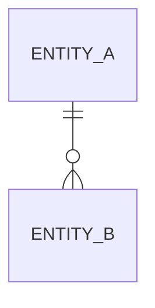

<!--
File: Template for .workflow/specs/NNN-slug/data-model.md: the schema this feature creates or changes. No frontmatter.
Written by modules/discovery.md at 0.4.4-0.4.5; read by task-breakdown at 2.1, which orders migration tasks by the Migrations section.

Rules:
  - Classify every part the change touches: `create` (new), `extend` (adds to an existing part without changing what is there), `refactor` (changes the existing shape or meaning), `unchanged` (read or depended on, not modified). List `unchanged` parts too, so reviewers see what was deliberately left alone.
  - Name entities and fields with .workflow/GLOSSARY.md terms. A new term goes through the term gate (0.4.2) first.
  - State the domain's valid states, then show the shape cannot represent the invalid ones (or name the ones it still can, as a known risk).
  - Migrations are numbered in the order they must run. Mark each reversible or irreversible: an irreversible one fails the light-path test (0.3.20).
  - Delete sections that do not apply (for example State transitions for an entity without a lifecycle) and this comment in the finished file. Keep Summary and Migrations; write "None." when there are no migrations.
-->

# Data model: <feature title>

Spec: [spec.md](spec.md) · Placement: <owning module>

## Summary

| Part | Kind | Classification | Owning module |
| --- | --- | --- | --- |
| <name> | entity / field / relationship / interface | create / extend / refactor / unchanged | <module> |

## Entities

### <EntityName> (<classification>)

<One sentence: what this entity is, in .workflow/GLOSSARY.md terms.>

| Field | Type | Required | Validation rule | Change |
| --- | --- | --- | --- | --- |
| <field> | <type> | yes / no | <rule from a requirement, with the CAP-### it comes from> | create / extend / refactor / unchanged |

**Relationships:** <EntityName> <has many / belongs to / references> <OtherEntity> (<cardinality>; <what happens on delete>)

**State transitions:**

| From | Event | To | Guard |
| --- | --- | --- | --- |
| <state> | <event> | <state> | <condition> |

**Invalid states ruled out:** <for example "an approved record without an approver cannot be represented: approval data lives only on the approved variant">. Still representable: <invalid state and why it is accepted, or "None.">

## Relationships

<Cross-entity view when more than two entities interact. Delete for a single entity.>

## Migrations

<!-- Ordered. task-breakdown (2.1) turns each into a task or part of one, in this order. A wide change runs expand, then migrate in batches, then contract. -->

| # | Migration | Classification | Reversible | Depends on | Data handling |
| --- | --- | --- | --- | --- | --- |
| M1 | <what changes> | create / extend / refactor | yes / no (<why>) | - | <backfill, default, or none> |
