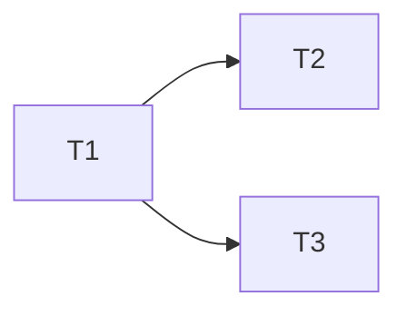

---
tasks:
  - id: T1
    title: "<short name of the slice>"
    status: pending          # pending | in-progress | done | blocked | split-out. Written only by scripts/status-transition.sh.
    capability: CAP-NEW-example  # the capability ID from spec.md: CAP-### if it exists, else the provisional CAP-NEW-<slug> until 5.3
    depends_on: []           # ids of the tasks that must be done before this one starts
    touches_core: false      # true when the task changes shared core (.workflow/rules.md "Shared core"); batched for integration (2.4)
    work_type: null          # profile name (.workflow/profiles/<work_type>.md); null until classified at 3.1
    module: "<module>"       # owning module, a key under `modules` in .workflow/rules.md "Ownership"
    seam: "<interface under test>"  # the interface the tests drive, agreed at 2.3
    file: tasks/T01-<slug>.md          # the task file holding the body (assets/task.md), relative to the spec folder
    branch: task/NNN-slug/T01-<slug>   # the task branch created at wave start; null on the light path (T1 commits on the spec branch)
    predicted_files: []      # paths or globs the task will create or change, tests included (2.1)
    size: {files: 0, est_lines: 0, points: S}  # predicted; points S | M | L, L is a split signal
    mode: afk                # afk | hitl (needs a human mid-task; the orchestrator pauses before launching it, 3.3)
    parallel_with: []        # stakeholder-approved overlaps: ids that may share a wave despite overlapping predicted_files
    tests: []                # optional: selectors of the Phase 1 tests this task turns green (2.5); every Phase 1 test belongs to exactly one task
    pr: null                 # task PR/MR URL, set by the orchestrator at 3.16 through set-task; null until then or with task_review local
---
<!--
File: Template for .workflow/specs/NNN-slug/tasks.md, the task INDEX: the records, the waves table and the dependency graph. Every feature has one. Each task's body lives in its own task file, tasks/Tnn-<slug>.md, from assets/task.md; this file holds no per-task body text.
Written by modules/task-breakdown.md at 2.5, or by modules/discovery.md at 0.3.20 on the light path (one task). work_type is filled at 3.1, pr at 3.16.

Record schema (the `tasks:` array in the frontmatter is the source; the body is commentary). Read with mikefarah yq v4 `--front-matter=extract` by resolve-launch.sh (work_type by task id), status-transition.sh (writes records, via `--front-matter=process`), run-toolchain.sh (tests), budget-check.sh (size) and task-waves.sh (predicted_files, parallel_with).
  Plan-specified fields (required on every record):
  - id:           string, `T<n>` (T1, T2, ...), unique in this file, never reused or renumbered. It is the `task_id` in the launch header.
  - status:       pending | in-progress | done | blocked | split-out.
  - work_type:    string naming .workflow/profiles/<work_type>.md, or null until 3.1 classifies the task. Once set it is not reclassified on resume.
  - depends_on:   list of ids in this file; [] when the task can start immediately. No cycles.
  - touches_core: boolean.
  - capability:   string, a capability listed in spec.md: `CAP-###` for an existing capability, or the provisional `CAP-NEW-<slug>` (lowercase kebab-case) for a new one until sign-off 5.3 rewrites it to the assigned CAP-###. A prefactoring task names the capability it unblocks.
  Task-breakdown fields. 2.5 and 0.3.20 write every one except tests; the validator accepts a missing one (older lists) but checks each that is present:
  - file:            string, `tasks/T<nn>-<slug>.md`, `<nn>` the id number zero-padded to two digits (the validator accepts any zero-padding of the record's own number). The task file must exist.
  - branch:          string `task/<NNN-slug>/T<nn>-<slug>` (the same stem as `file`), or null on the light path, where T1 commits straight onto the spec branch.
  - predicted_files: list of repo-relative paths or globs, tests included.
  - size:            map {files: int (predicted file count), est_lines: int (estimated changed lines), points: S | M | L}. S up to 5 files and 150 lines; M up to 15 files and 400 lines; L beyond either, or too big for one fresh context window: a split signal raised at 2.1.
  - mode:            afk | hitl. hitl needs a human decision, credential or manual step mid-task; the orchestrator asks before launching it (3.3).
  - parallel_with:   list of ids. Two tasks whose predicted_files overlap share a wave only when each lists the other here, after the stakeholder approved it at 2.1; otherwise the overlap is a depends_on edge. Default [].
  - tests:           optional list of non-empty strings: the Phase 1 tests (from the 1.2/1.3 records) this task turns green, as selectors the profile's test runner understands (paths, ids or name patterns). 2.5 assigns every Phase 1 test to exactly one task. run-toolchain.sh excludes the tests of unfinished tasks from `test` through the profile's `test_scoped` key (3.5, 3.9). Absent or [] when the task owns no Phase 1 test.
  - pr:              string URL or null. Set by the orchestrator through `set-task` at 3.16 after it opens the task PR/MR.
  Added by this template (first-party, consumers may ignore them):
  - title:        string, short name of the slice.
  - module:       string, the owning module from .workflow/rules.md Ownership. One task works in one module (3.3).
  - seam:         string, the interface under test agreed at 2.3, which the implementation agent receives.
  Status meaning: `pending` not started; `in-progress` launched; `done` its gates (3.6 tools, 3.8 mini-review) passed and its task branch is merged into the spec branch; `blocked` cannot continue without a human (for example a "profile is wrong" report); `split-out` terminal: the work moved to a work-backlog item at a size-budget split, set only by `set-task --status split-out --step 00.29` from `pending`.
  Add no other keys. Waves are not stored as a key: they are derived from depends_on (below) and copied into the Waves table.

Waves (derived): a task with depends_on [] is in wave 1; otherwise its wave is 1 + the highest wave among its dependencies. At each wave start the orchestrator creates one task branch and worktree per task off the spec-branch tip, launches the wave in parallel, and merges it back in id order.

Read and validate with yq (prints true, exits non-zero otherwise):
  yq --front-matter=extract '.tasks[] | select(.id == "T1") | .file' .workflow/specs/NNN-slug/tasks.md
  yq --front-matter=extract -e '
    (.tasks | tag) == "!!seq" and (.tasks | length) > 0 and
    ([.tasks[].id] | unique | length) == (.tasks | length) and
    ([.tasks[] | select((.id | sub("^T"; "")) as $n | (
        (.id | test("^T[0-9]+$")) and
        (.status | test("^(pending|in-progress|done|blocked|split-out)$")) and
        ((.depends_on | tag) == "!!seq") and
        ((.touches_core | tag) == "!!bool") and
        (.capability | test("^CAP-([0-9]{3,}|NEW-[a-z0-9]+(-[a-z0-9]+)*)$")) and
        ((.work_type | tag) == "!!null" or (.work_type | tag) == "!!str") and
        ([.file == null, ([(.file | tag) == "!!str", ((.file // "") | tostring | test("^tasks/T0*" + $n + "-[A-Za-z0-9][A-Za-z0-9._-]*[.]md$"))] | all)] | any) and
        ([.branch == null, ([(.branch | tag) == "!!str", ((.branch // "") | tostring | test("^task/[0-9]{3,}-[A-Za-z0-9][A-Za-z0-9._-]*/T0*" + $n + "-[A-Za-z0-9][A-Za-z0-9._-]*$"))] | all)] | any) and
        ([.predicted_files == null, ([(.predicted_files | tag) == "!!seq", ([.predicted_files[] | select(tag == "!!str" and . != "")] | length) == (.predicted_files | length)] | all)] | any) and
        ([.size == null, ([(.size | tag) == "!!map", (.size.files | tag) == "!!int", ((.size.files // "") | tostring | test("^[0-9]+$")), (.size.est_lines | tag) == "!!int", ((.size.est_lines // "") | tostring | test("^[0-9]+$")), ((.size.points // "") | test("^(S|M|L)$"))] | all)] | any) and
        ([.mode == null, ((.mode | tag) == "!!str" and ((.mode // "") | tostring | test("^(afk|hitl)$")))] | any) and
        ([.parallel_with == null, ([(.parallel_with | tag) == "!!seq", ([.parallel_with[] | select(tag == "!!str") | select(test("^T[0-9]+$"))] | length) == (.parallel_with | length)] | all)] | any) and
        ([.tests == null, ([(.tests | tag) == "!!seq", ([.tests[] | select(tag == "!!str" and . != "")] | length) == (.tests | length)] | all)] | any) and
        ([.pr == null, ((.pr | tag) == "!!str" and ((.pr // "") | tostring | test("^https?://[^[:space:]]+$")))] | any)
      ))] | length) == (.tasks | length)
  ' .workflow/specs/NNN-slug/tasks.md

Delete this comment in the finished file. Keep the records, the task files and the Waves table in step: one task file per record, one table row per record.
-->

# Tasks: <feature title>

Spec: [spec.md](spec.md) · Data model: [data-model.md](data-model.md) · Task files: [tasks/](tasks/)

## Waves

<Derived from `depends_on` at 2.5 and shown in the 2.1 quiz. Overlaps: the other tasks whose `predicted_files` intersect this one's, and how each was settled (an edge, or `parallel_with`).>

| Wave | Task | Title | Size | Mode | Overlaps |
| --- | --- | --- | --- | --- | --- |
| 1 | [T1](tasks/T01-<slug>.md) | <title> | S (3 files, ~80 lines) | afk | none |
| 2 | [T2](tasks/T02-<slug>.md) | <title> | M (8 files, ~250 lines) | hitl | T3: `src/<module>/index.ts`, approved `parallel_with` (merged in id order) |

## Dependency graph

