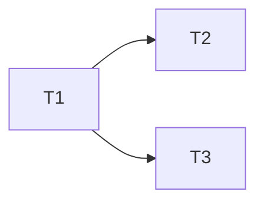

---
tasks:
  - id: T1
    title: "<short name of the slice>"
    status: pending          # pending | in-progress | done | blocked | split-out. Written only by scripts/status-transition.sh.
    capability: CAP-NEW-example  # the capability ID from spec.md: CAP-### if it exists, else the provisional CAP-NEW-<slug> until 5.3 (D44)
    depends_on: []           # ids of the tasks that must be done before this one starts
    touches_core: false      # true when the task changes shared core (docs/rules.md "Shared core"); batched for integration (2.4, D28)
    work_type: null          # profile name (profiles/<work_type>.md); null until classified at 3.1
    module: "<module>"       # owning module, a key under `modules` in docs/rules.md "Ownership"
    seam: "<interface under test>"  # the interface the tests drive, agreed at 2.3
---
<!--
File: Template for specs/NNN-slug/tasks.md: vertical-slice task list with its dependency graph. Every feature has one (D14).
Written by modules/task-breakdown.md at 2.5, or by modules/discovery.md at 0.3.20 on the light path (one task). work_type is filled at 3.1.
Sources: slice rules, blocking edges and per-ticket fields (what to build, blocked by, acceptance criteria) adapted from mattpocock/skills/skills/engineering/to-tickets/SKILL.md@49dd158 (MIT); dependency patterns and wave computation adapted from github/spec-kit templates/tasks-template.md (MIT), claude-night-market spec-kit skills/task-planning/modules/dependency-patterns.md (MIT) and open-gsd/gsd-core agents/gsd-planner.md (MIT, "assign_waves"). The record schema is first-party: PLAN/decision-flow-reference.md "Per-feature files", 2.1-2.5, 3.1; assetlist D14, D15, D28, D31, D37, D38.

Record schema (the `tasks:` array in the frontmatter is the source; the body is commentary). Read with mikefarah yq v4 `--front-matter=extract` (D38) by resolve-launch.sh (work_type by task id), status-transition.sh (writes status, via `--front-matter=process`) and run-toolchain.sh.
  Plan-specified fields (required on every record):
  - id:           string, `T<n>` (T1, T2, ...), unique in this file, never reused or renumbered. It is the `task_id` in the launch header (D37).
  - status:       pending | in-progress | done | blocked | split-out.
  - work_type:    string naming profiles/<work_type>.md, or null until 3.1 classifies the task. Once set it is not reclassified on resume.
  - depends_on:   list of ids in this file; [] when the task can start immediately. No cycles.
  - touches_core: boolean.
  - capability:   string, a capability listed in spec.md: `CAP-###` for an existing capability, or the provisional `CAP-NEW-<slug>` (lowercase kebab-case) for a new one until sign-off 5.3 rewrites it to the assigned CAP-### (D44). A prefactoring task names the capability it unblocks.
  Added by this template (first-party additions, not named in the plan; consumers may ignore them):
  - title:        string, short name of the slice.
  - module:       string, the owning module from docs/rules.md Ownership. One task works in one module (3.3).
  - seam:         string, the interface under test agreed at 2.3, which the implementation agent receives.
  Status meaning: `pending` not started; `in-progress` launched; `done` its gates (3.6 tools, 3.8 mini-review) passed and its worktree is merged; `blocked` cannot continue without a human (for example a "profile is wrong" report); `split-out` terminal (D68): the work moved to a work-backlog item at a size-budget split, set only by `set-task --status split-out --step 00.29` from `pending`.
  Add no other keys. Waves are not stored: they are derived from depends_on (below).

Slice rules (2.1):
  - Each task is a narrow but complete vertical path through every layer it needs (schema, API, UI, tests), demoable or verifiable on its own, and small enough for one fresh context window.
  - Prefactoring comes first. A task respects the profile file-location rules, so it does not straddle two work types without need. Migrations follow the order in data-model.md.
  - A wide refactor (one mechanical change with a codebase-wide blast radius) is sequenced expand, then migrate in batches, then contract, each its own task.
  - Integration batches touch one work type each (D28).

Waves (derived, never stored): a task with depends_on [] is in wave 1; otherwise its wave is 1 + the highest wave among its dependencies. The orchestrator launches each wave's tasks in parallel, one worktree per task, and merges between waves (D18).

Launch header for a task (D37; resolve-launch.sh owns the per-type validation, this is an example only):
  ```yaml launch-header
  task_type: implementation
  spec_dir: specs/NNN-slug
  task_id: T1
  work_type: <work_type from this file>
  ```

Read and validate with yq:
  yq --front-matter=extract '.tasks[] | select(.id == "T1") | .work_type' specs/NNN-slug/tasks.md
  yq --front-matter=extract -e '
    (.tasks | tag) == "!!seq" and (.tasks | length) > 0 and
    ([.tasks[].id] | unique | length) == (.tasks | length) and
    ([.tasks[] | select(
        (.id | test("^T[0-9]+$")) and
        (.status | test("^(pending|in-progress|done|blocked|split-out)$")) and
        ((.depends_on | tag) == "!!seq") and
        ((.touches_core | tag) == "!!bool") and
        (.capability | test("^CAP-([0-9]{3,}|NEW-[a-z0-9]+(-[a-z0-9]+)*)$")) and
        ((.work_type | tag) == "!!null" or (.work_type | tag) == "!!str")
      )] | length) == (.tasks | length)
  ' specs/NNN-slug/tasks.md

Delete this comment in the finished file. Keep the frontmatter and body in step: add a body section for every record.
-->

# Tasks: <feature title>

Spec: [spec.md](spec.md) · Data model: [data-model.md](data-model.md)

## Dependency graph

<Waves derived from `depends_on`. One line per wave; tasks in the same wave run in parallel.>

- Wave 1: T1
- Wave 2: <T2, T3>



## T1: <title>

**What to build:** <the end-to-end behaviour this task makes work, from the user's perspective, not a layer-by-layer list.>

**Seam:** <the interface under test and how the tests drive it (2.3).>

**Acceptance criteria:**

- [ ] <specific, independently verifiable criterion>

**Notes:** <shared-core change requested (touches_core), migration it carries from data-model.md, or "None.">
