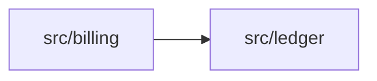
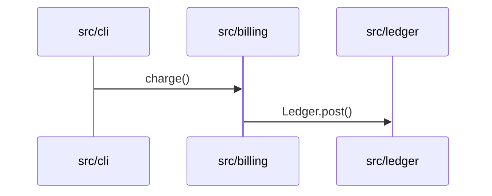

<!--
File: Tier B cache frontmatter schema shared by .workflow/cache/modules.md, .workflow/cache/flows.md and .workflow/cache/architecture.md (00.5-00.7). The schema `publish-cache.sh` writes and `cache-stamp-check.sh` and the `retrieval` agent read.
Sources: fields from PLAN/decision-flow-reference.md "Persistent files" 00.5-00.7 and assetlist D8, D17. The commit stamp idiom is shared with open-gsd/gsd-core's codebase mapper (`last_mapped_commit`, MIT; its source file could not be fetched, so only the idea is used) and with skills/data-structure-audit/references/incremental.md (git-anchored changed-since-commit logic). YAML is read with mikefarah yq v4 (D38).
Body shapes: PLAN/gap-research.md G6 (generated skeletons, agent-written slots, sorted lists, canonical Mermaid), first-party.
Plan refs: 00.5-00.7, 0.2.7, 0.2.8; D4, D17, D38, D64.
-->

# Tier B cache frontmatter

Every file in `.workflow/cache/` starts with this YAML frontmatter. A cache is derived from code, stamped with the commit it was derived from, and never hand-edited. Only `publish-cache.sh` writes into `.workflow/cache/` (D17).

## Who writes what

- The `cache-regeneration` agent writes the body to the staging path and leaves the stamp fields to the script. It may omit the frontmatter entirely.
- `publish-cache.sh` writes (or overwrites) the frontmatter below, then moves the file into `.workflow/cache/`.
- `cache-stamp-check.sh` and the `retrieval` agent read it. Neither writes it.

## Fields

| Field | Required | Type | Meaning |
| --- | --- | --- | --- |
| `generated_at_commit` | yes | string, 40 hex chars | Full SHA of `HEAD` when the cache was derived. `cache-stamp-check.sh` compares it with `HEAD` for the paths in `scope`. |
| `generated_at` | yes | quoted string, UTC ISO 8601 (`"2026-10-15T09:30:00Z"`) | When the cache was published. Informational; staleness is decided by the commit, never by this date. |
| `scope` | yes | list of repo-relative paths, at least one | Paths the cache covers (files or directories, no globs). A cache is stale when any path in `scope` changed between `generated_at_commit` and `HEAD`. `architecture` also lists `.workflow/tools/boundaries/dependency-cruiser.cjs` when it exists: a stamp-only path for its Boundary violations, never passed to `build-architecture.sh --scope`. |
| `cache_type` | yes | `modules` \| `flows` \| `architecture` | Which cache this is; must match the file name (`.workflow/cache/<cache_type>.md`). |
| `generator` | yes | string | What produced the body, for example `cache-regeneration` or `dependency-cruiser`. Free text, no version-sensitive values required. |

No other fields. Keep the frontmatter machine-read and the body human-read.

## Example

```yaml
---
generated_at_commit: 9f2c1d7e4b5a6c8d0e1f2a3b4c5d6e7f8a9b0c1d
generated_at: "2026-10-15T09:30:00Z"
scope:
  - src/billing
  - src/shared/core
cache_type: modules
generator: cache-regeneration
---
```

## Validate with yq

yq is mikefarah v4; the frontmatter is read with `--front-matter=extract` (D38). This prints `true` for a valid file and exits non-zero otherwise (`-e`):

```bash
yq --front-matter=extract -e '
  (.generated_at_commit | test("^[0-9a-f]{40}$")) and
  (.generated_at | test("^[0-9]{4}-[0-9]{2}-[0-9]{2}T[0-9]{2}:[0-9]{2}:[0-9]{2}Z$")) and
  ((.scope | tag) == "!!seq") and ((.scope | length) > 0) and
  (.cache_type | test("^(modules|flows|architecture)$")) and
  ((.generator | tag) == "!!str")
' .workflow/cache/modules.md
```

Read a single field (what the stamp check does):

```bash
yq --front-matter=extract '.generated_at_commit' .workflow/cache/modules.md
yq --front-matter=extract '.scope[]' .workflow/cache/modules.md
```

Always quote `generated_at`: an unquoted ISO timestamp is read as a YAML timestamp rather than a string, and the `test` above would not match it. `publish-cache.sh` writes it quoted.

## Determinism

Output is identical for identical scope and commit, whether launched by 0.2.8 or by `regenerate-caches` (D4). Regenerate a cache from scratch and replace it; never patch the previous one.

## Body shape per cache type

A script generates whatever can be generated; the `cache-regeneration` agent writes only bounded text into fixed slots (PLAN/gap-research.md G6). `scripts/build-architecture.sh` produces the generated parts from one dependency-cruiser run, and `scripts/check-staged-cache.sh` rejects a staged body that breaks the shapes below.

### Rules for every body

- **Sorted.** Every list and every `##` section is in byte order (`LC_ALL=C sort`), with no duplicates. The only exceptions are a diagram's call order and the fixed section order of `architecture.md`.
- **No timestamps or counts.** The stamp lives in the frontmatter only (D17).
- **Paths, not prose.** Modules are named by repo-relative path; the same path is the node name in every cache, and its Mermaid id is the path with every non-alphanumeric character replaced by `_` (`src/shared/core` → `src_shared_core`). Two paths with the same id stop the build rather than merge.
- **Module paths.** A file belongs to its longest module root: the `owns` paths of the `.workflow/rules.md` Ownership block plus `shared_core.paths`, with a trailing `/**` or `/*` removed. A file under no root belongs to `<scope path>/<first segment>`, or is its own module when it sits directly in the scope path. The script reads the roots itself, so the agent never reads Tier A.
- **From code at HEAD.** The scope paths must have no uncommitted or untracked changes; the build refuses otherwise.
- **No slot left.** A generated `<!-- slot: ... -->` marker must be replaced before publishing.

### `architecture.md` (fully generated, `generator: dependency-cruiser`)

`build-architecture.sh --cache architecture` writes the whole body; the agent does not change it. Its `scope` includes `.workflow/tools/boundaries/dependency-cruiser.cjs` when that file exists, so a boundary-config change marks it stale (see the `scope` field).

````markdown
# Architecture

## Module graph



## Edges

- `src/billing` → `src/ledger`

## Boundary violations

- `billing-not-to-ledger`: `src/billing/index.ts` → `src/ledger/index.ts`
````

- **Module graph:** every module node (sorted), then every module-to-module edge (sorted, self-edges dropped).
- **Edges:** the same edges as text, or `None.`.
- **Boundary violations:** `rule: from → to` from `depcruise --config .workflow/tools/boundaries/dependency-cruiser.cjs -T json`, sorted, or `None.`; `Not checked: no boundary config at .workflow/tools/boundaries/dependency-cruiser.cjs.` when the project has none.

### `modules.md` (generated skeleton, agent-written Purpose)

`build-architecture.sh --cache modules` writes one `## <module path>` section per module, sorted, with the five fields in this order:

```markdown
# Modules

## src/billing

- Purpose: Charges a ledger for a plan.
- Files:
  - `src/billing/index.ts`
- Depends on:
  - `src/ledger`
- Used by: none
- Public interface:
  - `Plan` (enum)
  - `charge` (function)
```

- **Files**, **Depends on**, **Used by:** generated from the dependency graph; an empty list reads `none`.
- **Public interface:** generated. The exported names of the module's entry declaration (`<module>/index.d.ts`, or the module file itself) from `tsc --declaration --emitDeclarationOnly`, sorted, with kind (`function`, `class`, `interface`, `type`, `const`, `enum`, `namespace`, `re-export from "<spec>"`, `default export`). A relative `export *` is replaced by the target's names. Without declarations the line reads `Not generated: <reason>.`
- **Purpose:** the only agent-written slot, generated as `<!-- slot: purpose -->`. Exactly one sentence ending in `.`, present tense, no quality adjectives, drawn from the module's code and comments only. If the code does not say, write `Not determinable from code.`

### `flows.md` (agent-written, constrained)

Entry points are discovered on every run, with no config block (D64). `build-architecture.sh --cache entries` lists the candidates: source files that nothing in scope imports, tests and declarations excluded, each with the files and modules it reaches. The agent keeps a candidate only when its code shows it is an entry point (a route or page the framework loads, a CLI main with a shebang or `process.argv`, or an exported handler a platform invokes) and drops the rest.

````markdown
# Flows

## Entry points

- `src/cli/main.ts`

## src/cli/main.ts



Error branches:
- `src/billing/index.ts` `charge()`: throws `RangeError` when the amount is negative
````

- **Entry points:** one `` - `<file>` `` per kept entry, sorted, or `None.` (and no further sections).
- **One `## <entry file>` section per entry**, in the same order, each with exactly one `sequenceDiagram`:
  - every `participant <id> as <module path>` line first, in first-call order, using the ids above;
  - one arrow per cross-module call on the happy path, in call order, labelled `name()` or `Class.method()` (constructors: `Class.constructor()`), with no arguments, prose, `Note`, `autonumber`, `activate` or return arrows;
  - `alt`/`else`/`opt`/`loop`/`end` only where the code itself branches or loops around a cross-module call.
- **Error branches:** after the diagram, the line `Error branches:` and then `- none`, or one bullet per error path the code takes (`` - `<file>` `<function>()`: <throws or returns what, when> ``), sorted.

### Determinism check

Regenerate a cache twice at the same commit and `diff` the two bodies. Generated sections never differ; any difference in an agent-written slot is a prompt fix in `.agents/agents/cache-regeneration.md`, not a tolerated drift.

### Mermaid validation

`check-staged-cache.sh <type> <file> --html-out <file>.html` wraps each ` ```mermaid ` block in `<pre class="mermaid">`, because `.agents/skills/visual-change-report/scripts/validate_mermaid.mjs` reads only HTML. Run `node .agents/skills/visual-change-report/scripts/validate_mermaid.mjs <file>.html` when the project has `mermaid@11` and `jsdom` in its `node_modules`; otherwise check the blocks against `.agents/skills/visual-change-report/references/visual-library.md` "Mermaid syntax rules" and report them as not machine-validated.
