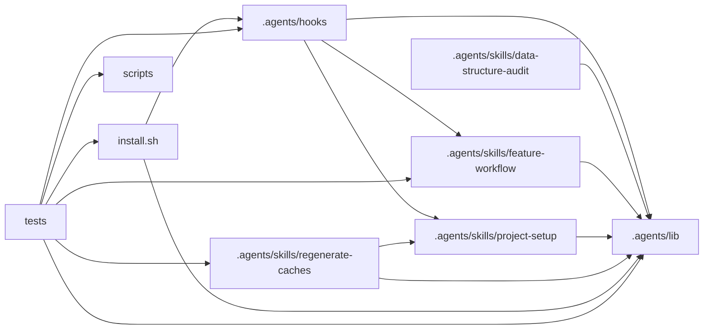

# Architecture

## Module graph

## Edges

- `.agents/hooks` → `.agents/lib`
- `.agents/hooks` → `.agents/skills/feature-workflow`
- `.agents/hooks` → `.agents/skills/project-setup`
- `.agents/skills/data-structure-audit` → `.agents/lib`
- `.agents/skills/feature-workflow` → `.agents/lib`
- `.agents/skills/project-setup` → `.agents/lib`
- `.agents/skills/regenerate-caches` → `.agents/lib`
- `.agents/skills/regenerate-caches` → `.agents/skills/project-setup`
- `install.sh` → `.agents/hooks`
- `install.sh` → `.agents/lib`
- `tests` → `.agents/hooks`
- `tests` → `.agents/lib`
- `tests` → `.agents/skills/feature-workflow`
- `tests` → `.agents/skills/regenerate-caches`
- `tests` → `install.sh`
- `tests` → `scripts`

## Boundary violations

Not checked: no boundary checker for this project's graph extractors (bash).

## Unresolved edges

- `.agents/skills/regenerate-caches/scripts/build-architecture.sh:133` `$EXTRACTORS_DIR/*.sh`
- `.agents/skills/regenerate-caches/scripts/build-architecture.sh:143` `$EXTRACTORS_DIR/$name.sh`
- `.agents/skills/regenerate-caches/scripts/build-architecture.sh:272` `$EXTRACTORS_DIR/$name.sh`
- `tests/fixtures/graph-extractors.sh:128` `$r/bin/build.sh`
- `tests/fixtures/graph-extractors.sh:128` `$r/ops/report.sh`
- `tests/fixtures/graph-extractors.sh:128` `$r/tests/build-test.sh`
- `tests/fixtures/graph-extractors.sh:128` `$r/tools/deploy.sh`
- `tests/fixtures/initiative.sh:152` `$1/.agents/hooks/session-start-resume.sh`
- `tests/fixtures/review-lessons.sh:113` `$p/src/report.sh`
- `tests/hooks/audit-agent-worktrees.sh:131` `$H/post-implementation-audit.sh`
- `tests/hooks/audit-agent-worktrees.sh:132` `$TESTS_DIR/fixtures/claude-settings.sh`
- `tests/hooks/audit-agent-worktrees.sh:13` `$TESTS_DIR/fixtures/claude-settings.sh`
- `tests/hooks/audit-agent-worktrees.sh:62` `$H/post-implementation-audit.sh`
- `tests/hooks/audit-sync-resume.sh:103` `$H/post-implementation-audit.sh`
- `tests/hooks/audit-sync-resume.sh:107` `$H/post-implementation-audit.sh`
- `tests/hooks/audit-sync-resume.sh:113` `$H/post-implementation-audit.sh`
- `tests/hooks/audit-sync-resume.sh:119` `$H/post-implementation-audit.sh`
- `tests/hooks/audit-sync-resume.sh:123` `$H/post-implementation-audit.sh`
- `tests/hooks/audit-sync-resume.sh:128` `$H/post-implementation-audit.sh`
- `tests/hooks/audit-sync-resume.sh:133` `$H/post-implementation-audit.sh`
- `tests/hooks/audit-sync-resume.sh:135` `$H/post-implementation-audit.sh`
- `tests/hooks/audit-sync-resume.sh:139` `$H/post-implementation-audit.sh`
- `tests/hooks/audit-sync-resume.sh:145` `$H/post-implementation-audit.sh`
- `tests/hooks/audit-sync-resume.sh:149` `$H/post-implementation-audit.sh`
- `tests/hooks/audit-sync-resume.sh:155` `$H/post-implementation-audit.sh`
- `tests/hooks/audit-sync-resume.sh:158` `$H/post-implementation-audit.sh`
- `tests/hooks/audit-sync-resume.sh:163` `$H/post-implementation-audit.sh`
- `tests/hooks/audit-sync-resume.sh:173` `$H/post-implementation-audit.sh`
- `tests/hooks/audit-sync-resume.sh:176` `$H/post-implementation-audit.sh`
- `tests/hooks/audit-sync-resume.sh:182` `$H/rules-boundary-config-sync.sh`
- `tests/hooks/audit-sync-resume.sh:184` `$H/rules-boundary-config-sync.sh`
- `tests/hooks/audit-sync-resume.sh:207` `$H/rules-boundary-config-sync.sh`
- `tests/hooks/audit-sync-resume.sh:211` `$H/rules-boundary-config-sync.sh`
- `tests/hooks/audit-sync-resume.sh:213` `$H/rules-boundary-config-sync.sh`
- `tests/hooks/audit-sync-resume.sh:215` `$H/rules-boundary-config-sync.sh`
- `tests/hooks/audit-sync-resume.sh:217` `$H/rules-boundary-config-sync.sh`
- `tests/hooks/audit-sync-resume.sh:219` `$H/rules-boundary-config-sync.sh`
- `tests/hooks/audit-sync-resume.sh:223` `$H/session-start-resume.sh`
- `tests/hooks/audit-sync-resume.sh:310` `$H/post-implementation-audit.sh`
- `tests/hooks/audit-sync-resume.sh:310` `$H/rules-boundary-config-sync.sh`
- `tests/hooks/audit-sync-resume.sh:310` `$H/session-start-resume.sh`
- `tests/hooks/audit-sync-resume.sh:84` `$H/post-implementation-audit.sh`
- `tests/hooks/audit-sync-resume.sh:87` `$H/post-implementation-audit.sh`
- `tests/hooks/audit-sync-resume.sh:92` `$H/post-implementation-audit.sh`
- `tests/hooks/audit-sync-resume.sh:94` `$H/post-implementation-audit.sh`
- `tests/hooks/audit-sync-resume.sh:97` `$H/post-implementation-audit.sh`
- `tests/hooks/audit-sync-resume.sh:98` `$H/post-implementation-audit.sh`
- `tests/hooks/block-destructive-git.sh:21` `$WORK/proj/.agents/hooks/block-destructive-git.sh`
- `tests/hooks/codex-adapters.sh:138` `$H/codex-write-guard.sh`
- `tests/hooks/codex-adapters.sh:140` `$H/codex-write-guard.sh`
- `tests/hooks/codex-adapters.sh:158` `$H/codex-pre-spawn.sh`
- `tests/hooks/codex-adapters.sh:200` `$H/codex-pre-spawn.sh`
- `tests/hooks/codex-adapters.sh:228` `$H/codex-rules-sync.sh`
- `tests/hooks/codex-adapters.sh:262` `$H/_codex-patch.sh`
- `tests/hooks/codex-adapters.sh:262` `$H/codex-pre-spawn.sh`
- `tests/hooks/codex-adapters.sh:262` `$H/codex-rules-sync.sh`
- `tests/hooks/codex-adapters.sh:262` `$H/codex-write-guard.sh`
- `tests/hooks/codex-adapters.sh:38` `$H/_codex-patch.sh`
- `tests/hooks/codex-adapters.sh:82` `$H/codex-write-guard.sh`
- `tests/hooks/codex-pre-spawn-initiative.sh:11` `$TESTS_DIR/fixtures/initiative.sh`
- `tests/hooks/codex-pre-spawn-initiative.sh:30` `$H/codex-pre-spawn.sh`
- `tests/hooks/codex-pre-spawn-initiative.sh:63` `$H/codex-pre-spawn.sh`
- `tests/hooks/codex-shim.sh:217` `$B/probe.sh`
- `tests/hooks/codex-shim.sh:227` `$H/generate-codex-agents.sh`
- `tests/hooks/codex-shim.sh:227` `$H/post-implementation-audit.sh`
- `tests/hooks/codex-shim.sh:92` `$H/post-implementation-audit.sh`
- `tests/hooks/initiative-write-guards.sh:14` `$TESTS_DIR/fixtures/initiative.sh`
- `tests/hooks/initiative-write-guards.sh:40` `$H/$g.sh`
- `tests/hooks/initiative-write-guards.sh:95` `$H/_guard-common.sh`
- `tests/hooks/initiative-write-guards.sh:95` `$H/spec-single-writer-guard.sh`
- `tests/hooks/initiative-write-guards.sh:95` `$H/tier-a-write-guard.sh`
- `tests/hooks/initiative-write-guards.sh:95` `$H/tier-b-write-guard.sh`
- `tests/hooks/session-start-initiatives.sh:10` `$TESTS_DIR/fixtures/initiative.sh`
- `tests/hooks/worktree-guard.sh:18` `$TESTS_DIR/fixtures/result-briefs.sh`
- `tests/hooks/worktree-guard.sh:223` `$WP1/tests/x.sh`
- `tests/hooks/worktree-guard.sh:233` `$WIG/.agents/lib/x.sh`
- `tests/hooks/worktree-guard.sh:235` `$WP1/x.sh`
- `tests/hooks/worktree-guard.sh:241` `$H/worktree-write-guard.sh`
- `tests/hooks/worktree-guard.sh:244` `$H/worktree-write-guard.sh`
- `tests/hooks/worktree-guard.sh:270` `$H/codex-write-guard.sh`
- `tests/hooks/worktree-guard.sh:286` `$H/codex-write-guard.sh`
- `tests/hooks/worktree-guard.sh:295` `$H/worktree-write-guard.sh`
- `tests/hooks/worktree-guard.sh:296` `$H/worktree-write-guard.sh`
- `tests/hooks/worktree-guard.sh:71` `$H/worktree-write-guard.sh`
- `tests/hooks/write-guards.sh:185` `$H/$TIERB.sh`
- `tests/hooks/write-guards.sh:201` `$H/$TIERB.sh`
- `tests/hooks/write-guards.sh:205` `$H/$g.sh`
- `tests/hooks/write-guards.sh:214` `$H/$SPECG.sh`
- `tests/hooks/write-guards.sh:222` `$H/$TIERA.sh`
- `tests/hooks/write-guards.sh:231` `$H/*-guard.sh`
- `tests/hooks/write-guards.sh:231` `$H/_guard-common.sh`
- `tests/hooks/write-guards.sh:235` `$NW/.agents/hooks/$g.sh`
- `tests/hooks/write-guards.sh:241` `$H/../lib/workflow-paths.sh`
- `tests/hooks/write-guards.sh:248` `$H/$SPECG.sh`
- `tests/hooks/write-guards.sh:248` `$H/$TIERA.sh`
- `tests/hooks/write-guards.sh:248` `$H/$TIERB.sh`
- `tests/hooks/write-guards.sh:248` `$H/../lib/workflow-paths.sh`
- `tests/hooks/write-guards.sh:248` `$H/_guard-common.sh`
- `tests/hooks/write-guards.sh:47` `$H/$1.sh`
- `tests/lint/agent-worktree-docs.sh:126` `$TESTS_DIR/fixtures/result-briefs.sh`
- `tests/lint/agent-worktree-docs.sh:15` `$TESTS_DIR/fixtures/result-briefs.sh`
- `tests/lint/frontmatter.sh:129` `$TESTS_DIR/lint/frontmatter.sh`
- `tests/lint/install-matcher-docs.sh:32` `$WORK/scaffold/install.sh`
- `tests/lint/install-matcher-docs.sh:33` `$WORK/scaffold/install.sh`
- `tests/lint/review-lessons.sh:14` `$TESTS_DIR/fixtures/review-lessons.sh`
- `tests/lint/review-lessons.sh:83` `$WORK/codex/.agents/hooks/generate-codex-agents.sh`
- `tests/lint/review-lessons.sh:92` `$TESTS_DIR/fixtures/review-lessons.sh`
- `tests/lint/review-lessons.sh:92` `$TESTS_DIR/lint/review-lessons.sh`
- `tests/lint/step-list.sh:105` `$FW_SKILL/scripts/initiative-transition.sh`
- `tests/lint/step-list.sh:15` `$TESTS_DIR/fixtures/initiative.sh`
- `tests/lint/step-list.sh:22` `$FW_SKILL/scripts/step-progress.sh`
- `tests/lint/step-list.sh:65` `$FW_SKILL/scripts/status-transition.sh`
- `tests/lint/step-list.sh:66` `$FW_SKILL/scripts/check-write.sh`
- `tests/lint/symlinks.sh:50` `$TESTS_DIR/lint/symlinks.sh`
- `tests/lint/upstream-lineage.sh:135` `$TESTS_DIR/lint/upstream-lineage.sh`
- `tests/run-all.sh:83` `$HERE/hooks/*.sh`
- `tests/run-all.sh:83` `$HERE/lint/*.sh`
- `tests/run-all.sh:83` `$HERE/scripts/*.sh`
- `tests/scripts/budget-check.sh:13` `$TESTS_DIR/fixtures/workflow-folders.sh`
- `tests/scripts/budget-check.sh:183` `$SRC/scripts/budget-check.sh`
- `tests/scripts/budget-check.sh:194` `$SRC/scripts/budget-check.sh`
- `tests/scripts/budget-check.sh:22` `$SRC/scripts/status-transition.sh`
- `tests/scripts/budget-check.sh:23` `$SRC/scripts/check-write.sh`
- `tests/scripts/budget-check.sh:24` `$SRC/scripts/budget-check.sh`
- `tests/scripts/build-architecture.sh:138` `$PLUGIN_DIR/$PLUGIN.sh`
- `tests/scripts/build-architecture.sh:139` `$ROOT/ops/gone.sh`
- `tests/scripts/build-architecture.sh:14` `$TESTS_DIR/fixtures/graph-extractors.sh`
- `tests/scripts/build-architecture.sh:20` `$S/build-architecture.sh`
- `tests/scripts/build-architecture.sh:21` `$S/check-staged-cache.sh`
- `tests/scripts/build-architecture.sh:341` `$PLUGIN_DIR/$PLUGIN.sh`
- `tests/scripts/build-architecture.sh:342` `$ROOT/ops/gone.sh`
- `tests/scripts/cache-bash-project.sh:15` `$TESTS_DIR/fixtures/graph-extractors.sh`
- `tests/scripts/cache-bash-project.sh:21` `$S/build-architecture.sh`
- `tests/scripts/cache-bash-project.sh:22` `$S/check-staged-cache.sh`
- `tests/scripts/cache-bash-project.sh:23` `$S/extractors/bash.sh`
- `tests/scripts/cache-boundary-check.sh:154` `$S/extractors/bash.sh`
- `tests/scripts/cache-boundary-check.sh:154` `$S/extractors/dependency-cruiser.sh`
- `tests/scripts/cache-boundary-check.sh:16` `$TESTS_DIR/fixtures/graph-extractors.sh`
- `tests/scripts/cache-boundary-check.sh:22` `$S/build-architecture.sh`
- `tests/scripts/cache-boundary-check.sh:23` `$S/check-staged-cache.sh`
- `tests/scripts/cache-js-unchanged.sh:15` `$TESTS_DIR/fixtures/graph-extractors.sh`
- `tests/scripts/cache-js-unchanged.sh:21` `$S/build-architecture.sh`
- `tests/scripts/cache-js-unchanged.sh:22` `$S/extractors/dependency-cruiser.sh`
- `tests/scripts/cache-missing-extractor-key.sh:11` `$TESTS_DIR/fixtures/graph-extractors.sh`
- `tests/scripts/cache-missing-extractor-key.sh:16` `$WORK/scaffold/.agents/skills/regenerate-caches/scripts/build-architecture.sh`
- `tests/scripts/cache-mixed-extractors.sh:11` `$TESTS_DIR/fixtures/graph-extractors.sh`
- `tests/scripts/cache-mixed-extractors.sh:17` `$S/build-architecture.sh`
- `tests/scripts/cache-mixed-extractors.sh:64` `$S/extractors/bash.sh`
- `tests/scripts/cache-mixed-extractors.sh:64` `$S/extractors/dependency-cruiser.sh`
- `tests/scripts/cache-repo-architecture.sh:12` `$TESTS_DIR/fixtures/architecture-oracle.sh`
- `tests/scripts/cache-scripts.sh:214` `$S/*.sh`
- `tests/scripts/cache-scripts.sh:24` `$S/publish-cache.sh`
- `tests/scripts/cache-scripts.sh:25` `$S/publish-cache.sh`
- `tests/scripts/cache-scripts.sh:26` `$S/publish-cache.sh`
- `tests/scripts/cache-scripts.sh:30` `$S/cache-stamp-check.sh`
- `tests/scripts/cache-scripts.sh:36` `$S/cache-stamp-check.sh`
- `tests/scripts/cache-scripts.sh:40` `$S/cache-stamp-check.sh`
- `tests/scripts/cache-scripts.sh:45` `$S/cache-stamp-check.sh`
- `tests/scripts/cache-scripts.sh:51` `$S/cache-stamp-check.sh`
- `tests/scripts/cache-scripts.sh:55` `$S/publish-cache.sh`
- `tests/scripts/cache-scripts.sh:63` `$S/cache-stamp-check.sh`
- `tests/scripts/cache-scripts.sh:71` `$S/cache-stamp-check.sh`
- `tests/scripts/cache-scripts.sh:78` `$S/cache-stamp-check.sh`
- `tests/scripts/cache-scripts.sh:84` `$S/publish-cache.sh`
- `tests/scripts/cache-scripts.sh:85` `$S/publish-cache.sh`
- `tests/scripts/cache-scripts.sh:87` `$S/publish-cache.sh`
- `tests/scripts/cache-scripts.sh:89` `$S/publish-cache.sh`
- `tests/scripts/cache-scripts.sh:90` `$S/publish-cache.sh`
- `tests/scripts/cache-scripts.sh:92` `$S/publish-cache.sh`
- `tests/scripts/check-pr-body.sh:173` `$WORK/renamed-risk/.agents/skills/feature-workflow/scripts/check-pr-body.sh`
- `tests/scripts/check-pr-body.sh:24` `$TESTS_DIR/fixtures/pr-template.sh`
- `tests/scripts/check-pr-body.sh:29` `$WORK/scaffold/.agents/skills/feature-workflow/scripts/check-pr-body.sh`
- `tests/scripts/check-review-findings.sh:13` `$TESTS_DIR/fixtures/review-lessons.sh`
- `tests/scripts/check-review-findings.sh:18` `$WORK/scaffold/.agents/skills/feature-workflow/scripts/check-review-findings.sh`
- `tests/scripts/check-review-findings.sh:294` `$TESTS_DIR/scripts/check-review-findings.sh`
- `tests/scripts/check-task-result.sh:16` `$WORK/scaffold/.agents/skills/feature-workflow/scripts/check-task-result.sh`
- `tests/scripts/check-task-result.sh:366` `$AGENTS_SRC/skills/feature-workflow/scripts/check-task-result.sh`
- `tests/scripts/check-write-paths.sh:172` `$SRC/scripts/check-write.sh`
- `tests/scripts/check-write-paths.sh:17` `$SRC/scripts/status-transition.sh`
- `tests/scripts/check-write-paths.sh:18` `$SRC/scripts/check-write.sh`
- `tests/scripts/check-write-paths.sh:19` `$SRC/scripts/budget-check.sh`
- `tests/scripts/check-write-tier-a.sh:105` `$SRC/scripts/check-write.sh`
- `tests/scripts/check-write-tier-a.sh:106` `$SRC/scripts/status-transition.sh`
- `tests/scripts/check-write-tier-a.sh:136` `$SRC/scripts/check-write.sh`
- `tests/scripts/check-write-tier-a.sh:18` `$SRC/scripts/status-transition.sh`
- `tests/scripts/check-write-tier-a.sh:19` `$SRC/scripts/check-write.sh`
- `tests/scripts/check-write-tier-a.sh:20` `$SRC/scripts/budget-check.sh`
- `tests/scripts/commit-workflow-data.sh:13` `$TESTS_DIR/fixtures/workflow-folders.sh`
- `tests/scripts/commit-workflow-data.sh:16` `$FW_SKILL/scripts/commit-workflow-data.sh`
- `tests/scripts/extractor-bash.sh:16` `$TESTS_DIR/fixtures/graph-extractors.sh`
- `tests/scripts/extractor-bash.sh:205` `./x`
- `tests/scripts/extractor-bash.sh:21` `$WORK/scaffold/.agents/skills/regenerate-caches/scripts/extractors/bash.sh`
- `tests/scripts/generate-boundary-config.sh:14` `$SETUP/scripts/generate-boundary-config.sh`
- `tests/scripts/graph-extractor-selection.sh:14` `$TESTS_DIR/fixtures/graph-extractors.sh`
- `tests/scripts/graph-extractor-selection.sh:20` `$S/build-architecture.sh`
- `tests/scripts/graph-extractor-selection.sh:21` `$S/extractors/dependency-cruiser.sh`
- `tests/scripts/graph-extractor-selection.sh:26` `$S/extractors/$1.sh`
- `tests/scripts/graph-extractor-selection.sh:37` `$S/extractors/broken.sh`
- `tests/scripts/initiative-conversion.sh:12` `$TESTS_DIR/fixtures/initiative.sh`
- `tests/scripts/initiative-emission.sh:11` `$TESTS_DIR/fixtures/initiative.sh`
- `tests/scripts/initiative-merge.sh:102` `$Q/$SCRIPTS_REL/rules-setting.sh`
- `tests/scripts/initiative-merge.sh:103` `$Q/$SCRIPTS_REL/rules-setting.sh`
- `tests/scripts/initiative-merge.sh:105` `$Q/$SCRIPTS_REL/open-task-pr.sh`
- `tests/scripts/initiative-merge.sh:162` `$R/$SCRIPTS_REL/open-task-pr.sh`
- `tests/scripts/initiative-merge.sh:16` `$TESTS_DIR/fixtures/initiative.sh`
- `tests/scripts/initiative-merge.sh:265` `$P/$SCRIPTS_REL/open-task-pr.sh`
- `tests/scripts/initiative-merge.sh:265` `$P/$SCRIPTS_REL/rules-setting.sh`
- `tests/scripts/initiative-merge.sh:50` `$P/$SCRIPTS_REL/rules-setting.sh`
- `tests/scripts/initiative-transition.sh:11` `$TESTS_DIR/fixtures/initiative.sh`
- `tests/scripts/initiative-transition.sh:13` `$TESTS_DIR/fixtures/workflow-folders.sh`
- `tests/scripts/install-claude-settings.sh:13` `$TESTS_DIR/fixtures/claude-settings.sh`
- `tests/scripts/install-payload.sh:54` `$WORK/badsc/install.sh`
- `tests/scripts/install-payload.sh:81` `$1/.agents/lib/workflow-paths.sh`
- `tests/scripts/install-upgrade.sh:173` `$WORK/sc2/install.sh`
- `tests/scripts/install-upgrade.sh:182` `$WORK/sc2/install.sh`
- `tests/scripts/install-upgrade.sh:204` `$WORK/sc2/install.sh`
- `tests/scripts/install-upgrade.sh:27` `$TESTS_DIR/fixtures/claude-settings.sh`
- `tests/scripts/lib-test-paths.sh:14` `$TESTS_DIR/fixtures/graph-extractors.sh`
- `tests/scripts/lib-test-paths.sh:19` `$WORK/scaffold/.agents/lib/test-paths.sh`
- `tests/scripts/lib-test-paths.sh:20` `$WORK/scaffold/.agents/skills/feature-workflow/scripts/budget-check.sh`
- `tests/scripts/lib-test-paths.sh:21` `$WORK/scaffold/.agents/skills/regenerate-caches/scripts/build-architecture.sh`
- `tests/scripts/lib-workflow-paths.sh:161` `$WORK/scaffold/.agents/hooks/codex-pre-spawn.sh`
- `tests/scripts/lib-workflow-paths.sh:162` `$WORK/scaffold/.agents/hooks/codex-pre-spawn.sh`
- `tests/scripts/lib-workflow-paths.sh:162` `$WORK/scaffold/.agents/hooks/post-implementation-audit.sh`
- `tests/scripts/lib-workflow-paths.sh:16` `$TESTS_DIR/fixtures/workflow-folders.sh`
- `tests/scripts/lib-workflow-paths.sh:21` `$WORK/scaffold/.agents/lib/workflow-paths.sh`
- `tests/scripts/resolve-launch-initiative.sh:11` `$TESTS_DIR/fixtures/initiative.sh`
- `tests/scripts/resolve-launch.sh:14` `$WORK/scaffold/.agents/skills/feature-workflow/scripts/resolve-launch.sh`
- `tests/scripts/review-lessons.sh:11` `$TESTS_DIR/fixtures/review-lessons.sh`
- `tests/scripts/review-lessons.sh:16` `$WORK/scaffold/.agents/skills/feature-workflow/scripts/review-lessons.sh`
- `tests/scripts/review-lessons.sh:94` `$TESTS_DIR/scripts/review-lessons.sh`
- `tests/scripts/run-all-selection.sh:18` `$FIXTURE_TESTS/run-all.sh`
- `tests/scripts/run-all-selection.sh:18` `$TESTS_DIR/run-all.sh`
- `tests/scripts/run-all-selection.sh:19` `$FIXTURE_TESTS/lib/common.sh`
- `tests/scripts/run-all-selection.sh:19` `$TESTS_DIR/lib/common.sh`
- `tests/scripts/run-all-selection.sh:20` `$FIXTURE_TESTS/run-all.sh`
- `tests/scripts/run-all-selection.sh:246` `$TESTS_DIR/run-all.sh`
- `tests/scripts/run-all-selection.sh:43` `$FIXTURE_TESTS/scripts/alpha.sh`
- `tests/scripts/run-all-selection.sh:44` `$FIXTURE_TESTS/scripts/beta.sh`
- `tests/scripts/run-all-selection.sh:45` `$FIXTURE_TESTS/hooks/gamma.sh`
- `tests/scripts/run-all-selection.sh:46` `$FIXTURE_TESTS/lint/delta.sh`
- `tests/scripts/run-toolchain.sh:13` `$WORK/scaffold/.agents/skills/feature-workflow/scripts/run-toolchain.sh`
- `tests/scripts/sign-off-pr.sh:165` `$WORK/publish-block.sh`
- `tests/scripts/sign-off-pr.sh:20` `$TESTS_DIR/fixtures/pr-template.sh`
- `tests/scripts/status-transition-specs.sh:12` `$TESTS_DIR/fixtures/workflow-folders.sh`
- `tests/scripts/status-transition-specs.sh:21` `$SRC/scripts/status-transition.sh`
- `tests/scripts/status-transition-specs.sh:22` `$SRC/scripts/check-write.sh`
- `tests/scripts/status-transition-specs.sh:23` `$SRC/scripts/budget-check.sh`
- `tests/scripts/status-transition-specs.sh:255` `$SRC/scripts/check-write.sh`
- `tests/scripts/status-transition-specs.sh:255` `$SRC/scripts/status-transition.sh`
- `tests/scripts/status-transition-tasks.sh:125` `$SRC/scripts/status-transition.sh`
- `tests/scripts/status-transition-tasks.sh:18` `$SRC/scripts/status-transition.sh`
- `tests/scripts/status-transition-tasks.sh:19` `$SRC/scripts/check-write.sh`
- `tests/scripts/status-transition-tasks.sh:20` `$SRC/scripts/budget-check.sh`
- `tests/scripts/status-transition-tasks.sh:264` `$SRC/scripts/budget-check.sh`
- `tests/scripts/status-transition-tasks.sh:264` `$SRC/scripts/check-write.sh`
- `tests/scripts/status-transition-tasks.sh:264` `$SRC/scripts/status-transition.sh`
- `tests/scripts/step-progress.sh:14` `$TESTS_DIR/fixtures/initiative.sh`
- `tests/scripts/step-progress.sh:18` `$FW_SKILL/scripts/step-progress.sh`
- `tests/scripts/task-breakdown.sh:17` `$TESTS_DIR/fixtures/workflow-folders.sh`
- `tests/scripts/task-breakdown.sh:184` `$WORK/scaffold/.agents/skills/project-setup/scripts/generate-boundary-config.sh`
- `tests/scripts/task-breakdown.sh:224` `$S/open-task-pr.sh`
- `tests/scripts/task-breakdown.sh:23` `$S/task-waves.sh`
- `tests/scripts/task-breakdown.sh:243` `$S/open-task-pr.sh`
- `tests/scripts/task-breakdown.sh:24` `$S/rules-setting.sh`
- `tests/scripts/task-breakdown.sh:295` `$S/run-toolchain.sh`
- `tests/scripts/task-breakdown.sh:331` `$S/open-task-pr.sh`
- `tests/scripts/task-breakdown.sh:336` `$S/open-task-pr.sh`
- `tests/scripts/task-breakdown.sh:340` `$S/open-task-pr.sh`
- `tests/scripts/task-breakdown.sh:340` `$S/rules-setting.sh`
- `tests/scripts/task-breakdown.sh:340` `$S/run-toolchain.sh`
- `tests/scripts/task-breakdown.sh:340` `$S/task-waves.sh`
- `tests/scripts/upstream-diff.sh:16` `$WORK/scaffold/scripts/upstream-diff.sh`
