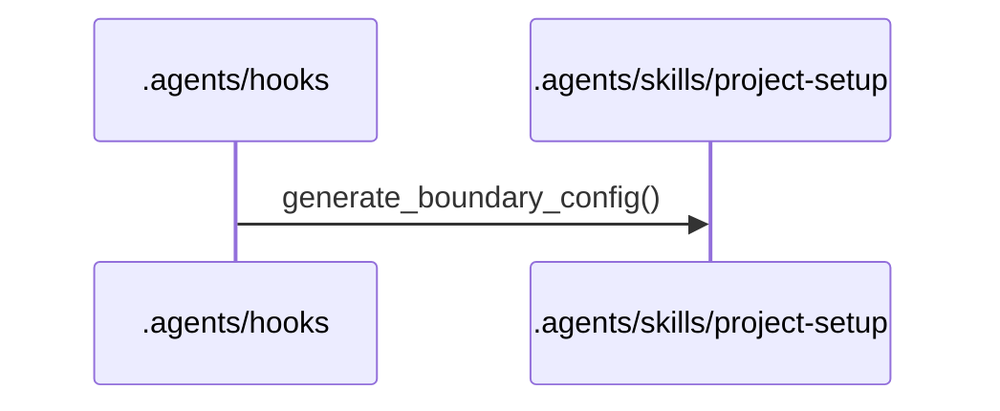
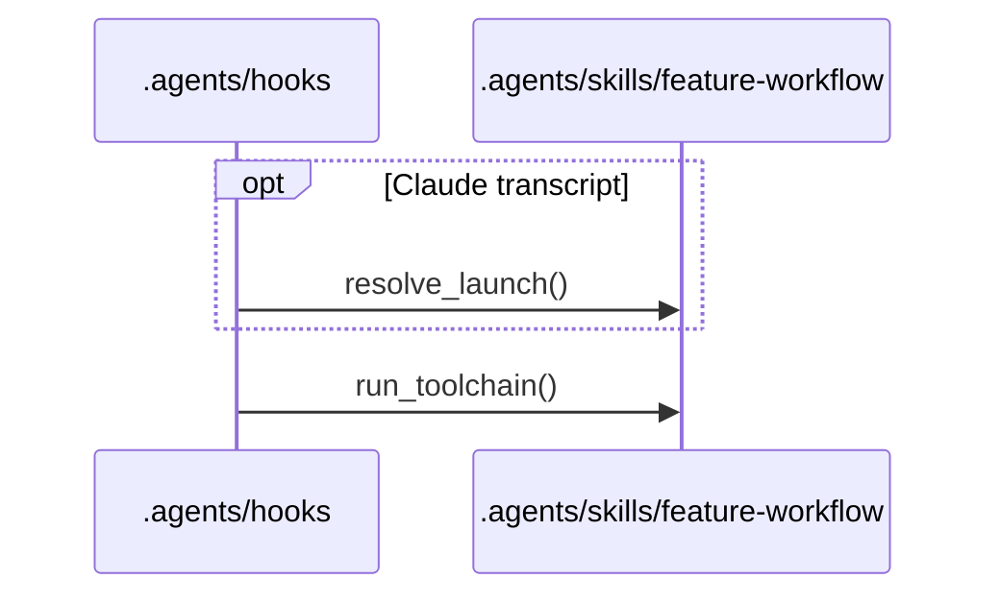
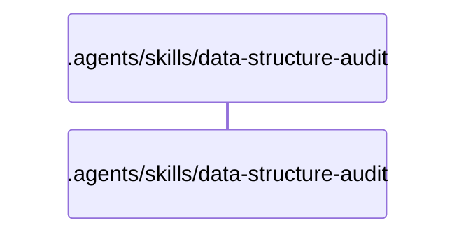
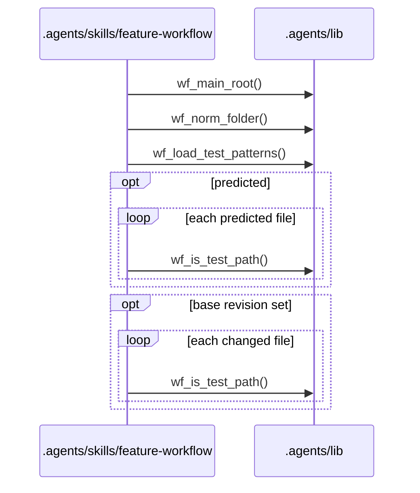
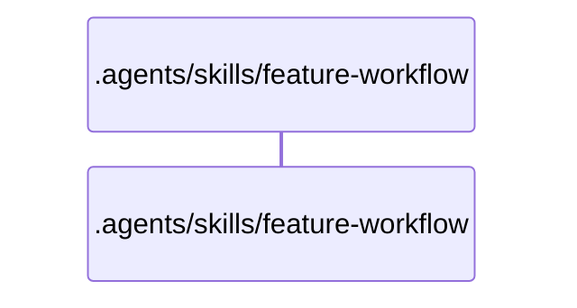
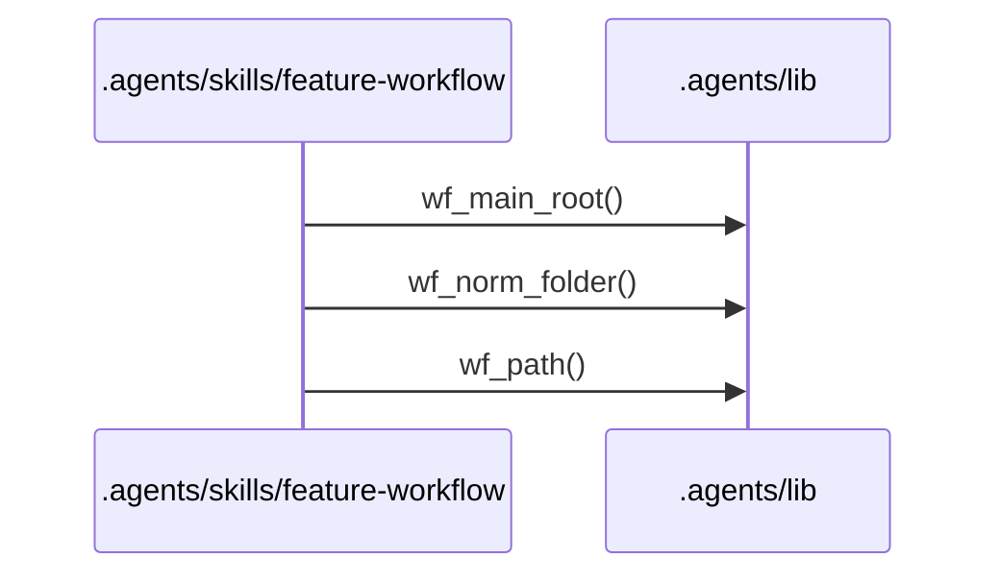
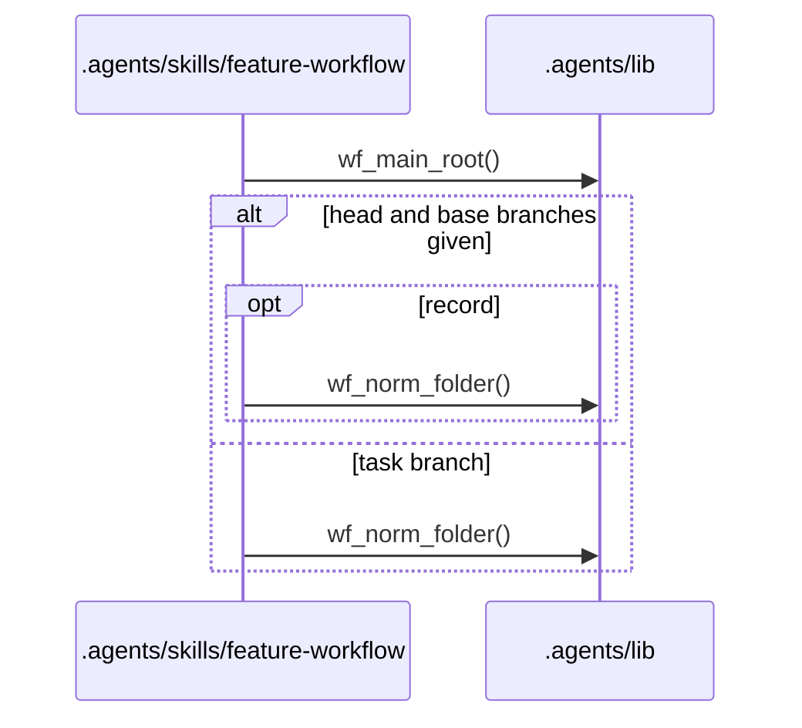
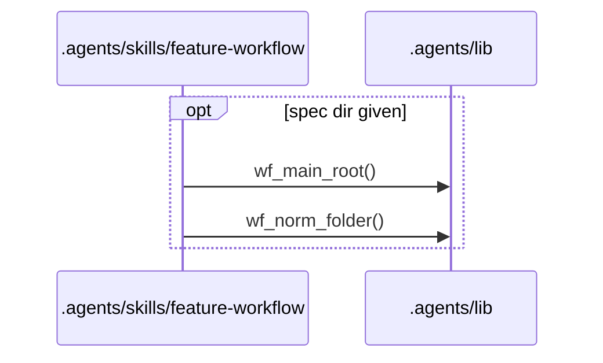
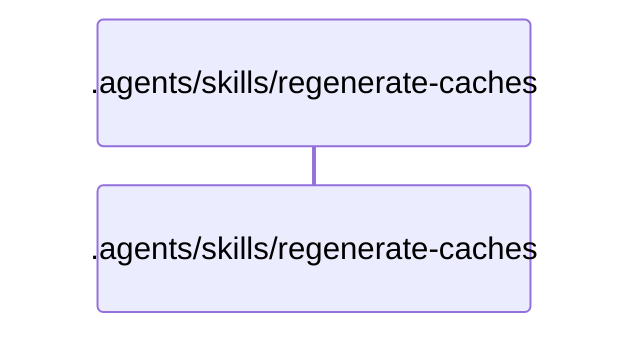

# Flows

## Entry points

- `.agents/hooks/codex-rules-sync.sh`
- `.agents/hooks/post-implementation-audit.sh`
- `.agents/hooks/spec-single-writer-guard.sh`
- `.agents/hooks/tier-a-write-guard.sh`
- `.agents/hooks/tier-b-write-guard.sh`
- `.agents/skills/data-structure-audit/scripts/audit_scope.sh`
- `.agents/skills/feature-workflow/scripts/budget-check.sh`
- `.agents/skills/feature-workflow/scripts/check-review-findings.sh`
- `.agents/skills/feature-workflow/scripts/check-task-result.sh`
- `.agents/skills/feature-workflow/scripts/commit-workflow-data.sh`
- `.agents/skills/feature-workflow/scripts/open-task-pr.sh`
- `.agents/skills/feature-workflow/scripts/task-waves.sh`
- `.agents/skills/regenerate-caches/scripts/cache-stamp-check.sh`
- `.agents/skills/regenerate-caches/scripts/extractors/dependency-cruiser.sh`
- `.agents/skills/regenerate-caches/scripts/publish-cache.sh`

## .agents/hooks/codex-rules-sync.sh

Error branches:
- `.agents/hooks/codex-rules-sync.sh` `codex_rules_sync()`: exits 0 with no output when jq is missing, the payload is not an apply_patch call, or the patch does not parse
- `.agents/hooks/rules-boundary-config-sync.sh` `rules_boundary_config_sync()`: prints a block decision when generate-boundary-config.sh exits 2 (the rules.md boundary blocks do not parse)
- `.agents/hooks/rules-boundary-config-sync.sh` `rules_boundary_config_sync()`: prints a systemMessage when generate-boundary-config.sh exits with another non-zero code

## .agents/hooks/post-implementation-audit.sh

Error branches:
- `.agents/hooks/post-implementation-audit.sh` `claude_task()`: allows the stop with a systemMessage when the transcript has no user text or resolve-launch.sh exits non-zero
- `.agents/hooks/post-implementation-audit.sh` `codex_task()`: allows the stop with a systemMessage when the task_name does not match one spec folder, one profile or an existing worktree
- `.agents/hooks/post-implementation-audit.sh` `post_implementation_audit()`: allows the stop with a gave-up systemMessage after 3 identical toolchain failures in a row
- `.agents/hooks/post-implementation-audit.sh` `post_implementation_audit()`: allows the stop with a systemMessage when the transcript is missing, the header has no spec_dir, no task worktree exists, or run-toolchain.sh exits other than 0 or 1
- `.agents/hooks/post-implementation-audit.sh` `post_implementation_audit()`: prints a block decision with the toolchain digest when run-toolchain.sh exits 1

## .agents/hooks/spec-single-writer-guard.sh

Error branches:
- `.agents/hooks/_guard-common.sh` `guard_on_exit()`: prints a static deny when the guard exits non-zero before a decision
- `.agents/hooks/_guard-common.sh` `run_guard()`: denies fail closed when check-write.sh exits with a non-zero code other than 2
- `.agents/hooks/_guard-common.sh` `run_guard()`: denies when check-write.sh exits 2, with its stderr as the reason
- `.agents/hooks/_guard-common.sh` `run_guard()`: denies when jq is missing or the payload does not parse
- `.agents/hooks/_guard-common.sh` `run_guard()`: denies when the proposed Edit content cannot be computed

## .agents/hooks/tier-a-write-guard.sh

Error branches:
- `.agents/hooks/_guard-common.sh` `guard_on_exit()`: prints a static deny when the guard exits non-zero before a decision
- `.agents/hooks/_guard-common.sh` `run_guard()`: denies fail closed when check-write.sh exits with a non-zero code other than 2
- `.agents/hooks/_guard-common.sh` `run_guard()`: denies when check-write.sh exits 2, with its stderr as the reason
- `.agents/hooks/_guard-common.sh` `run_guard()`: denies when jq is missing or the payload does not parse

## .agents/hooks/tier-b-write-guard.sh

Error branches:
- `.agents/hooks/_guard-common.sh` `guard_on_exit()`: prints a static deny when the guard exits non-zero before a decision
- `.agents/hooks/_guard-common.sh` `run_guard()`: denies fail closed when check-write.sh exits with a non-zero code other than 2
- `.agents/hooks/_guard-common.sh` `run_guard()`: denies when check-write.sh exits 2, with its stderr as the reason
- `.agents/hooks/_guard-common.sh` `run_guard()`: denies when jq is missing or the payload does not parse

## .agents/skills/data-structure-audit/scripts/audit_scope.sh

Error branches:
- `.agents/skills/data-structure-audit/scripts/audit_scope.sh` `audit_scope()`: exits 1 with NOT_A_GIT_REPO when record runs outside a git repository
- `.agents/skills/data-structure-audit/scripts/audit_scope.sh` `audit_scope()`: exits 1 with the usage line on an unknown command
- `.agents/skills/data-structure-audit/scripts/audit_scope.sh` `audit_scope()`: prints FULL_AUDIT when there is no state file or no audited commit usable from HEAD
- `.agents/skills/data-structure-audit/scripts/audit_scope.sh` `audit_scope()`: prints NOT_A_GIT_REPO and exits 0 when scope runs outside a git repository

## .agents/skills/feature-workflow/scripts/budget-check.sh

Error branches:
- `.agents/skills/feature-workflow/scripts/budget-check.sh` `budget_check()`: exits 1 on a usage error, missing jq or mikefarah yq, a path outside a git repository, a bad spec dir, a missing spec.md or tasks.md, or an unknown base commit
- `.agents/skills/feature-workflow/scripts/budget-check.sh` `budget_check()`: exits 1 when rules-setting.sh cannot read main_branch
- `.agents/skills/feature-workflow/scripts/budget-check.sh` `budget_check()`: exits 1 when wf_load_test_patterns() rejects a profile's test_patterns
- `.agents/skills/feature-workflow/scripts/budget-check.sh` `budget_check()`: exits 2 when the task count or the changed-file count is over budget
- `.agents/skills/feature-workflow/scripts/budget-check.sh` `read_budget()`: exits 1 when a budget is not a map of non-negative integers

## .agents/skills/feature-workflow/scripts/check-review-findings.sh

Error branches:
- `.agents/skills/feature-workflow/scripts/check-review-findings.sh` `check_review_findings()`: exits 1 and prints one line per shape error
- `.agents/skills/feature-workflow/scripts/check-review-findings.sh` `check_review_findings()`: exits 2 on a usage error, missing jq or mikefarah yq, a missing or unreadable file, YAML that does not parse, or a jq failure

## .agents/skills/feature-workflow/scripts/check-task-result.sh

Error branches:
- `.agents/skills/feature-workflow/scripts/check-task-result.sh` `check_task_result()`: exits 1 and prints one line per shape error
- `.agents/skills/feature-workflow/scripts/check-task-result.sh` `check_task_result()`: exits 2 on a usage error, missing jq or mikefarah yq, a missing or unreadable file, an unknown kind, YAML that does not parse, or a jq failure

## .agents/skills/feature-workflow/scripts/commit-workflow-data.sh

Error branches:
- `.agents/skills/feature-workflow/scripts/commit-workflow-data.sh` `commit_workflow_data()`: exits 1 when the main checkout is not on the spec branch or a merge, cherry-pick or revert is in progress
- `.agents/skills/feature-workflow/scripts/commit-workflow-data.sh` `commit_workflow_data()`: exits 2 on a usage error, missing yq, a path outside a git repository, a bad spec dir, a missing spec.md, local state that is not gitignored, or a failed git commit
- `.agents/skills/feature-workflow/scripts/commit-workflow-data.sh` `stage()`: exits 2 when git add fails

## .agents/skills/feature-workflow/scripts/open-task-pr.sh

Error branches:
- `.agents/skills/feature-workflow/scripts/open-task-pr.sh` `open_task_pr()`: exits 1 (task form) or 2 (generic form) on a usage error or a path outside a git repository
- `.agents/skills/feature-workflow/scripts/open-task-pr.sh` `open_task_pr()`: exits 1 on a bad task id or spec dir, missing yq, a missing spec.md or tasks.md, or a task id not listed exactly once
- `.agents/skills/feature-workflow/scripts/open-task-pr.sh` `open_task_pr()`: warns on stderr when status-transition.sh or initiative-transition.sh cannot record the URL
- `.agents/skills/feature-workflow/scripts/open-task-pr.sh` `skip()`: prints "skipped: <reason>" and exits 0 when task_review is local or unreadable, a branch or the origin remote is missing, the host is not GitHub or GitLab, the CLI is missing or logged out, the push fails, or no PR/MR URL comes back

## .agents/skills/feature-workflow/scripts/task-waves.sh

Error branches:
- `.agents/skills/feature-workflow/scripts/task-waves.sh` `task_waves()`: exits 1 on a usage error, missing jq or mikefarah yq, a path outside a git repository, a bad spec dir, a missing tasks.md, no tasks array, or a jq evaluation failure
- `.agents/skills/feature-workflow/scripts/task-waves.sh` `task_waves()`: exits 2 when the task graph has a cycle, an unknown id or a duplicate id

## .agents/skills/regenerate-caches/scripts/cache-stamp-check.sh

Error branches:
- `.agents/skills/regenerate-caches/scripts/cache-stamp-check.sh` `cache_stamp_check()`: exits 1 when a cache is missing or stale
- `.agents/skills/regenerate-caches/scripts/cache-stamp-check.sh` `cache_stamp_check()`: exits 2 on a usage error, missing git, jq or mikefarah yq, or a path outside a git repository
- `.agents/skills/regenerate-caches/scripts/cache-stamp-check.sh` `cache_stamp_check()`: exits 2 when a cache's frontmatter fails the schema, its cache_type does not match its file name, or its commit is not in the repository

## .agents/skills/regenerate-caches/scripts/extractors/dependency-cruiser.sh

Error branches:
- `.agents/skills/regenerate-caches/scripts/extractors/dependency-cruiser.sh` `dependency_cruiser()`: exits 2 on a usage error, a missing --root or --scope, a root that does not exist, depcruise not found, or a failed depcruise run

## .agents/skills/regenerate-caches/scripts/publish-cache.sh

Error branches:
- `.agents/skills/regenerate-caches/scripts/publish-cache.sh` `publish_cache()`: exits 1 when the staged file is missing, outside the staging folder or has an empty body, or the stamped file fails the schema
- `.agents/skills/regenerate-caches/scripts/publish-cache.sh` `publish_cache()`: exits 2 on a usage error, missing git, jq or mikefarah yq, an unknown cache type, an empty generator, a scope path that is absolute or has '..' or a glob, or a path outside a git repository
