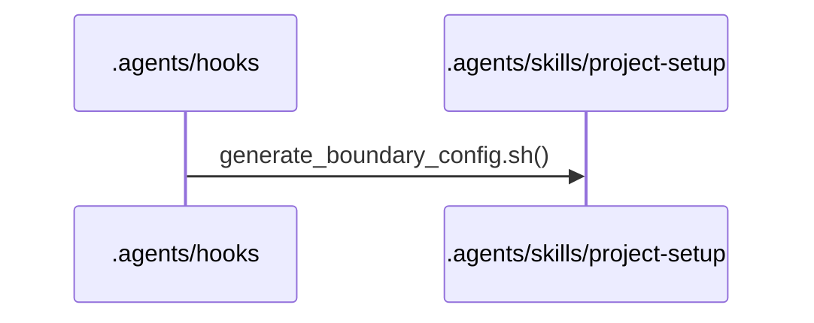
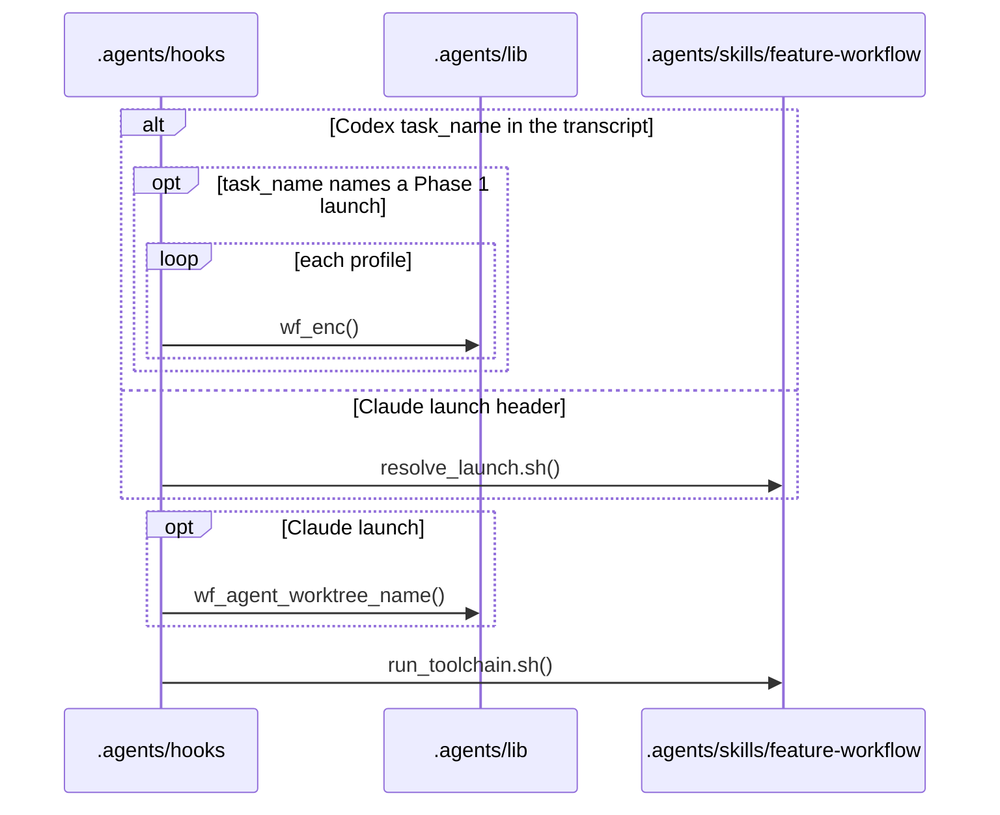
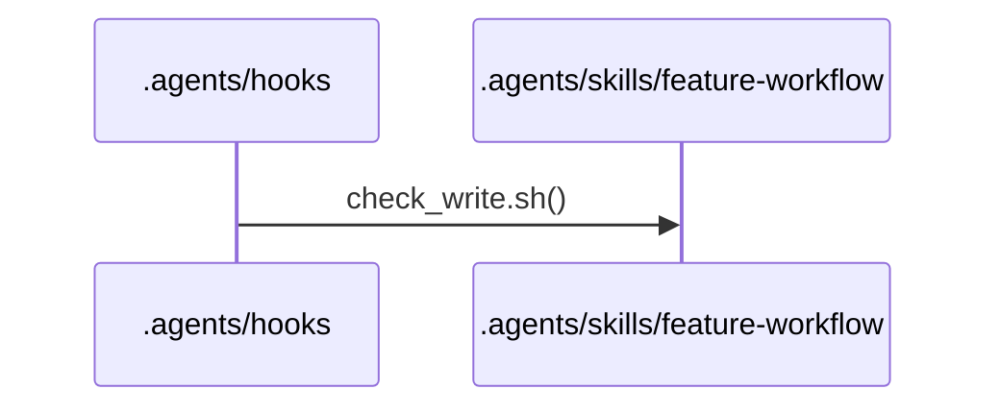
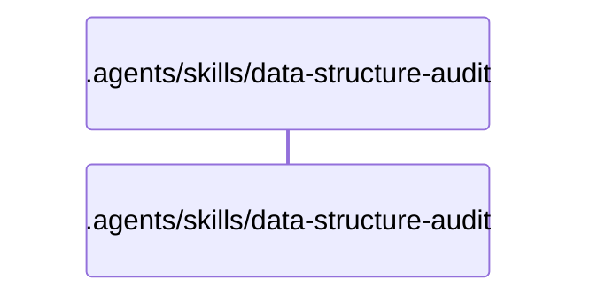
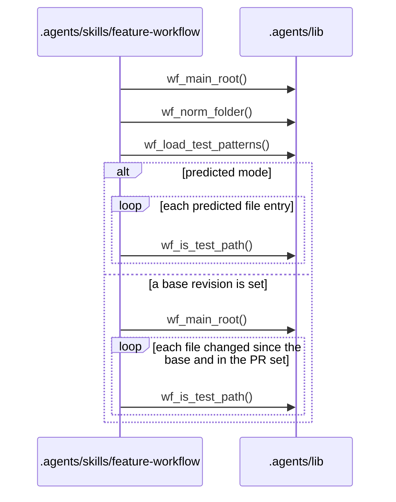
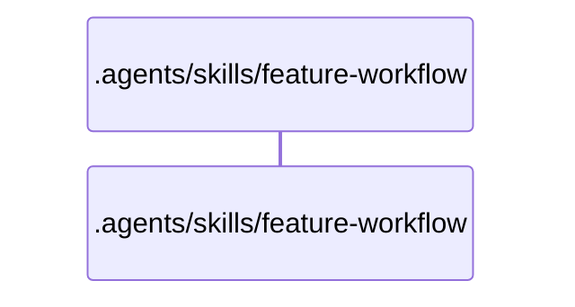
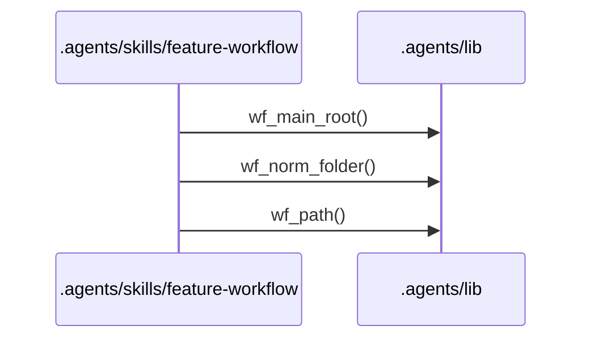
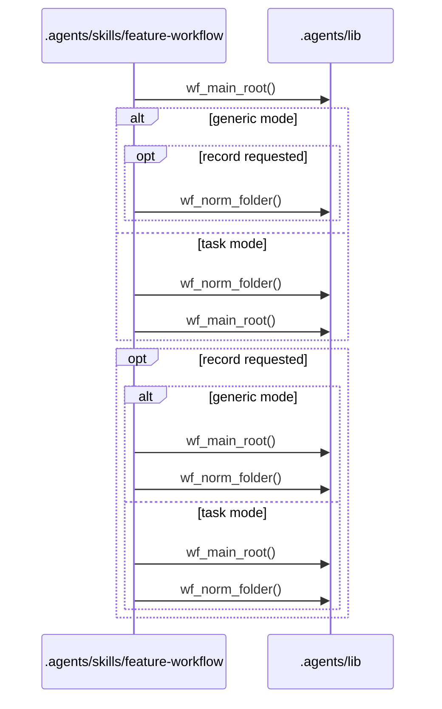
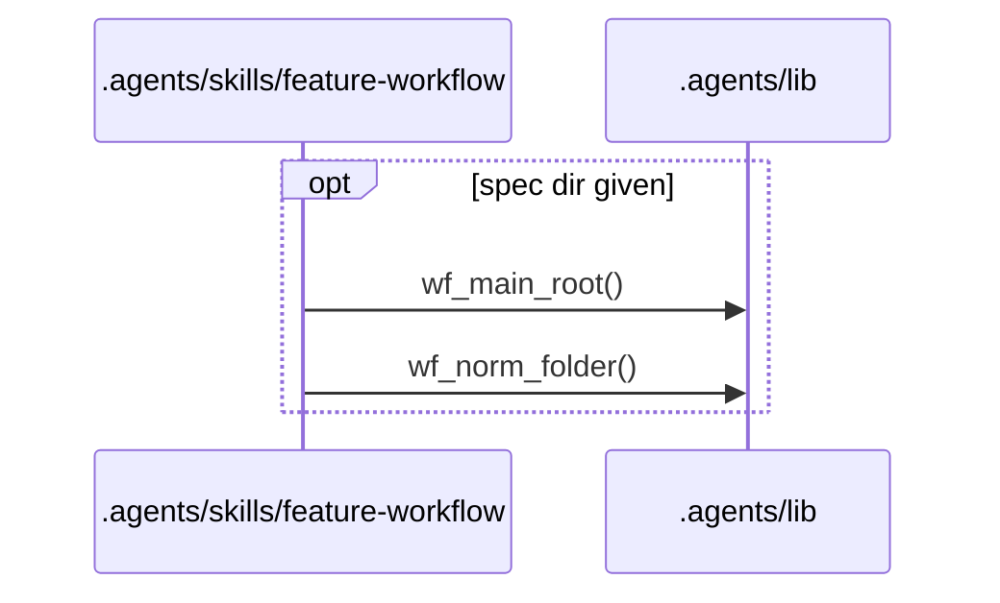
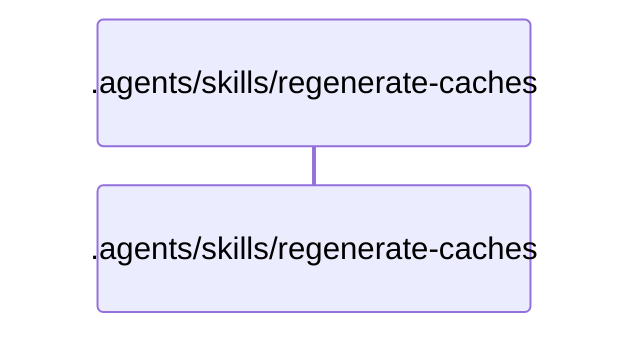

# Flows

## Entry points

- `.agents/hooks/codex-rules-sync.sh`
- `.agents/hooks/post-implementation-audit.sh`
- `.agents/hooks/spec-single-writer-guard.sh`
- `.agents/hooks/tier-a-write-guard.sh`
- `.agents/hooks/tier-b-write-guard.sh`
- `.agents/skills/data-structure-audit/scripts/audit_scope.sh`
- `.agents/skills/feature-workflow/scripts/budget-check.sh`
- `.agents/skills/feature-workflow/scripts/check-pr-body.sh`
- `.agents/skills/feature-workflow/scripts/check-review-findings.sh`
- `.agents/skills/feature-workflow/scripts/commit-workflow-data.sh`
- `.agents/skills/feature-workflow/scripts/open-task-pr.sh`
- `.agents/skills/feature-workflow/scripts/task-waves.sh`
- `.agents/skills/regenerate-caches/scripts/cache-stamp-check.sh`
- `.agents/skills/regenerate-caches/scripts/extractors/dependency-cruiser.sh`
- `.agents/skills/regenerate-caches/scripts/publish-cache.sh`

## .agents/hooks/codex-rules-sync.sh

Error branches:
- `.agents/hooks/rules-boundary-config-sync.sh` `main()`: prints a `decision: block` JSON with the generator's stderr when generate-boundary-config.sh exits 2
- `.agents/hooks/rules-boundary-config-sync.sh` `main()`: prints a `systemMessage` JSON when generate-boundary-config.sh exits with a code other than 0 or 2
- `.agents/skills/project-setup/scripts/generate-boundary-config.sh` `build_intermediate()`: exits 2 when rules.md is missing, or its Ownership or Shared core section has no fenced yaml block, more than one, or one that is not valid YAML
- `.agents/skills/project-setup/scripts/generate-boundary-config.sh` `main()`: exits 2 when the parsed rules fail validation
- `.agents/skills/project-setup/scripts/generate-boundary-config.sh` `require_tools()`: exits 3 when jq or mikefarah yq v4 is missing

## .agents/hooks/post-implementation-audit.sh

Error branches:
- `.agents/hooks/post-implementation-audit.sh` `main()`: allows the stop with a `systemMessage` and writes audit.json with outcome gave-up after 3 identical toolchain failures in a row
- `.agents/hooks/post-implementation-audit.sh` `main()`: blocks the stop with the toolchain digest as the reason when run-toolchain.sh exits 1
- `.agents/hooks/post-implementation-audit.sh` `warn_allow()`: allows the stop with a `systemMessage` and an audit warning when the transcript, launch header, Codex task_name, work_type or agent worktree does not identify the task, or run-toolchain.sh exits with a code other than 0 or 1
- `.agents/skills/feature-workflow/scripts/resolve-launch.sh` `main()`: exits 2 when the launch header is missing, malformed or names another task_type
- `.agents/skills/feature-workflow/scripts/run-toolchain.sh` `main()`: exits 1 when a toolchain command fails and 2 on a usage or config error

## .agents/hooks/spec-single-writer-guard.sh

Error branches:
- `.agents/hooks/_guard-common.sh` `guard_on_exit()`: prints a static deny when the guard exits non-zero before a decision
- `.agents/hooks/_guard-common.sh` `run_guard()`: denies fail closed when check-write.sh exits with a code other than 0 or 2
- `.agents/hooks/_guard-common.sh` `run_guard()`: denies when the hook payload does not parse
- `.agents/hooks/_guard-common.sh` `run_guard()`: denies when the proposed content of an Edit cannot be computed
- `.agents/hooks/_guard-common.sh` `run_guard()`: denies with a static reason when jq is not found
- `.agents/hooks/_guard-common.sh` `run_guard()`: denies with check-write.sh's stderr when it exits 2
- `.agents/skills/feature-workflow/scripts/check-write.sh` `main()`: exits 1 on a usage error, a --cwd that is not a directory or a missing --proposed file
- `.agents/skills/feature-workflow/scripts/check-write.sh` `main()`: exits 1 when the main checkout cannot be located
- `.agents/skills/feature-workflow/scripts/check-write.sh` `main()`: exits 2 for a spec or initiative .step marker
- `.agents/skills/feature-workflow/scripts/check-write.sh` `main()`: exits 2 for a work-backlog item with a bad name, or when its origin spec is not at 00.26 or 5.9 and the newest spec step is not 0.1.4
- `.agents/skills/feature-workflow/scripts/check-write.sh` `main()`: exits 2 for initiative.md outside steps 6.1, 6.7 or 6.9
- `.agents/skills/feature-workflow/scripts/check-write.sh` `main()`: exits 2 for spec.md with no step marker or a step outside its list
- `.agents/skills/feature-workflow/scripts/check-write.sh` `main()`: exits 2 for tasks.md or a task body outside steps 2.5 or 0.3.20
- `.agents/skills/feature-workflow/scripts/check-write.sh` `main()`: exits 2 when a sub-agent writes a guarded path
- `.agents/skills/feature-workflow/scripts/check-write.sh` `main()`: exits 2 when the proposed spec.md frontmatter does not parse or changes status or blocked_condition
- `.agents/skills/feature-workflow/scripts/check-write.sh` `require_yq()`: exits 1 when yq is missing or is not mikefarah yq v4

## .agents/hooks/tier-a-write-guard.sh

Error branches:
- `.agents/hooks/_guard-common.sh` `guard_on_exit()`: prints a static deny when the guard exits non-zero before a decision
- `.agents/hooks/_guard-common.sh` `run_guard()`: denies fail closed when check-write.sh exits with a code other than 0 or 2
- `.agents/hooks/_guard-common.sh` `run_guard()`: denies when the hook payload does not parse
- `.agents/hooks/_guard-common.sh` `run_guard()`: denies with a static reason when jq is not found
- `.agents/hooks/_guard-common.sh` `run_guard()`: denies with check-write.sh's stderr when it exits 2
- `.agents/skills/feature-workflow/scripts/check-write.sh` `main()`: exits 1 on a usage error, a --cwd that is not a directory or a missing --proposed file
- `.agents/skills/feature-workflow/scripts/check-write.sh` `main()`: exits 1 when the main checkout cannot be located
- `.agents/skills/feature-workflow/scripts/check-write.sh` `main()`: exits 2 for review-lessons.md when no feature is in flight
- `.agents/skills/feature-workflow/scripts/check-write.sh` `main()`: exits 2 when a feature is in flight but no in-flight spec or initiative has a step marker
- `.agents/skills/feature-workflow/scripts/check-write.sh` `main()`: exits 2 when a sub-agent writes a guarded path
- `.agents/skills/feature-workflow/scripts/check-write.sh` `main()`: exits 2 when the newest in-flight step is not one the path's class allows
- `.agents/skills/feature-workflow/scripts/check-write.sh` `require_yq()`: exits 1 when yq is missing or is not mikefarah yq v4

## .agents/hooks/tier-b-write-guard.sh

Error branches:
- `.agents/hooks/_guard-common.sh` `guard_on_exit()`: prints a static deny when the guard exits non-zero before a decision
- `.agents/hooks/_guard-common.sh` `run_guard()`: denies fail closed when check-write.sh exits with a code other than 0 or 2
- `.agents/hooks/_guard-common.sh` `run_guard()`: denies when the hook payload does not parse
- `.agents/hooks/_guard-common.sh` `run_guard()`: denies with a static reason when jq is not found
- `.agents/hooks/_guard-common.sh` `run_guard()`: denies with check-write.sh's stderr when it exits 2
- `.agents/skills/feature-workflow/scripts/check-write.sh` `main()`: exits 1 on a usage error, a --cwd that is not a directory or a missing --proposed file
- `.agents/skills/feature-workflow/scripts/check-write.sh` `main()`: exits 2 when the path is under .workflow/cache/

## .agents/skills/data-structure-audit/scripts/audit_scope.sh

Error branches:
- `.agents/skills/data-structure-audit/scripts/audit_scope.sh` `main()`: exits 1 on an unknown command
- `.agents/skills/data-structure-audit/scripts/audit_scope.sh` `main()`: exits 1 printing NOT_A_GIT_REPO when `record` runs outside a git repository

## .agents/skills/feature-workflow/scripts/budget-check.sh

Error branches:
- `.agents/lib/test-paths.sh` `wf_profile_test_patterns()`: returns 1 when a Toolchain yaml block does not parse or test_patterns is not a list of non-empty strings
- `.agents/skills/feature-workflow/scripts/budget-check.sh` `main()`: exits 1 on a usage error, a --cwd that is not a directory, or missing jq or mikefarah yq v4
- `.agents/skills/feature-workflow/scripts/budget-check.sh` `main()`: exits 1 when a profile's test_patterns is invalid
- `.agents/skills/feature-workflow/scripts/budget-check.sh` `main()`: exits 1 when rules-setting.sh cannot read main_branch
- `.agents/skills/feature-workflow/scripts/budget-check.sh` `main()`: exits 1 when spec.md or tasks.md is missing in the main checkout, or tasks.md has no tasks: array
- `.agents/skills/feature-workflow/scripts/budget-check.sh` `main()`: exits 1 when the base revision is not a commit or git diff fails
- `.agents/skills/feature-workflow/scripts/budget-check.sh` `main()`: exits 1 when the spec dir is not .workflow/specs/NNN-slug or --cwd is not inside a git repository
- `.agents/skills/feature-workflow/scripts/budget-check.sh` `main()`: exits 1 with --predicted when a counted task has no integer size.files
- `.agents/skills/feature-workflow/scripts/budget-check.sh` `main()`: exits 2 when the task count or the changed-file count is over budget
- `.agents/skills/feature-workflow/scripts/budget-check.sh` `read_budget()`: exits 1 when a budget is not a map of non-negative integers max_tasks and max_changed_files
- `.agents/skills/feature-workflow/scripts/rules-setting.sh` `main()`: exits 1 when yq is missing, the Workflow settings block does not parse, or main_branch is not a valid branch name

## .agents/skills/feature-workflow/scripts/check-pr-body.sh

Error branches:
- `.agents/skills/feature-workflow/scripts/check-pr-body.sh` `main()`: exits 1 printing one `<field>: <problem>` line per missing, empty or out-of-order section, or missing or off-scale score
- `.agents/skills/feature-workflow/scripts/check-pr-body.sh` `main()`: exits 2 on a usage error
- `.agents/skills/feature-workflow/scripts/check-pr-body.sh` `main()`: exits 2 when the template has no headings, or the workflow template has no Risk and reversibility heading
- `.agents/skills/feature-workflow/scripts/check-pr-body.sh` `require_readable()`: exits 2 when the body or the template is missing or unreadable

## .agents/skills/feature-workflow/scripts/check-review-findings.sh

Error branches:
- `.agents/skills/feature-workflow/scripts/check-review-findings.sh` `main()`: exits 1 printing one `<field>: <problem>` line per shape error
- `.agents/skills/feature-workflow/scripts/check-review-findings.sh` `main()`: exits 2 on a usage error, missing jq or mikefarah yq v4, or a missing or unreadable file
- `.agents/skills/feature-workflow/scripts/check-review-findings.sh` `main()`: exits 2 when the YAML does not parse or jq fails

## .agents/skills/feature-workflow/scripts/commit-workflow-data.sh

Error branches:
- `.agents/skills/feature-workflow/scripts/commit-workflow-data.sh` `main()`: exits 1 when a merge, cherry-pick or revert is in progress in the main checkout
- `.agents/skills/feature-workflow/scripts/commit-workflow-data.sh` `main()`: exits 1 when the main checkout is not on the spec branch
- `.agents/skills/feature-workflow/scripts/commit-workflow-data.sh` `main()`: exits 2 on a usage error, missing yq, no git repository, a spec dir that is not .workflow/specs/NNN-slug, or a missing or unreadable spec.md
- `.agents/skills/feature-workflow/scripts/commit-workflow-data.sh` `main()`: exits 2 when git commit fails
- `.agents/skills/feature-workflow/scripts/commit-workflow-data.sh` `main()`: exits 2 when local workflow state is not gitignored
- `.agents/skills/feature-workflow/scripts/commit-workflow-data.sh` `stage()`: exits 2 when git add fails

## .agents/skills/feature-workflow/scripts/open-task-pr.sh

Error branches:
- `.agents/skills/feature-workflow/scripts/open-task-pr.sh` `main()`: exits 1 on a task-mode usage error, a task id that is not T<n>, missing mikefarah yq v4, no git repository, or a spec.md, tasks.md or single task record that is not found
- `.agents/skills/feature-workflow/scripts/open-task-pr.sh` `main()`: exits 2 on a generic-mode usage error, a --record directory without initiative.md, or a --cwd outside a git repository
- `.agents/skills/feature-workflow/scripts/open-task-pr.sh` `main()`: prints a warning and still exits 0 when initiative-transition.sh or status-transition.sh cannot record the URL
- `.agents/skills/feature-workflow/scripts/open-task-pr.sh` `skip()`: prints `skipped: <reason>` and exits 0 when task_review is local, a branch or the origin remote is missing, the host is not GitHub or GitLab, the CLI is missing or not logged in, or push or create gives no URL

## .agents/skills/feature-workflow/scripts/task-waves.sh

Error branches:
- `.agents/skills/feature-workflow/scripts/task-waves.sh` `main()`: exits 1 on a usage error or missing jq or mikefarah yq v4
- `.agents/skills/feature-workflow/scripts/task-waves.sh` `main()`: exits 1 when --cwd is not a directory in a git repository or the spec dir is not .workflow/specs/NNN-slug
- `.agents/skills/feature-workflow/scripts/task-waves.sh` `main()`: exits 1 when jq cannot evaluate tasks.md
- `.agents/skills/feature-workflow/scripts/task-waves.sh` `main()`: exits 1 when tasks.md is missing, unreadable or has no tasks: array
- `.agents/skills/feature-workflow/scripts/task-waves.sh` `main()`: exits 2 when the task graph has a cycle, an unknown id or a duplicate id

## .agents/skills/regenerate-caches/scripts/cache-stamp-check.sh

Error branches:
- `.agents/skills/regenerate-caches/scripts/cache-stamp-check.sh` `main()`: exits 1 when a cache is stale or missing and none is invalid
- `.agents/skills/regenerate-caches/scripts/cache-stamp-check.sh` `main()`: exits 2 on a usage error, missing git, jq or mikefarah yq v4, or no git repository
- `.agents/skills/regenerate-caches/scripts/cache-stamp-check.sh` `main()`: exits 2 when a cache's frontmatter is missing, fails the schema, names another cache_type or stamps an unknown commit

## .agents/skills/regenerate-caches/scripts/extractors/dependency-cruiser.sh

Error branches:
- `.agents/skills/regenerate-caches/scripts/extractors/dependency-cruiser.sh` `main()`: exits 2 on a usage error or a root that is not found
- `.agents/skills/regenerate-caches/scripts/extractors/dependency-cruiser.sh` `main()`: exits 2 when depcruise is not found or fails

## .agents/skills/regenerate-caches/scripts/publish-cache.sh

Error branches:
- `.agents/skills/regenerate-caches/scripts/publish-cache.sh` `main()`: exits 1 when the staged file is missing, outside the staging dir or has an empty body
- `.agents/skills/regenerate-caches/scripts/publish-cache.sh` `main()`: exits 1 when the stamped file fails the cache-frontmatter schema
- `.agents/skills/regenerate-caches/scripts/publish-cache.sh` `main()`: exits 2 on a usage error, a bad cache type, generator or scope path, missing git, jq or mikefarah yq v4, or no git repository
