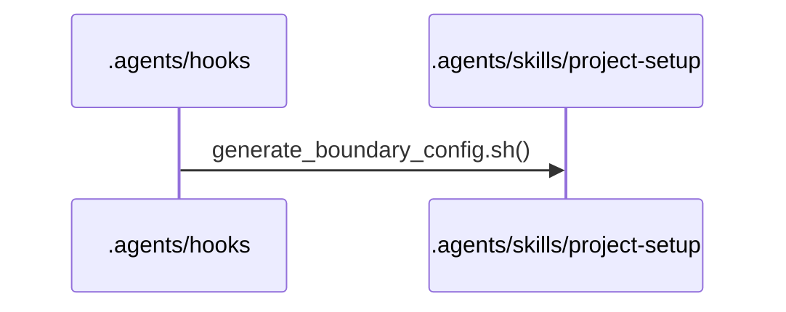
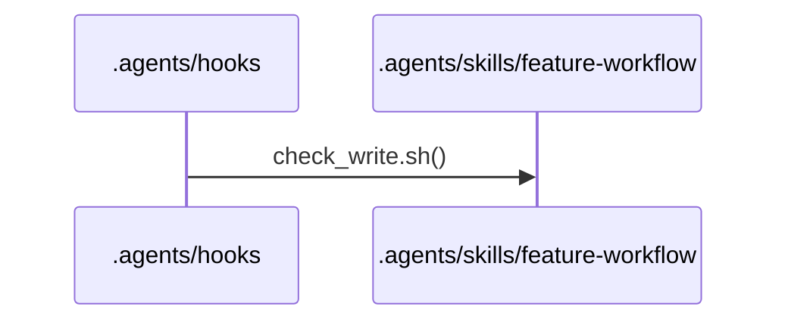
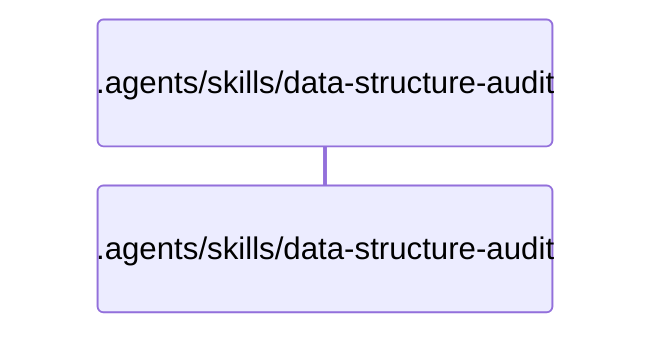
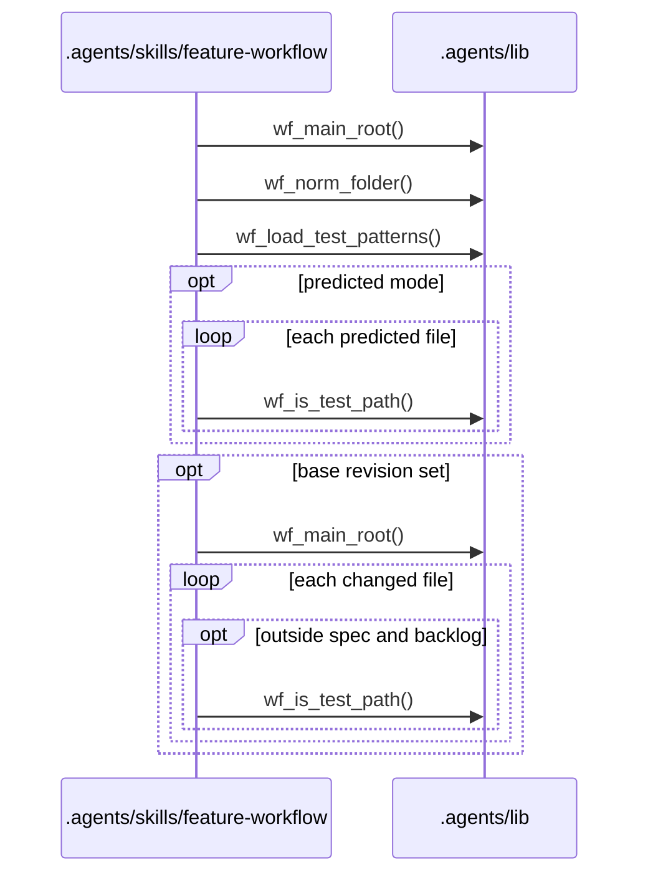
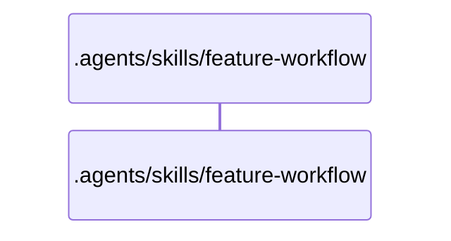
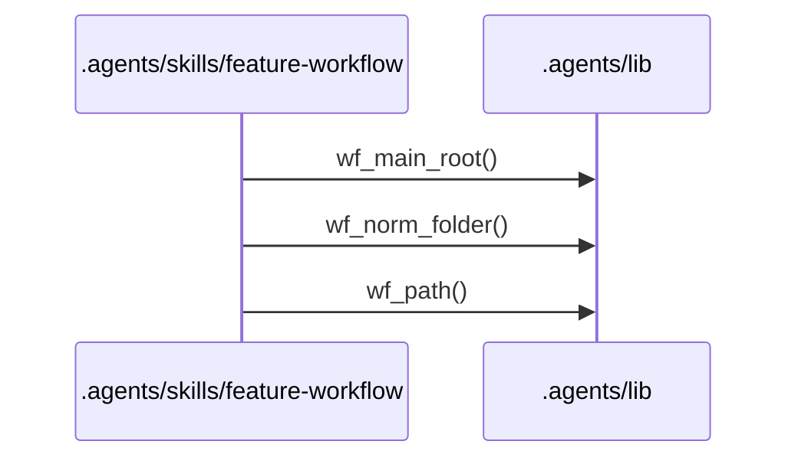
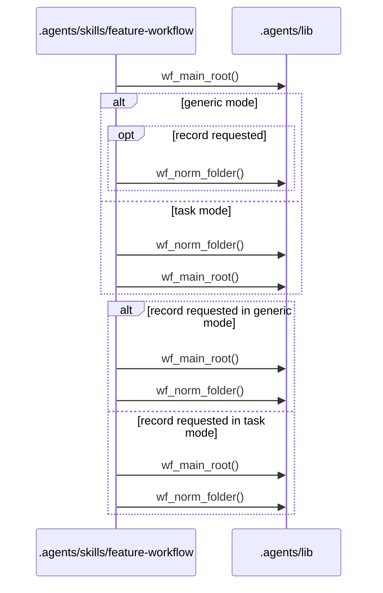
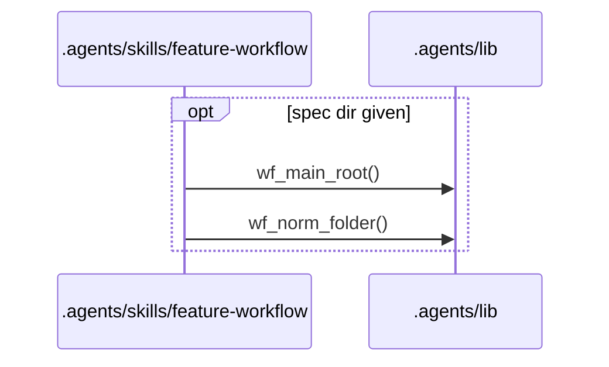
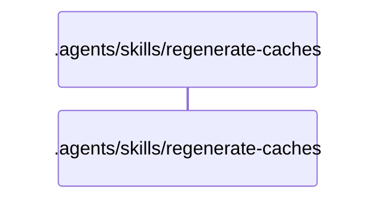

# Flows

## Entry points

- `.agents/hooks/codex-rules-sync.sh`
- `.agents/hooks/post-implementation-audit.sh`
- `.agents/hooks/spec-single-writer-guard.sh`
- `.agents/hooks/tier-a-write-guard.sh`
- `.agents/hooks/tier-b-write-guard.sh`
- `.agents/skills/data-structure-audit/scripts/audit_scope.sh`
- `.agents/skills/feature-workflow/scripts/budget-check.sh`
- `.agents/skills/feature-workflow/scripts/check-pr-body.sh`
- `.agents/skills/feature-workflow/scripts/check-review-findings.sh`
- `.agents/skills/feature-workflow/scripts/commit-workflow-data.sh`
- `.agents/skills/feature-workflow/scripts/open-task-pr.sh`
- `.agents/skills/feature-workflow/scripts/task-waves.sh`
- `.agents/skills/regenerate-caches/scripts/cache-stamp-check.sh`
- `.agents/skills/regenerate-caches/scripts/extractors/dependency-cruiser.sh`
- `.agents/skills/regenerate-caches/scripts/publish-cache.sh`

## .agents/hooks/codex-rules-sync.sh

Error branches:
- `.agents/hooks/_codex-patch.sh` `codex_patch_paths()`: exits 1 with an `apply_patch parse error` on stderr when the patch text breaks the apply_patch grammar
- `.agents/hooks/_codex-patch.sh` `codex_patch_text()`: exits 1 when `tool_input.command` is neither a string nor an array ending in a string
- `.agents/hooks/codex-rules-sync.sh` `codex-rules-sync.sh()`: exits 0 with no output when jq is missing, the payload is not a JSON object, the tool is not apply_patch, the patch does not parse or no patch path ends in `.workflow/rules.md`
- `.agents/hooks/rules-boundary-config-sync.sh` `rules-boundary-config-sync.sh()`: prints `{"decision":"block","reason":...}` and exits 0 when the generator exits 2
- `.agents/hooks/rules-boundary-config-sync.sh` `rules-boundary-config-sync.sh()`: prints `{"systemMessage":...}` and exits 0 when the generator exits with any other non-zero code
- `.agents/skills/project-setup/scripts/generate-boundary-config.sh` `build_intermediate()`: exits 2 when `.workflow/rules.md` is not found
- `.agents/skills/project-setup/scripts/generate-boundary-config.sh` `extract_block()`: exits 2 when the Ownership or Shared core heading has no fenced yaml block or more than one
- `.agents/skills/project-setup/scripts/generate-boundary-config.sh` `main()`: exits 2 when the project directory is missing or the parsed rules do not validate
- `.agents/skills/project-setup/scripts/generate-boundary-config.sh` `require_tools()`: exits 3 when jq or mikefarah yq v4 is missing
- `.agents/skills/project-setup/scripts/generate-boundary-config.sh` `yaml_to_json()`: exits 2 when a block is not valid YAML

## .agents/hooks/post-implementation-audit.sh

Error branches:
- `.agents/hooks/post-implementation-audit.sh` `claude_task()`: allows the stop with a `systemMessage` warning when the transcript is not valid JSONL, holds no user text, or resolve-launch.sh exits non-zero (exit 2: launch header missing or malformed)
- `.agents/hooks/post-implementation-audit.sh` `codex_task()`: allows the stop with a `systemMessage` warning when the task_name is not s<NNN>_t<N> or s<NNN>_phase_1_<work_type>, names an integration batch, matches no single spec folder or profile, or has no worktree
- `.agents/hooks/post-implementation-audit.sh` `post-implementation-audit.sh()`: allows the stop with a `systemMessage` warning when an implementation agent's transcript is missing, the header has no spec_dir or work_type, or the agent ran in the main checkout with no agent worktree
- `.agents/hooks/post-implementation-audit.sh` `post-implementation-audit.sh()`: allows the stop with a `systemMessage` warning when run-toolchain.sh exits other than 0 or 1
- `.agents/hooks/post-implementation-audit.sh` `post-implementation-audit.sh()`: exits 0 with only a stderr note when jq is missing or the payload is not a JSON object
- `.agents/hooks/post-implementation-audit.sh` `post-implementation-audit.sh()`: prints `{"decision":"block","reason":<digest>}` when run-toolchain.sh exits 1
- `.agents/hooks/post-implementation-audit.sh` `post-implementation-audit.sh()`: records `gave-up` in audit.json and allows the stop with a `systemMessage` after 3 identical toolchain failures in a row

## .agents/hooks/spec-single-writer-guard.sh

Error branches:
- `.agents/hooks/_guard-common.sh` `guard_on_exit()`: prints the static deny JSON when the guard exits non-zero before a decision
- `.agents/hooks/_guard-common.sh` `run_guard()`: denies fail closed when check-write.sh exits with any other non-zero code
- `.agents/hooks/_guard-common.sh` `run_guard()`: denies fail closed when jq is missing or the payload does not parse
- `.agents/hooks/_guard-common.sh` `run_guard()`: denies fail closed when the proposed content of an Edit cannot be computed
- `.agents/hooks/_guard-common.sh` `run_guard()`: denies with check-write.sh's stderr when check-write.sh exits 2
- `.agents/skills/feature-workflow/scripts/check-write.sh` `check-write.sh()`: exits 1 on a usage or environment error (missing yq, bad --cwd or --only, missing --proposed file, main checkout not found)
- `.agents/skills/feature-workflow/scripts/check-write.sh` `check-write.sh()`: exits 2 with the deny reason on stderr when the current step does not allow the spec.md, tasks.md or task-body write, or the call comes from a sub-agent

## .agents/hooks/tier-a-write-guard.sh

Error branches:
- `.agents/hooks/_guard-common.sh` `guard_on_exit()`: prints the static deny JSON when the guard exits non-zero before a decision
- `.agents/hooks/_guard-common.sh` `run_guard()`: denies fail closed when check-write.sh exits with any other non-zero code
- `.agents/hooks/_guard-common.sh` `run_guard()`: denies fail closed when jq is missing or the payload does not parse
- `.agents/hooks/_guard-common.sh` `run_guard()`: denies with check-write.sh's stderr when check-write.sh exits 2
- `.agents/skills/feature-workflow/scripts/check-write.sh` `check-write.sh()`: exits 1 on a usage or environment error (missing yq, bad --cwd or --only, missing --proposed file, main checkout not found)
- `.agents/skills/feature-workflow/scripts/check-write.sh` `check-write.sh()`: exits 2 with the deny reason on stderr when the step marker does not allow the Tier A write, or the call comes from a sub-agent

## .agents/hooks/tier-b-write-guard.sh

Error branches:
- `.agents/hooks/_guard-common.sh` `guard_on_exit()`: prints the static deny JSON when the guard exits non-zero before a decision
- `.agents/hooks/_guard-common.sh` `run_guard()`: denies fail closed when check-write.sh exits with any other non-zero code
- `.agents/hooks/_guard-common.sh` `run_guard()`: denies fail closed when jq is missing or the payload does not parse
- `.agents/hooks/_guard-common.sh` `run_guard()`: denies with check-write.sh's stderr when check-write.sh exits 2
- `.agents/skills/feature-workflow/scripts/check-write.sh` `check-write.sh()`: exits 1 on a usage or environment error (missing yq, bad --cwd or --only, missing --proposed file, main checkout not found)
- `.agents/skills/feature-workflow/scripts/check-write.sh` `check-write.sh()`: exits 2 with the deny reason and a pointer to regenerate-caches on stderr for every write under `.workflow/cache/`

## .agents/skills/data-structure-audit/scripts/audit_scope.sh

Error branches:
- `.agents/skills/data-structure-audit/scripts/audit_scope.sh` `audit_scope.sh()`: exits 1 when record runs outside a git repository, printing `NOT_A_GIT_REPO` on stderr
- `.agents/skills/data-structure-audit/scripts/audit_scope.sh` `audit_scope.sh()`: exits 1 with a usage line when the command is not scope or record
- `.agents/skills/data-structure-audit/scripts/audit_scope.sh` `audit_scope.sh()`: prints `FULL_AUDIT` and exits 0 when the state file is missing or holds no commit usable from HEAD
- `.agents/skills/data-structure-audit/scripts/audit_scope.sh` `audit_scope.sh()`: prints `NOT_A_GIT_REPO` and exits 0 when scope runs outside a git repository

## .agents/skills/feature-workflow/scripts/budget-check.sh

Error branches:
- `.agents/skills/feature-workflow/scripts/budget-check.sh` `budget-check.sh()`: exits 1 when an argument is unknown, jq or mikefarah yq v4 is missing, the directory is outside a git repository, the spec dir is malformed or spec.md or tasks.md is missing
- `.agents/skills/feature-workflow/scripts/budget-check.sh` `budget-check.sh()`: exits 1 when tasks.md has no tasks array, a profile's test_patterns is invalid or (predicted mode) a counted task has no integer size.files
- `.agents/skills/feature-workflow/scripts/budget-check.sh` `budget-check.sh()`: exits 1 when the base revision is not a commit, git diff fails or rules-setting.sh cannot read main_branch
- `.agents/skills/feature-workflow/scripts/budget-check.sh` `budget-check.sh()`: exits 2 after printing the JSON when the task count or changed-file count is over its maximum
- `.agents/skills/feature-workflow/scripts/budget-check.sh` `budget-check.sh()`: warns on stderr and in `note` when impl_base_revision is unset or the target branch or its merge-base is missing
- `.agents/skills/feature-workflow/scripts/budget-check.sh` `read_budget()`: exits 1 when a budget is not a map of non-negative integers max_tasks and max_changed_files
- `.agents/skills/feature-workflow/scripts/budget-check.sh` `usage()`: exits 1 when --spec-dir or an option value is missing

## .agents/skills/feature-workflow/scripts/check-pr-body.sh

Error branches:
- `.agents/skills/feature-workflow/scripts/check-pr-body.sh` `check-pr-body.sh()`: exits 1 with one `<field>: <problem>` line per fault when a section is missing, empty or out of order, a Risk or Reversibility score is missing or off its scale, or Irreversible lacks Risk: High
- `.agents/skills/feature-workflow/scripts/check-pr-body.sh` `check-pr-body.sh()`: exits 2 when the template has no headings or the workflow template lacks the Risk and reversibility heading
- `.agents/skills/feature-workflow/scripts/check-pr-body.sh` `require_readable()`: exits 2 when the body or template is missing or unreadable
- `.agents/skills/feature-workflow/scripts/check-pr-body.sh` `usage()`: exits 2 on bad arguments

## .agents/skills/feature-workflow/scripts/check-review-findings.sh

Error branches:
- `.agents/skills/feature-workflow/scripts/check-review-findings.sh` `check-review-findings.sh()`: exits 1 with one `<field>: <problem>` line per shape error in the findings file
- `.agents/skills/feature-workflow/scripts/check-review-findings.sh` `check-review-findings.sh()`: exits 2 when jq or mikefarah yq v4 is missing, the file is missing or unreadable, the YAML does not parse or jq fails
- `.agents/skills/feature-workflow/scripts/check-review-findings.sh` `usage()`: exits 2 unless given exactly one file

## .agents/skills/feature-workflow/scripts/commit-workflow-data.sh

Error branches:
- `.agents/skills/feature-workflow/scripts/commit-workflow-data.sh` `commit-workflow-data.sh()`: exits 1 when a merge, cherry-pick or revert is in progress
- `.agents/skills/feature-workflow/scripts/commit-workflow-data.sh` `commit-workflow-data.sh()`: exits 1 when the main checkout is not on the spec branch
- `.agents/skills/feature-workflow/scripts/commit-workflow-data.sh` `commit-workflow-data.sh()`: exits 2 when git commit fails
- `.agents/skills/feature-workflow/scripts/commit-workflow-data.sh` `commit-workflow-data.sh()`: exits 2 when local state is not gitignored
- `.agents/skills/feature-workflow/scripts/commit-workflow-data.sh` `commit-workflow-data.sh()`: exits 2 when yq is missing, the main checkout is not found, the spec dir is malformed, spec.md is missing or its spec_branch is unreadable
- `.agents/skills/feature-workflow/scripts/commit-workflow-data.sh` `stage()`: exits 2 when git add fails
- `.agents/skills/feature-workflow/scripts/commit-workflow-data.sh` `usage()`: exits 2 on bad arguments

## .agents/skills/feature-workflow/scripts/open-task-pr.sh

Error branches:
- `.agents/skills/feature-workflow/scripts/open-task-pr.sh` `die()`: exits 1 (task mode) or 2 (generic mode) on an unknown option or when the directory is outside a git repository
- `.agents/skills/feature-workflow/scripts/open-task-pr.sh` `generic_usage()`: exits 2 when the head, base or title is missing, positional arguments are given, the directory does not exist, or the record directory is not an initiative
- `.agents/skills/feature-workflow/scripts/open-task-pr.sh` `open-task-pr.sh()`: exits 1 when the task id is not T<n>, the directory does not exist, yq is missing, the spec dir is malformed, spec.md or tasks.md is missing, or the task is not listed exactly once
- `.agents/skills/feature-workflow/scripts/open-task-pr.sh` `open-task-pr.sh()`: prints a warning on stderr and still exits 0 when status-transition.sh or initiative-transition.sh cannot record the URL
- `.agents/skills/feature-workflow/scripts/open-task-pr.sh` `skip()`: prints `skipped: <reason>` and exits 0 when task_review is local, a branch is missing, there is no origin, the host is neither GitHub nor GitLab, the CLI is missing or not logged in, the push fails or no PR/MR URL comes back
- `.agents/skills/feature-workflow/scripts/open-task-pr.sh` `usage()`: exits 1 on bad task-mode arguments

## .agents/skills/feature-workflow/scripts/task-waves.sh

Error branches:
- `.agents/skills/feature-workflow/scripts/task-waves.sh` `task-waves.sh()`: exits 1 when jq cannot evaluate tasks.md for another reason
- `.agents/skills/feature-workflow/scripts/task-waves.sh` `task-waves.sh()`: exits 1 when jq or mikefarah yq v4 is missing, both a spec dir and a tasks file are given, the directory is outside a git repository, the spec dir is malformed, or tasks.md is missing or has no tasks array
- `.agents/skills/feature-workflow/scripts/task-waves.sh` `task-waves.sh()`: exits 2 when the task graph has a cycle, an unknown id or a duplicate id
- `.agents/skills/feature-workflow/scripts/task-waves.sh` `usage()`: exits 1 when neither a spec dir nor a tasks file is given

## .agents/skills/regenerate-caches/scripts/cache-stamp-check.sh

Error branches:
- `.agents/skills/regenerate-caches/scripts/cache-stamp-check.sh` `cache-stamp-check.sh()`: exits 1 after printing the JSON when a cache is stale or missing and none is invalid
- `.agents/skills/regenerate-caches/scripts/cache-stamp-check.sh` `cache-stamp-check.sh()`: exits 2 after printing the JSON when a cache's frontmatter fails the schema, its cache_type does not match the file name or its stamp commit is unknown
- `.agents/skills/regenerate-caches/scripts/cache-stamp-check.sh` `die()`: exits 2 on an unknown argument, a missing git, jq or mikefarah yq v4, or no git repository

## .agents/skills/regenerate-caches/scripts/extractors/dependency-cruiser.sh

Error branches:
- `.agents/skills/regenerate-caches/scripts/extractors/dependency-cruiser.sh` `dependency-cruiser.sh()`: exits 2 when a root or scope value is missing, an argument is unknown or the root does not exist
- `.agents/skills/regenerate-caches/scripts/extractors/dependency-cruiser.sh` `dependency-cruiser.sh()`: exits 2 when depcruise is not found or the depcruise run fails

## .agents/skills/regenerate-caches/scripts/publish-cache.sh

Error branches:
- `.agents/skills/regenerate-caches/scripts/publish-cache.sh` `publish-cache.sh()`: exits 1 when the staged file is missing, sits outside `.workflow/.cache-staging/`, has an empty body, or the stamped file fails the cache-frontmatter schema
- `.agents/skills/regenerate-caches/scripts/publish-cache.sh` `publish-cache.sh()`: exits 2 when arguments are missing, git, jq or mikefarah yq v4 is missing, the cache type or a scope path is invalid, or no git repository is found
