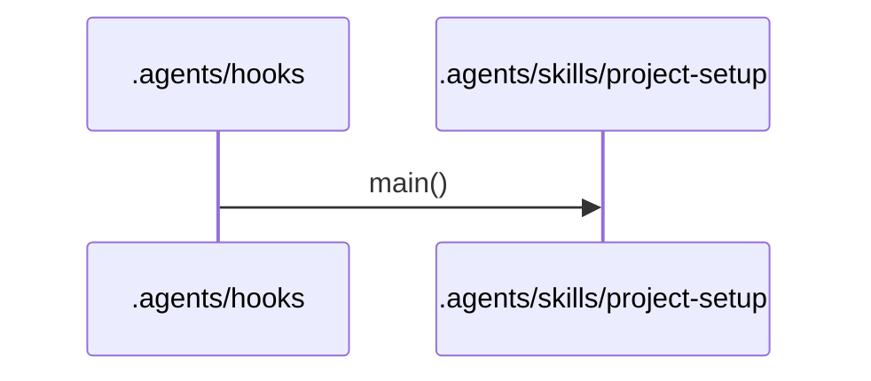
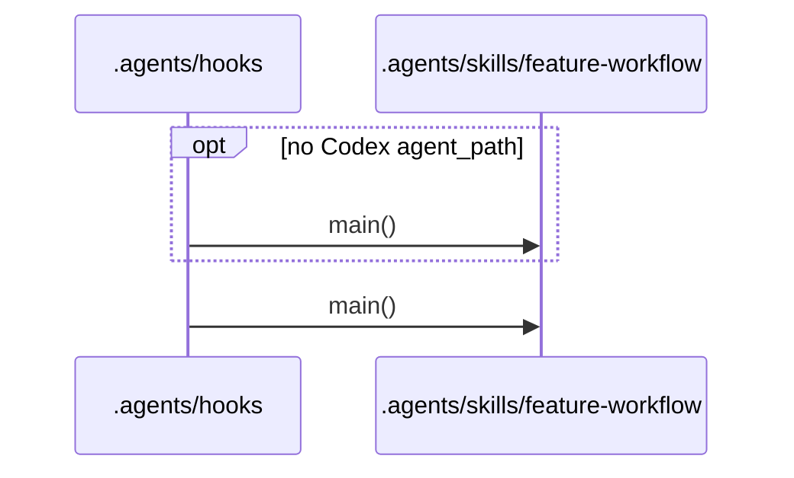
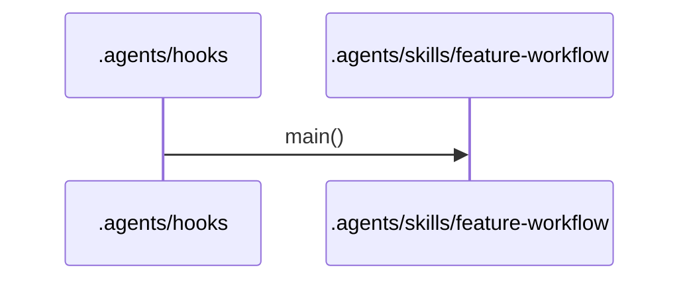
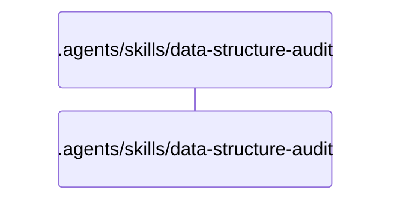
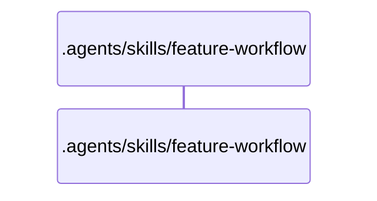
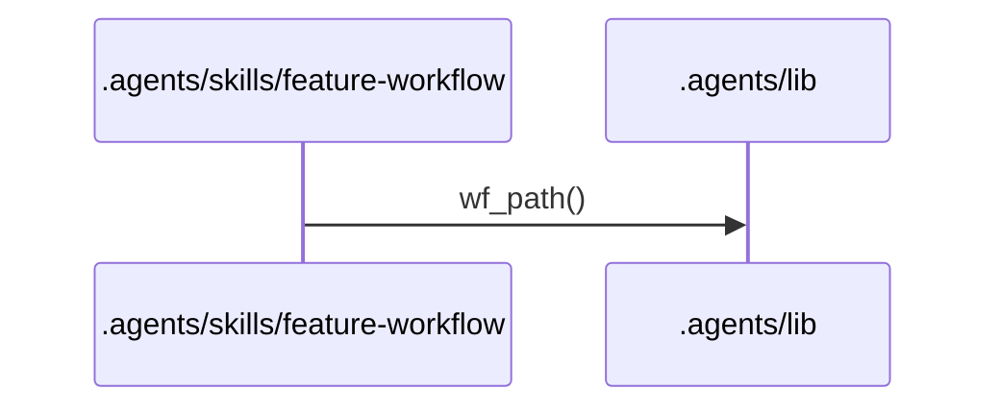
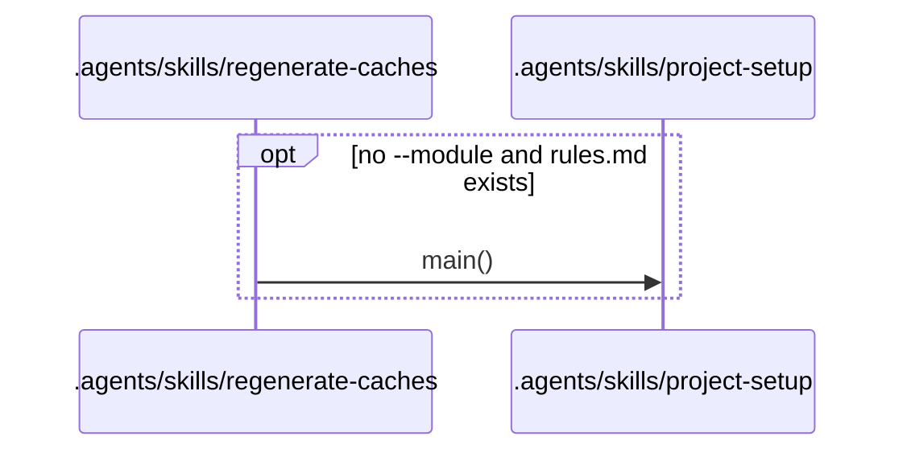
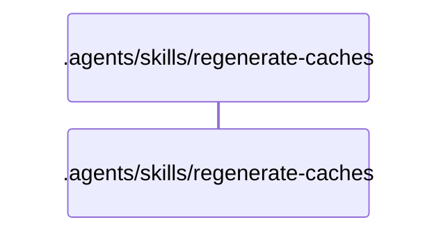

# Flows

## Entry points

- `.agents/hooks/codex-rules-sync.sh`
- `.agents/hooks/post-implementation-audit.sh`
- `.agents/hooks/spec-single-writer-guard.sh`
- `.agents/hooks/tier-a-write-guard.sh`
- `.agents/hooks/tier-b-write-guard.sh`
- `.agents/skills/data-structure-audit/scripts/audit_scope.sh`
- `.agents/skills/feature-workflow/scripts/budget-check.sh`
- `.agents/skills/feature-workflow/scripts/check-review-findings.sh`
- `.agents/skills/feature-workflow/scripts/check-task-result.sh`
- `.agents/skills/feature-workflow/scripts/commit-workflow-data.sh`
- `.agents/skills/feature-workflow/scripts/open-task-pr.sh`
- `.agents/skills/feature-workflow/scripts/task-waves.sh`
- `.agents/skills/regenerate-caches/scripts/build-architecture.sh`
- `.agents/skills/regenerate-caches/scripts/cache-stamp-check.sh`
- `.agents/skills/regenerate-caches/scripts/check-staged-cache.sh`
- `.agents/skills/regenerate-caches/scripts/extractors/bash.sh`
- `.agents/skills/regenerate-caches/scripts/extractors/dependency-cruiser.sh`
- `.agents/skills/regenerate-caches/scripts/publish-cache.sh`

## .agents/hooks/codex-rules-sync.sh

Error branches:
- `.agents/hooks/codex-rules-sync.sh` `main()`: exits 0 with no output when jq is missing, the payload is not a JSON object, the tool is not apply_patch, the patch does not parse or it names no .workflow/rules.md
- `.agents/hooks/rules-boundary-config-sync.sh` `main()`: prints a block decision when generate-boundary-config.sh exits 2 (rules.md does not parse)
- `.agents/hooks/rules-boundary-config-sync.sh` `main()`: prints a systemMessage when generate-boundary-config.sh exits with any other non-zero code

## .agents/hooks/post-implementation-audit.sh

Error branches:
- `.agents/hooks/post-implementation-audit.sh` `claude_task()`: allows the stop with a systemMessage warning when the transcript is not valid JSONL, holds no user text, or resolve-launch.sh exits non-zero
- `.agents/hooks/post-implementation-audit.sh` `codex_task()`: allows the stop with a systemMessage warning when the task_name, spec folder, profile or worktree does not match
- `.agents/hooks/post-implementation-audit.sh` `main()`: allows the stop with a gave-up systemMessage after 3 identical toolchain failures in a row
- `.agents/hooks/post-implementation-audit.sh` `main()`: allows the stop with a systemMessage warning when the transcript is missing, the header has no spec_dir, a Phase 1 header has no work_type, no task worktree exists, or run-toolchain.sh exits 2 or higher
- `.agents/hooks/post-implementation-audit.sh` `main()`: exits 0 with a stderr note when jq is missing or the payload is not a JSON object
- `.agents/hooks/post-implementation-audit.sh` `main()`: prints a block decision with the toolchain digest when run-toolchain.sh exits 1

## .agents/hooks/spec-single-writer-guard.sh

Error branches:
- `.agents/hooks/_guard-common.sh` `guard_on_exit()`: prints a static deny when the guard exits non-zero before a decision
- `.agents/hooks/_guard-common.sh` `run_guard()`: denies fail closed when check-write.sh exits with a code other than 0 or 2
- `.agents/hooks/_guard-common.sh` `run_guard()`: denies fail closed when jq is missing or the payload does not parse
- `.agents/hooks/_guard-common.sh` `run_guard()`: denies fail closed when the proposed Edit content cannot be computed
- `.agents/hooks/_guard-common.sh` `run_guard()`: denies with check-write.sh's stderr when it exits 2

## .agents/hooks/tier-a-write-guard.sh

Error branches:
- `.agents/hooks/_guard-common.sh` `guard_on_exit()`: prints a static deny when the guard exits non-zero before a decision
- `.agents/hooks/_guard-common.sh` `run_guard()`: denies fail closed when check-write.sh exits with a code other than 0 or 2
- `.agents/hooks/_guard-common.sh` `run_guard()`: denies fail closed when jq is missing or the payload does not parse
- `.agents/hooks/_guard-common.sh` `run_guard()`: denies with check-write.sh's stderr when it exits 2

## .agents/hooks/tier-b-write-guard.sh

Error branches:
- `.agents/hooks/_guard-common.sh` `guard_on_exit()`: prints a static deny when the guard exits non-zero before a decision
- `.agents/hooks/_guard-common.sh` `run_guard()`: denies fail closed when check-write.sh exits with a code other than 0 or 2
- `.agents/hooks/_guard-common.sh` `run_guard()`: denies fail closed when jq is missing or the payload does not parse
- `.agents/hooks/_guard-common.sh` `run_guard()`: denies with check-write.sh's stderr when it exits 2

## .agents/skills/data-structure-audit/scripts/audit_scope.sh

Error branches:
- `.agents/skills/data-structure-audit/scripts/audit_scope.sh` `main()`: exits 1 with NOT_A_GIT_REPO when record runs outside a git repository
- `.agents/skills/data-structure-audit/scripts/audit_scope.sh` `main()`: exits 1 with a usage line for an unknown subcommand

## .agents/skills/feature-workflow/scripts/budget-check.sh

Error branches:
- `.agents/skills/feature-workflow/scripts/budget-check.sh` `main()`: exits 1 on a usage or environment error (missing yq or jq, not a git repo, missing file, malformed budget or test_patterns, unknown baseline commit, invalid main_branch)
- `.agents/skills/feature-workflow/scripts/budget-check.sh` `main()`: exits 2 when the spec is over its size budget

## .agents/skills/feature-workflow/scripts/check-review-findings.sh

Error branches:
- `.agents/skills/feature-workflow/scripts/check-review-findings.sh` `main()`: exits 1 and prints one line per shape error when the findings file is malformed
- `.agents/skills/feature-workflow/scripts/check-review-findings.sh` `main()`: exits 2 on a usage error, a missing or unreadable file, YAML that does not parse, or missing jq or yq

## .agents/skills/feature-workflow/scripts/check-task-result.sh

Error branches:
- `.agents/skills/feature-workflow/scripts/check-task-result.sh` `main()`: exits 1 and prints one line per shape error when the result file is malformed
- `.agents/skills/feature-workflow/scripts/check-task-result.sh` `main()`: exits 2 on a usage error, a missing or unreadable file, YAML that does not parse, an unknown kind, or missing jq or yq

## .agents/skills/feature-workflow/scripts/commit-workflow-data.sh

Error branches:
- `.agents/skills/feature-workflow/scripts/commit-workflow-data.sh` `main()`: exits 1 when the main checkout is not on the spec branch, or a merge, cherry-pick or revert is in progress
- `.agents/skills/feature-workflow/scripts/commit-workflow-data.sh` `main()`: exits 2 on a usage or environment error (not a git repository, bad spec dir, spec.md or yq missing, local state not gitignored, git add or commit failing)

## .agents/skills/feature-workflow/scripts/open-task-pr.sh

Error branches:
- `.agents/skills/feature-workflow/scripts/open-task-pr.sh` `main()`: exits 1 on a task-mode usage error (bad arguments, spec or task not found)
- `.agents/skills/feature-workflow/scripts/open-task-pr.sh` `main()`: exits 2 on a generic-mode usage error (missing --head, --base or --title, unknown option, bad --record directory, --cwd outside a git repository)
- `.agents/skills/feature-workflow/scripts/open-task-pr.sh` `main()`: prints a skipped line and exits 0 when task_review is local, a branch or the origin remote is missing, the host is neither GitHub nor GitLab, the CLI is missing or not logged in, or the push or create fails
- `.agents/skills/feature-workflow/scripts/open-task-pr.sh` `main()`: warns on stderr when status-transition.sh or initiative-transition.sh cannot record the URL

## .agents/skills/feature-workflow/scripts/task-waves.sh

Error branches:
- `.agents/skills/feature-workflow/scripts/task-waves.sh` `main()`: exits 1 on a usage or environment error (missing jq or yq, not a git repo, missing or unreadable tasks.md)
- `.agents/skills/feature-workflow/scripts/task-waves.sh` `main()`: exits 2 when the task graph is invalid (cycle, unknown id in depends_on or parallel_with, duplicate id)

## .agents/skills/regenerate-caches/scripts/build-architecture.sh

Error branches:
- `.agents/skills/regenerate-caches/scripts/build-architecture.sh` `main()`: exits 2 on a usage error, dirty scope, a profile without or with an unknown graph_extractor, no work profiles, a failed extractor, a file claimed by two extractors, unparseable JSON, a node-id collision or a bad test_patterns
- `.agents/skills/regenerate-caches/scripts/build-architecture.sh` `main()`: exits 2 when generate-boundary-config.sh is missing or the rules.md Ownership or Shared core does not parse

## .agents/skills/regenerate-caches/scripts/cache-stamp-check.sh

Error branches:
- `.agents/skills/regenerate-caches/scripts/cache-stamp-check.sh` `main()`: exits 1 when a cache is stale or missing and none is invalid
- `.agents/skills/regenerate-caches/scripts/cache-stamp-check.sh` `main()`: exits 2 when a cache is invalid, or on a usage or tooling error

## .agents/skills/regenerate-caches/scripts/check-staged-cache.sh

Error branches:
- `.agents/skills/regenerate-caches/scripts/check-staged-cache.sh` `main()`: exits 1 and lists one problem per line when the body breaks its shape
- `.agents/skills/regenerate-caches/scripts/check-staged-cache.sh` `main()`: exits 2 on a usage error or a missing staged file

## .agents/skills/regenerate-caches/scripts/extractors/bash.sh

Error branches:
- `.agents/skills/regenerate-caches/scripts/extractors/bash.sh` `main()`: exits 2 on a usage error, a missing root or scope, a root that is not a git work tree, a missing tool, or a git ls-files, awk or jq failure

## .agents/skills/regenerate-caches/scripts/extractors/dependency-cruiser.sh

Error branches:
- `.agents/skills/regenerate-caches/scripts/extractors/dependency-cruiser.sh` `main()`: exits 2 on a usage error, or when depcruise is not found or fails

## .agents/skills/regenerate-caches/scripts/publish-cache.sh

Error branches:
- `.agents/skills/regenerate-caches/scripts/publish-cache.sh` `main()`: exits 1 when the staged file is missing, empty or outside the staging dir, or the stamped result fails validation
- `.agents/skills/regenerate-caches/scripts/publish-cache.sh` `main()`: exits 2 on a usage or tooling error
