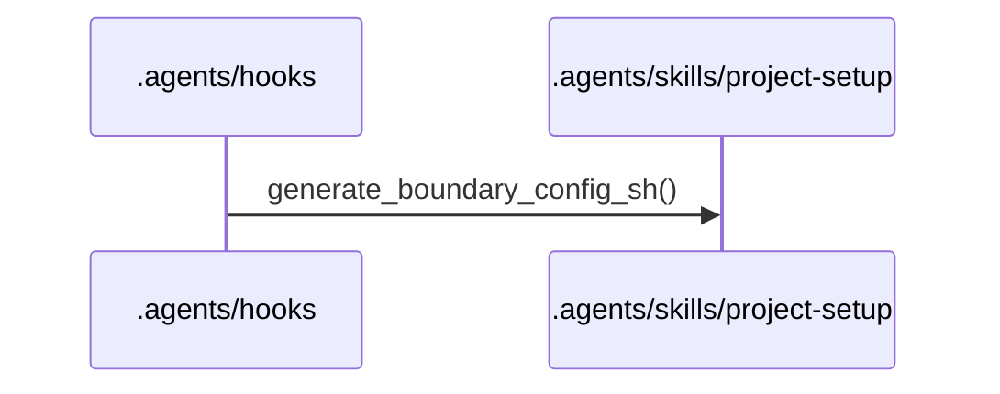
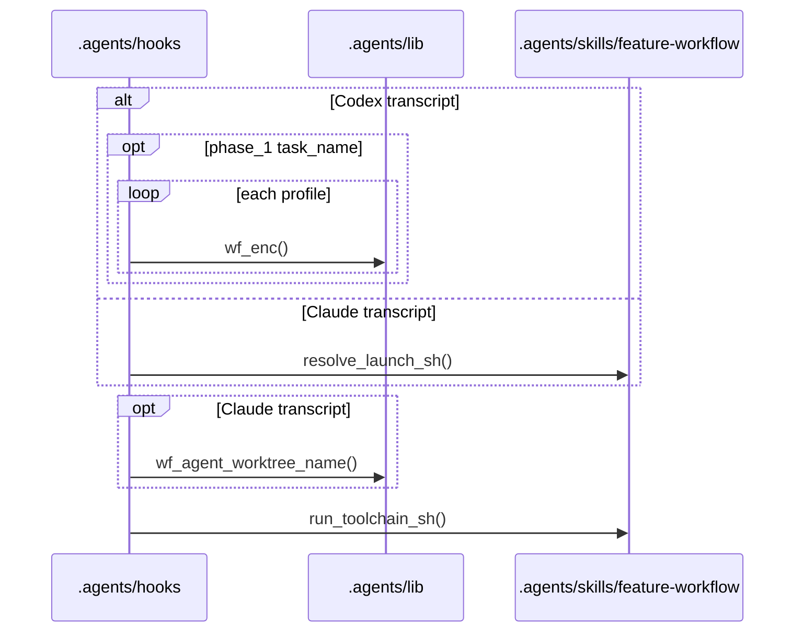
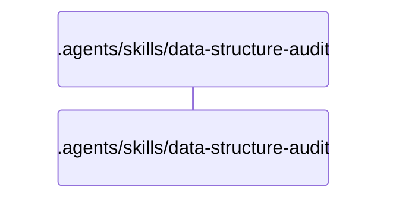
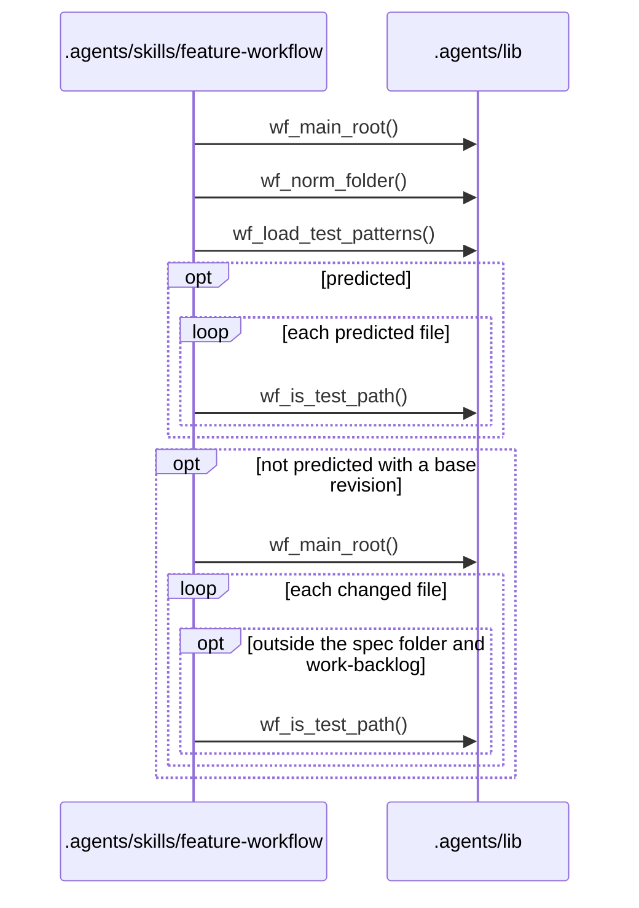
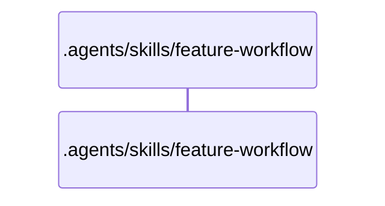
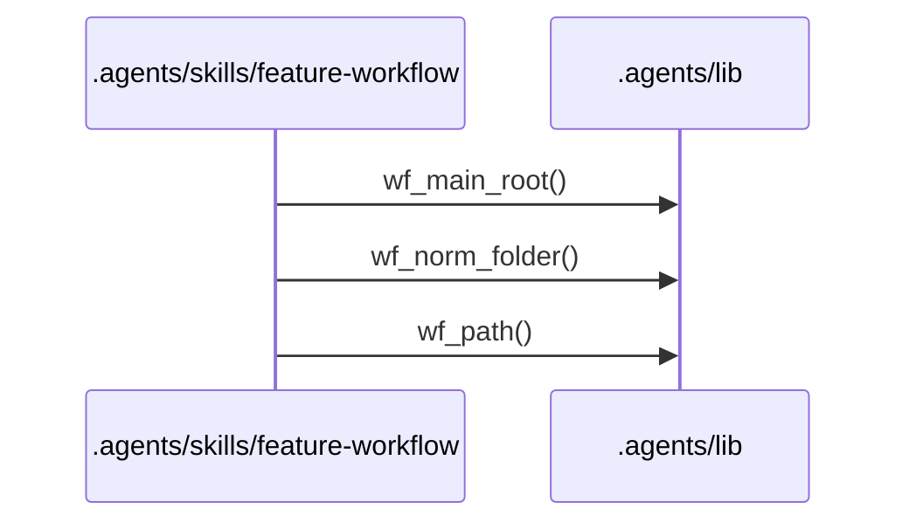
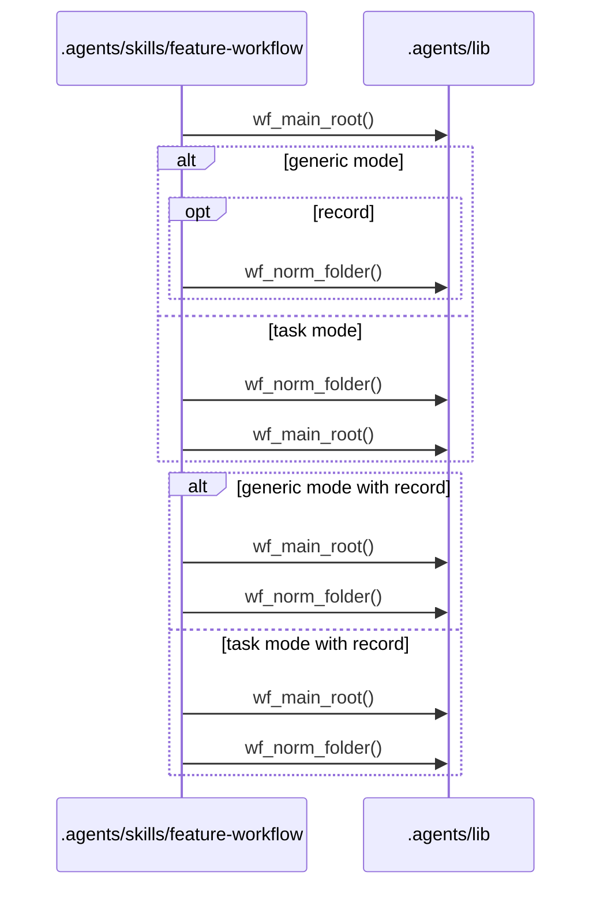
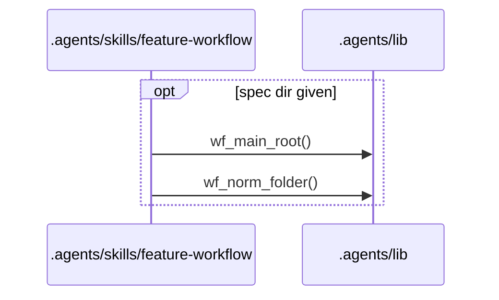
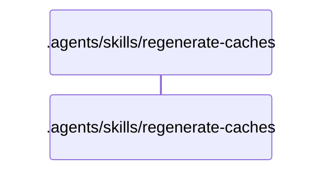

# Flows

## Entry points

- `.agents/hooks/codex-rules-sync.sh`
- `.agents/hooks/post-implementation-audit.sh`
- `.agents/hooks/spec-single-writer-guard.sh`
- `.agents/hooks/tier-a-write-guard.sh`
- `.agents/hooks/tier-b-write-guard.sh`
- `.agents/skills/data-structure-audit/scripts/audit_scope.sh`
- `.agents/skills/feature-workflow/scripts/budget-check.sh`
- `.agents/skills/feature-workflow/scripts/check-pr-body.sh`
- `.agents/skills/feature-workflow/scripts/check-review-findings.sh`
- `.agents/skills/feature-workflow/scripts/commit-workflow-data.sh`
- `.agents/skills/feature-workflow/scripts/open-task-pr.sh`
- `.agents/skills/feature-workflow/scripts/task-waves.sh`
- `.agents/skills/regenerate-caches/scripts/cache-stamp-check.sh`
- `.agents/skills/regenerate-caches/scripts/extractors/dependency-cruiser.sh`
- `.agents/skills/regenerate-caches/scripts/publish-cache.sh`

## .agents/hooks/codex-rules-sync.sh

Error branches:
- `.agents/hooks/codex-rules-sync.sh` `codex_rules_sync_sh()`: exits 0 with no output when jq is missing, the payload is not a JSON object, or the patch text or its paths do not parse
- `.agents/hooks/rules-boundary-config-sync.sh` `rules_boundary_config_sync_sh()`: prints `{"decision":"block","reason":...}` and exits 0 when generate-boundary-config.sh exits 2
- `.agents/hooks/rules-boundary-config-sync.sh` `rules_boundary_config_sync_sh()`: prints `{"systemMessage":...}` and exits 0 when generate-boundary-config.sh exits with any other non-zero code
- `.agents/skills/project-setup/scripts/generate-boundary-config.sh` `build_intermediate()`: exits 2 when rules.md is missing or its Ownership or Shared core yaml block is absent, duplicated or not valid YAML
- `.agents/skills/project-setup/scripts/generate-boundary-config.sh` `main()`: exits 2 when the parsed rules fail validation
- `.agents/skills/project-setup/scripts/generate-boundary-config.sh` `require_tools()`: exits 3 when jq or mikefarah yq v4 is missing

## .agents/hooks/post-implementation-audit.sh

Error branches:
- `.agents/hooks/post-implementation-audit.sh` `claude_task()`: allows the stop with a `systemMessage` warning when the transcript is not valid JSONL, has no user message with text, or resolve-launch.sh exits non-zero
- `.agents/hooks/post-implementation-audit.sh` `codex_task()`: allows the stop with a `systemMessage` warning when the task_name is not s<NNN>_t<N> or s<NNN>_phase_1_<work_type>, matches no single spec folder or profile, names an integration batch, or has no worktree
- `.agents/hooks/post-implementation-audit.sh` `post_implementation_audit_sh()`: allows the stop with a `systemMessage` and writes audit.json with outcome gave-up after 3 identical toolchain failures in a row
- `.agents/hooks/post-implementation-audit.sh` `post_implementation_audit_sh()`: allows the stop with a `systemMessage` warning when an implementation agent's transcript is missing, the header has no spec_dir or needed work_type, the agent ran in the main checkout with no agent worktree, or run-toolchain.sh exits other than 0 or 1
- `.agents/hooks/post-implementation-audit.sh` `post_implementation_audit_sh()`: exits 0 with a reason on stderr and no output when jq is missing or the payload is not a JSON object
- `.agents/hooks/post-implementation-audit.sh` `post_implementation_audit_sh()`: prints `{"decision":"block","reason":<digest>}` when run-toolchain.sh exits 1
- `.agents/skills/feature-workflow/scripts/resolve-launch.sh` `extract_header()`: exits 2 when the launch header is not on the first line, has no closing fence, is empty or is not a YAML mapping
- `.agents/skills/feature-workflow/scripts/resolve-launch.sh` `resolve_launch_sh()`: exits 1 when jq or mikefarah yq v4 is missing or the prompt file does not exist
- `.agents/skills/feature-workflow/scripts/resolve-launch.sh` `validate_header()`: exits 2 when the header is missing for a type that needs one, has no or an unknown task_type, disagrees with --task-type, or its fields do not match a shape or format
- `.agents/skills/feature-workflow/scripts/run-toolchain.sh` `run_toolchain_sh()`: exits 1 with the failure digest when at least one toolchain command fails
- `.agents/skills/feature-workflow/scripts/run-toolchain.sh` `run_toolchain_sh()`: exits 2 when jq or mikefarah yq v4 is missing, --cwd is outside a git repository, or the work type, profile or its Toolchain yaml block is missing or does not parse
- `.agents/skills/feature-workflow/scripts/run-toolchain.sh` `tree_hash()`: exits 2 when the checkout cannot be hashed

## .agents/hooks/spec-single-writer-guard.sh

Error branches:
- `.agents/hooks/_guard-common.sh` `guard_on_exit()`: prints a static fail-closed deny JSON when the guard exits non-zero before a decision
- `.agents/hooks/_guard-common.sh` `run_guard()`: prints a deny JSON with check-write.sh's reason when it exits 2
- `.agents/hooks/_guard-common.sh` `run_guard()`: prints a fail-closed deny JSON when check-write.sh exits with any other non-zero code
- `.agents/hooks/_guard-common.sh` `run_guard()`: prints a fail-closed deny JSON when the payload does not parse
- `.agents/hooks/_guard-common.sh` `run_guard()`: prints a fail-closed deny JSON when the proposed content of an Edit cannot be computed
- `.agents/hooks/_guard-common.sh` `run_guard()`: prints a static deny JSON when jq is missing
- `.agents/skills/feature-workflow/scripts/check-write.sh` `deny()`: exits 2 with the reason on stderr when a write to spec.md, tasks.md, tasks/, a .step marker, the work-backlog or initiative.md comes from a sub-agent, is not allowed at the current step, or changes status or blocked_condition
- `.agents/skills/feature-workflow/scripts/check-write.sh` `die()`: exits 1 on a bad argument, a missing --proposed file, or a missing mikefarah yq v4

## .agents/hooks/tier-a-write-guard.sh

Error branches:
- `.agents/hooks/_guard-common.sh` `guard_on_exit()`: prints a static fail-closed deny JSON when the guard exits non-zero before a decision
- `.agents/hooks/_guard-common.sh` `run_guard()`: prints a deny JSON with check-write.sh's reason when it exits 2
- `.agents/hooks/_guard-common.sh` `run_guard()`: prints a fail-closed deny JSON when check-write.sh exits with any other non-zero code
- `.agents/hooks/_guard-common.sh` `run_guard()`: prints a fail-closed deny JSON when the payload does not parse
- `.agents/hooks/_guard-common.sh` `run_guard()`: prints a static deny JSON when jq is missing
- `.agents/skills/feature-workflow/scripts/check-write.sh` `deny()`: exits 2 with the reason on stderr when a Tier A write comes from a sub-agent or the newest in-flight step is not one its path allows
- `.agents/skills/feature-workflow/scripts/check-write.sh` `die()`: exits 1 on a bad argument or a missing mikefarah yq v4

## .agents/hooks/tier-b-write-guard.sh

Error branches:
- `.agents/hooks/_guard-common.sh` `guard_on_exit()`: prints a static fail-closed deny JSON when the guard exits non-zero before a decision
- `.agents/hooks/_guard-common.sh` `run_guard()`: prints a deny JSON with check-write.sh's reason when it exits 2
- `.agents/hooks/_guard-common.sh` `run_guard()`: prints a fail-closed deny JSON when check-write.sh exits with any other non-zero code
- `.agents/hooks/_guard-common.sh` `run_guard()`: prints a fail-closed deny JSON when the payload does not parse
- `.agents/hooks/_guard-common.sh` `run_guard()`: prints a static deny JSON when jq is missing
- `.agents/skills/feature-workflow/scripts/check-write.sh` `deny()`: exits 2 with a pointer to regenerate-caches on stderr for every write under .workflow/cache/
- `.agents/skills/feature-workflow/scripts/check-write.sh` `die()`: exits 1 on a bad argument

## .agents/skills/data-structure-audit/scripts/audit_scope.sh

Error branches:
- `.agents/skills/data-structure-audit/scripts/audit_scope.sh` `audit_scope_sh()`: exits 1 with NOT_A_GIT_REPO on stderr when `record` runs outside a git repository
- `.agents/skills/data-structure-audit/scripts/audit_scope.sh` `audit_scope_sh()`: exits 1 with the usage line for an unknown command
- `.agents/skills/data-structure-audit/scripts/audit_scope.sh` `audit_scope_sh()`: prints NOT_A_GIT_REPO and exits 0 when `scope` runs outside a git repository

## .agents/skills/feature-workflow/scripts/budget-check.sh

Error branches:
- `.agents/skills/feature-workflow/scripts/budget-check.sh` `budget_check_sh()`: exits 1 when --predicted finds a task without an integer size.files
- `.agents/skills/feature-workflow/scripts/budget-check.sh` `budget_check_sh()`: exits 1 when a profile's test_patterns is invalid
- `.agents/skills/feature-workflow/scripts/budget-check.sh` `budget_check_sh()`: exits 1 when jq or mikefarah yq v4 is missing, the cwd is outside a git repository, the spec dir is not `.workflow/specs/NNN-slug`, or spec.md or tasks.md is missing
- `.agents/skills/feature-workflow/scripts/budget-check.sh` `budget_check_sh()`: exits 1 when the base revision is not a commit or rules-setting.sh cannot read main_branch
- `.agents/skills/feature-workflow/scripts/budget-check.sh` `budget_check_sh()`: exits 2 when the task count or the changed-file count is over its maximum
- `.agents/skills/feature-workflow/scripts/budget-check.sh` `read_budget()`: exits 1 when a budget map lacks non-negative integer max_tasks and max_changed_files
- `.agents/skills/feature-workflow/scripts/budget-check.sh` `usage()`: exits 1 on missing arguments
- `.agents/skills/feature-workflow/scripts/rules-setting.sh` `rules_setting_sh()`: exits 1 when the Workflow settings block does not parse or is not a map, or main_branch is not a valid branch name

## .agents/skills/feature-workflow/scripts/check-pr-body.sh

Error branches:
- `.agents/skills/feature-workflow/scripts/check-pr-body.sh` `check_pr_body_sh()`: exits 1 printing one `<field>: <problem>` line per fault when a section is missing, empty or out of order, or a Risk or Reversibility score is missing, off its scale, or Irreversible without Risk: High
- `.agents/skills/feature-workflow/scripts/check-pr-body.sh` `check_pr_body_sh()`: exits 2 when the template has no headings, or the workflow template has no `## Risk and reversibility` heading
- `.agents/skills/feature-workflow/scripts/check-pr-body.sh` `require_readable()`: exits 2 when the body or the template is missing or unreadable
- `.agents/skills/feature-workflow/scripts/check-pr-body.sh` `usage()`: exits 2 on bad arguments

## .agents/skills/feature-workflow/scripts/check-review-findings.sh

Error branches:
- `.agents/skills/feature-workflow/scripts/check-review-findings.sh` `check_review_findings_sh()`: exits 1 printing one `<field>: <problem>` line per shape error in the findings file
- `.agents/skills/feature-workflow/scripts/check-review-findings.sh` `check_review_findings_sh()`: exits 2 when jq or mikefarah yq v4 is missing, the file is missing or unreadable, its YAML does not parse, or jq fails
- `.agents/skills/feature-workflow/scripts/check-review-findings.sh` `usage()`: exits 2 on bad arguments

## .agents/skills/feature-workflow/scripts/commit-workflow-data.sh

Error branches:
- `.agents/skills/feature-workflow/scripts/commit-workflow-data.sh` `commit_workflow_data_sh()`: exits 1 when the main checkout is not on the spec branch or a merge, cherry-pick or revert is in progress
- `.agents/skills/feature-workflow/scripts/commit-workflow-data.sh` `commit_workflow_data_sh()`: exits 2 when yq is missing, the cwd is outside a git repository, the spec dir is not `.workflow/specs/NNN-slug`, spec.md is missing, local state is not gitignored, or git commit fails
- `.agents/skills/feature-workflow/scripts/commit-workflow-data.sh` `stage()`: exits 2 when git add fails
- `.agents/skills/feature-workflow/scripts/commit-workflow-data.sh` `usage()`: exits 2 on bad arguments

## .agents/skills/feature-workflow/scripts/open-task-pr.sh

Error branches:
- `.agents/skills/feature-workflow/scripts/initiative-transition.sh` `initiative_transition_sh()`: exits 1 when initiative.md is missing or the URL is not an http(s) URL
- `.agents/skills/feature-workflow/scripts/initiative-transition.sh` `write_validated()`: exits 2 when the updated initiative.md fails its template validator
- `.agents/skills/feature-workflow/scripts/open-task-pr.sh` `generic_usage()`: exits 2 when a generic-mode argument is missing or wrong, the cwd is not a directory, or the --record directory is not an initiative folder with initiative.md
- `.agents/skills/feature-workflow/scripts/open-task-pr.sh` `open_task_pr_sh()`: exits 1 in task mode when the task id or spec dir is malformed, mikefarah yq v4 is missing, the cwd is outside a git repository, or spec.md, tasks.md or a single task record is missing
- `.agents/skills/feature-workflow/scripts/open-task-pr.sh` `open_task_pr_sh()`: prints a warning on stderr when initiative-transition.sh set-pr or status-transition.sh set-task cannot record the URL
- `.agents/skills/feature-workflow/scripts/open-task-pr.sh` `skip()`: prints `skipped: <reason>` and exits 0 when rules-setting.sh fails, task_review is local, the task has no branch, a branch does not exist locally, origin is missing or neither GitHub nor GitLab, the CLI is missing or not logged in, the push fails, or no PR/MR URL comes back
- `.agents/skills/feature-workflow/scripts/open-task-pr.sh` `usage()`: exits 1 on bad task-mode arguments
- `.agents/skills/feature-workflow/scripts/rules-setting.sh` `rules_setting_sh()`: exits 1 when the Workflow settings block does not parse or is not a map, or task_review is not pr, pr-blocking or local
- `.agents/skills/feature-workflow/scripts/status-transition.sh` `status_transition_sh()`: exits 1 when spec.md, tasks.md or a single task record is missing, the URL is not an http(s) URL, or the result fails the tasks.md validator
- `.agents/skills/feature-workflow/scripts/status-transition.sh` `status_transition_sh()`: exits 2 when the spec is done

## .agents/skills/feature-workflow/scripts/task-waves.sh

Error branches:
- `.agents/skills/feature-workflow/scripts/task-waves.sh` `task_waves_sh()`: exits 1 when jq or mikefarah yq v4 is missing, the cwd is outside a git repository, the spec dir is not `.workflow/specs/NNN-slug`, tasks.md is missing or has no tasks array, or jq cannot evaluate it
- `.agents/skills/feature-workflow/scripts/task-waves.sh` `task_waves_sh()`: exits 2 when the task graph has a cycle, an unknown id in depends_on or parallel_with, or a duplicate id
- `.agents/skills/feature-workflow/scripts/task-waves.sh` `usage()`: exits 1 on bad arguments

## .agents/skills/regenerate-caches/scripts/cache-stamp-check.sh

Error branches:
- `.agents/skills/regenerate-caches/scripts/cache-stamp-check.sh` `cache_stamp_check_sh()`: exits 1 when at least one cache is stale or missing and none is invalid
- `.agents/skills/regenerate-caches/scripts/cache-stamp-check.sh` `cache_stamp_check_sh()`: exits 2 on a bad argument, a missing git, jq or mikefarah yq v4, or a directory outside a git repository without --root
- `.agents/skills/regenerate-caches/scripts/cache-stamp-check.sh` `cache_stamp_check_sh()`: exits 2 when at least one cache has frontmatter that fails the schema, a cache_type that does not match its file name, or an unknown generated_at_commit

## .agents/skills/regenerate-caches/scripts/extractors/dependency-cruiser.sh

Error branches:
- `.agents/skills/regenerate-caches/scripts/extractors/dependency-cruiser.sh` `dependency_cruiser_sh()`: exits 2 on a bad argument, a missing --root or --scope, a root that does not exist, no depcruise found, or a failed depcruise run

## .agents/skills/regenerate-caches/scripts/publish-cache.sh

Error branches:
- `.agents/skills/regenerate-caches/scripts/publish-cache.sh` `publish_cache_sh()`: exits 1 when the staged file is missing, outside the staging dir, or has an empty body, or the stamped file fails the cache-frontmatter schema
- `.agents/skills/regenerate-caches/scripts/publish-cache.sh` `publish_cache_sh()`: exits 2 on a usage error, a bad cache type or scope path, a missing git, jq or mikefarah yq v4, or a directory outside a git repository without --root
