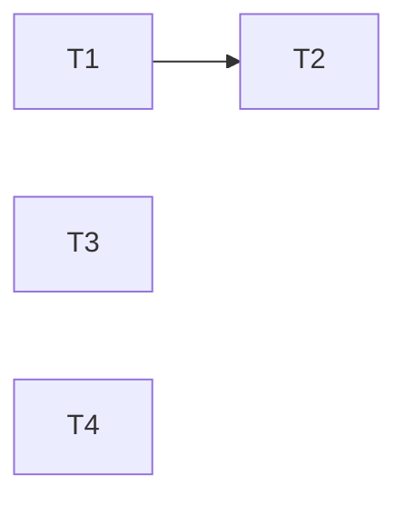

---
tasks:
  - id: T1
    title: "Scope check fails closed and passes quoted reads"
    status: done
    capability: CAP-007
    depends_on: []
    touches_core: false
    work_type: shell-scripts
    module: "feature-workflow"
    seam: "check-worktree-scope.sh CLI: --cwd D [--worktree-name N] [--confined] (--path P... | --command C); exit 0 allow, 2 deny, 1 usage"
    file: tasks/T01-scope-check-fails-closed.md
    branch: task/00010-worktree-guard-followups/T01-scope-check-fails-closed
    predicted_files: [".agents/skills/feature-workflow/scripts/check-worktree-scope.sh", ".agents/skills/feature-workflow/modules/implementation-orchestrator.md"]
    size: {files: 2, est_lines: 200, points: M}
    mode: afk
    parallel_with: []
    pr: null
  - id: T2
    title: "Worktree guard fails closed"
    status: done
    capability: CAP-007
    depends_on: [T1]
    touches_core: false
    work_type: shell-scripts
    module: "hooks"
    seam: "worktree-write-guard.sh PreToolUse: payload JSON on stdin, nothing or one deny JSON on stdout, exit 0"
    file: tasks/T02-worktree-guard-fails-closed.md
    branch: task/00010-worktree-guard-followups/T02-worktree-guard-fails-closed
    predicted_files: [".agents/hooks/worktree-write-guard.sh"]
    size: {files: 1, est_lines: 60, points: S}
    mode: afk
    parallel_with: []
    tests: ["tests/hooks/worktree-guard.sh"]
    pr: null
  - id: T3
    title: "Settings deny in-place frontmatter extract"
    status: done
    capability: CAP-009
    depends_on: []
    touches_core: false
    work_type: shell-scripts
    module: "hooks"
    seam: "settings JSON permissions.deny and install.sh --host claude merged output"
    file: tasks/T03-settings-deny-extract-in-place.md
    branch: task/00010-worktree-guard-followups/T03-settings-deny-extract-in-place
    predicted_files: [".agents/hooks/claude-settings.template.json", ".agents/hooks/claude-settings.template.md", ".claude/settings.json"]
    size: {files: 3, est_lines: 20, points: S}
    mode: afk
    parallel_with: []
    tests: ["tests/scripts/install-claude-settings.sh"]
    pr: null
  - id: T4
    title: "Asset record matches the agent worktree build"
    status: done
    capability: CAP-007
    depends_on: []
    touches_core: false
    work_type: agent-docs
    module: "root-docs"
    seam: "record text checked by tests/lint/agent-worktree-docs.sh"
    file: tasks/T04-asset-record-agent-worktrees.md
    branch: task/00010-worktree-guard-followups/T04-asset-record-agent-worktrees
    predicted_files: ["assetlist.md", "PROVENANCE.md"]
    size: {files: 2, est_lines: 15, points: S}
    mode: afk
    parallel_with: []
    tests: ["tests/lint/agent-worktree-docs.sh"]
    pr: null
---

# Tasks: Worktree guard and upgrade follow-ups

Spec: [spec.md](spec.md) · Data model: [data-model.md](data-model.md) · Task files: [tasks/](tasks/)

## Waves

| Wave | Task | Title | Size | Mode | Overlaps |
| --- | --- | --- | --- | --- | --- |
| 1 | [T1](tasks/T01-scope-check-fails-closed.md) | Scope check fails closed and passes quoted reads | M (2 files, ~200 lines) | afk | none |
| 1 | [T3](tasks/T03-settings-deny-extract-in-place.md) | Settings deny in-place frontmatter extract | S (3 files, ~20 lines) | afk | none |
| 1 | [T4](tasks/T04-asset-record-agent-worktrees.md) | Asset record matches the agent worktree build | S (2 files, ~15 lines) | afk | none |
| 2 | [T2](tasks/T02-worktree-guard-fails-closed.md) | Worktree guard fails closed | S (1 file, ~60 lines) | afk | none |

## Dependency graph

