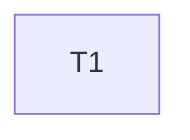

---
tasks:
  - id: T1
    title: "Stop background suites when the runner is interrupted"
    status: pending
    capability: CAP-001
    depends_on: []
    touches_core: false
    work_type: null
    module: "tests"
    seam: "tests/run-all.sh command line and exit code, driven by tests/scripts/run-all-selection.sh against stub suites"
    file: tasks/T01-stop-suites-on-signal.md
    branch: null
    predicted_files: ["tests/run-all.sh", "tests/scripts/run-all-selection.sh"]
    size: {files: 2, est_lines: 100, points: S}
    mode: afk
    parallel_with: []
    pr: null
---

# Tasks: Interrupted harness runs clean up their background suites

Spec: [spec.md](spec.md) · Task files: [tasks/](tasks/)

## Waves

| Wave | Task | Title | Size | Mode | Overlaps |
| --- | --- | --- | --- | --- | --- |
| 1 | [T1](tasks/T01-stop-suites-on-signal.md) | Stop background suites when the runner is interrupted | S (2 files, ~100 lines) | afk | none |

## Dependency graph

