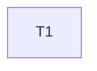

---
tasks:
  - id: T1
    title: "Share one quote state across lines with every reader of the bash extractor"
    status: done
    capability: CAP-005
    depends_on: []
    touches_core: false
    work_type: shell-scripts
    module: "regenerate-caches"
    seam: "extractors/bash.sh CLI and output JSON, driven by tests/scripts/extractor-bash.sh on run-time fixture repos"
    file: tasks/T01-quote-aware-readers.md
    branch: null
    predicted_files: [".agents/skills/regenerate-caches/scripts/extractors/bash.sh", "tests/scripts/extractor-bash.sh", "tests/fixtures/graph-extractors.sh"]
    size: {files: 3, est_lines: 180, points: M}
    mode: afk
    parallel_with: []
    pr: null
---

# Tasks: The bash graph extractor never reads quoted text as commands

Spec: [spec.md](spec.md) · Task files: [tasks/](tasks/)

## Waves

| Wave | Task | Title | Size | Mode | Overlaps |
| --- | --- | --- | --- | --- | --- |
| 1 | [T1](tasks/T01-quote-aware-readers.md) | Share one quote state across lines with every reader of the bash extractor | M (3 files, ~180 lines) | afk | none |

## Dependency graph

