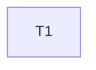

---
tasks:
  - id: T1
    title: "Report a broken validator with yq's diagnostic in both single writers"
    status: done
    capability: CAP-NEW-validator-diagnostic
    depends_on: []
    touches_core: false
    work_type: shell-scripts
    module: "feature-workflow"
    seam: "status-transition.sh set-task and initiative-transition.sh CLIs (exit code, stderr, files), driven by their suites with a yq shim"
    file: tasks/T01-validator-error-diagnostic.md
    branch: null
    predicted_files: [".agents/skills/feature-workflow/scripts/status-transition.sh", ".agents/skills/feature-workflow/scripts/initiative-transition.sh", "tests/scripts/status-transition-tasks.sh", "tests/scripts/initiative-transition.sh"]
    size: {files: 4, est_lines: 90, points: S}
    mode: afk
    parallel_with: []
    pr: null
---

# Tasks: The single writers keep the validator's diagnostic

Spec: [spec.md](spec.md) · Task files: [tasks/](tasks/)

## Waves

| Wave | Task | Title | Size | Mode | Overlaps |
| --- | --- | --- | --- | --- | --- |
| 1 | [T1](tasks/T01-validator-error-diagnostic.md) | Report a broken validator with yq's diagnostic in both single writers | S (4 files, ~90 lines) | afk | none |

## Dependency graph

