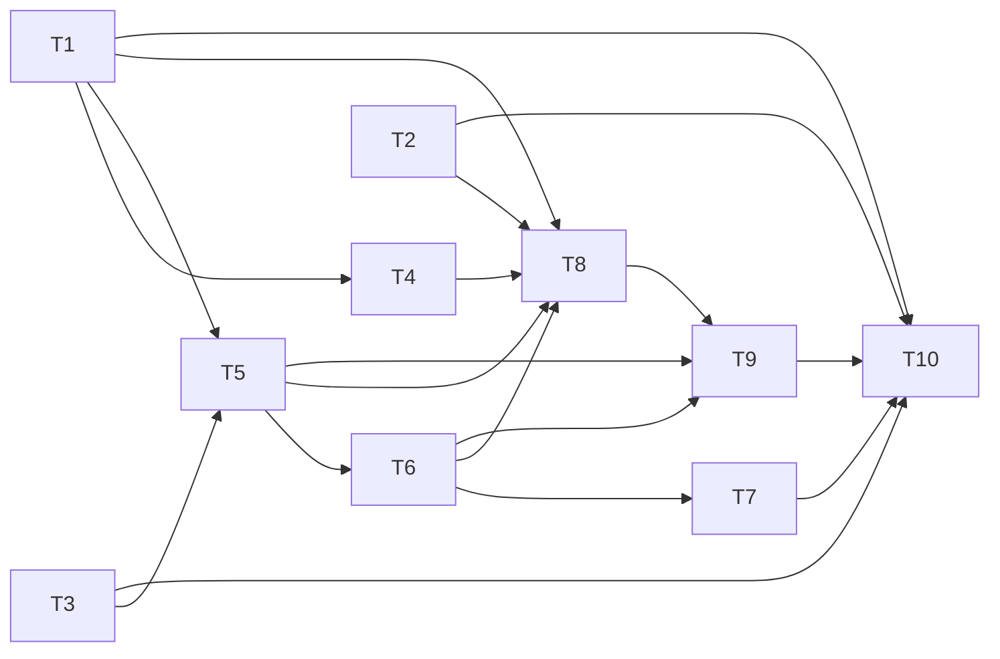

---
tasks:
  - id: T1
    title: "Shared host choice and path rewrite"
    status: done
    capability: CAP-NEW-issue-tracking-setup
    depends_on: []
    touches_core: true
    work_type: shell-scripts
    module: "feature-workflow"
    seam: "the existing CLIs of move-to-done.sh, open-task-pr.sh and rules-setting.sh, driven by their existing suites"
    file: tasks/T01-shared-host-choice-and-path-rewrite.md
    branch: task/00014-tracker-issue-spec-ids/T01-shared-host-choice-and-path-rewrite
    predicted_files:
      - .agents/skills/feature-workflow/scripts/move-to-done.sh
      - .agents/skills/feature-workflow/scripts/open-task-pr.sh
      - .agents/skills/feature-workflow/scripts/rules-setting.sh
      - .agents/skills/feature-workflow/modules/sign-off.md
      - .agents/lib/workflow-paths.sh
    size: {files: 5, est_lines: 250, points: M}
    mode: afk
    parallel_with: []
    pr: null
  - id: T2
    title: "Tracker link keys"
    status: done
    capability: CAP-NEW-tracker-issues
    depends_on: []
    touches_core: false
    work_type: shell-scripts
    module: "feature-workflow"
    seam: "the status-transition.sh set-task CLI and the yq validators in assets/spec.md and assets/tasks.md"
    file: tasks/T02-tracker-link-keys.md
    branch: task/00014-tracker-issue-spec-ids/T02-tracker-link-keys
    predicted_files:
      - .agents/skills/feature-workflow/scripts/status-transition.sh
      - .agents/skills/feature-workflow/assets/tasks.md
      - .agents/skills/feature-workflow/assets/spec.md
      - .agents/skills/feature-workflow/assets/task.md
    size: {files: 4, est_lines: 80, points: S}
    mode: afk
    parallel_with: []
    tests: [tests/scripts/status-transition-tasks.sh]
    pr: null
  - id: T3
    title: "next-spec-number.sh"
    status: done
    capability: CAP-NEW-tracker-issues
    depends_on: []
    touches_core: true
    work_type: shell-scripts
    module: "feature-workflow"
    seam: "the next-spec-number.sh CLI on fixture repos with fake gh and glab logging calls"
    file: tasks/T03-next-spec-number.md
    branch: task/00014-tracker-issue-spec-ids/T03-next-spec-number
    predicted_files:
      - .agents/skills/feature-workflow/scripts/next-spec-number.sh
      - .agents/skills/feature-workflow/modules/discovery.md
      - tests/scripts/move-to-done.sh
      - tests/scripts/spec-worktree.sh
      - tests/fixtures/initiative.sh
    size: {files: 5, est_lines: 140, points: S}
    mode: afk
    parallel_with: []
    tests: [tests/scripts/next-spec-number.sh]
    pr: null
  - id: T4
    title: "Done folder accepts old_ names"
    status: done
    capability: CAP-NEW-issue-tracking-setup
    depends_on: [T1]
    touches_core: true
    work_type: shell-scripts
    module: "feature-workflow"
    seam: "wf_norm_folder, review-lessons.sh validate, the check-write.sh CLI and move-to-done.sh --check"
    file: tasks/T04-done-folder-old-names.md
    branch: task/00014-tracker-issue-spec-ids/T04-done-folder-old-names
    predicted_files:
      - .agents/skills/feature-workflow/scripts/review-lessons.sh
      - .agents/skills/feature-workflow/scripts/check-write.sh
      - .agents/skills/feature-workflow/scripts/move-to-done.sh
    size: {files: 3, est_lines: 60, points: S}
    mode: afk
    parallel_with: []
    tests: [tests/scripts/lib-workflow-paths.sh, tests/scripts/review-lessons.sh, tests/scripts/check-write-paths.sh]
    pr: null
  - id: T5
    title: "Tracker script"
    status: done
    capability: CAP-NEW-tracker-issues
    depends_on: [T1, T3]
    touches_core: false
    work_type: shell-scripts
    module: "issue-tracking"
    seam: "the issue-tracker.sh and next-spec-number.sh CLIs against the fake glab and gh call log"
    file: tasks/T05-tracker-script.md
    branch: task/00014-tracker-issue-spec-ids/T05-tracker-script
    predicted_files:
      - .agents/skills/issue-tracking/scripts/issue-tracker.sh
      - .agents/skills/issue-tracking/SKILL.md
    size: {files: 2, est_lines: 350, points: M}
    mode: afk
    parallel_with: []
    tests: [tests/scripts/issue-tracking.sh]
    pr: null
  - id: T6
    title: "Tracker setup"
    status: done
    capability: CAP-NEW-issue-tracking-setup
    depends_on: [T5]
    touches_core: false
    work_type: shell-scripts
    module: "issue-tracking"
    seam: "the tracker-setup.sh CLI against the fake CLIs, and the settings file it writes"
    file: tasks/T06-tracker-setup.md
    branch: task/00014-tracker-issue-spec-ids/T06-tracker-setup
    predicted_files:
      - .agents/skills/issue-tracking/scripts/tracker-setup.sh
      - .agents/skills/issue-tracking/SKILL.md
    size: {files: 2, est_lines: 200, points: M}
    mode: afk
    parallel_with: []
    tests: [tests/scripts/issue-tracking-setup.sh]
    pr: null
  - id: T7
    title: "project-setup tracker step"
    status: pending
    capability: CAP-NEW-issue-tracking-setup
    depends_on: [T6]
    touches_core: false
    work_type: agent-docs
    module: "project-setup"
    seam: "the project-setup step text, checked by the JRN-014 docs lint (owned by T10)"
    file: tasks/T07-project-setup-tracker-step.md
    branch: task/00014-tracker-issue-spec-ids/T07-project-setup-tracker-step
    predicted_files:
      - .agents/skills/project-setup/SKILL.md
      - .agents/skills/project-setup/modules/files.md
    size: {files: 2, est_lines: 40, points: S}
    mode: afk
    parallel_with: []
    pr: null
  - id: T8
    title: "Tracker adoption"
    status: pending
    capability: CAP-NEW-issue-tracking-setup
    depends_on: [T1, T2, T4, T5, T6]
    touches_core: false
    work_type: shell-scripts
    module: "issue-tracking"
    seam: "the tracker-adoption.sh CLI on the adoption fixture project with a local bare origin, plus the JRN-013 lint"
    file: tasks/T08-tracker-adoption.md
    branch: task/00014-tracker-issue-spec-ids/T08-tracker-adoption
    predicted_files:
      - .agents/skills/issue-tracking/scripts/tracker-adoption.sh
      - .agents/skills/issue-tracking/SKILL.md
    size: {files: 2, est_lines: 400, points: M}
    mode: afk
    parallel_with: []
    tests: [tests/scripts/tracker-adoption.sh, tests/lint/shared-tracker-logic.sh]
    pr: null
  - id: T9
    title: "Package the issue-tracking skill"
    status: pending
    capability: CAP-NEW-issue-tracking-setup
    depends_on: [T5, T6, T8]
    touches_core: false
    work_type: agent-docs
    module: "installer"
    seam: "the install suites and the JRN-014 manifest and PROVENANCE checks (owned by T10)"
    file: tasks/T09-package-the-skill.md
    branch: task/00014-tracker-issue-spec-ids/T09-package-the-skill
    predicted_files:
      - .agents/install-manifest.txt
      - PROVENANCE.md
    size: {files: 2, est_lines: 15, points: S}
    mode: afk
    parallel_with: []
    pr: null
  - id: T10
    title: "Step-file tracker calls and Sign-off PR link"
    status: pending
    capability: CAP-NEW-tracker-issues
    depends_on: [T1, T2, T3, T7, T9]
    touches_core: false
    work_type: agent-docs
    module: "feature-workflow"
    seam: "the step-file docs lint and the sign-off-pr suite with check-pr-body.sh"
    file: tasks/T10-step-file-tracker-calls.md
    branch: task/00014-tracker-issue-spec-ids/T10-step-file-tracker-calls
    predicted_files:
      - .agents/skills/feature-workflow/modules/questioning-loop.md
      - .agents/skills/feature-workflow/modules/discovery-impact.md
      - .agents/skills/feature-workflow/modules/task-breakdown.md
      - .agents/skills/feature-workflow/modules/implementation-setup.md
      - .agents/skills/feature-workflow/modules/implementation-waves.md
      - .agents/skills/feature-workflow/modules/implementation-finish.md
      - .agents/skills/feature-workflow/modules/sign-off.md
      - .agents/skills/feature-workflow/references/conventions.md
      - .agents/skills/feature-workflow/assets/pr-template.md
    size: {files: 9, est_lines: 180, points: M}
    mode: afk
    parallel_with: []
    tests: [tests/lint/issue-tracking-docs.sh, tests/scripts/sign-off-pr.sh]
    pr: null
---

# Tasks: Tracker issues as spec IDs

Spec: [spec.md](spec.md) · Data model: [data-model.md](data-model.md) · Task files: [tasks/](tasks/)

## Waves

Approved at 2.1 (D25-D27). Shared-core requests go to integration before wave 1 (T1, T3) and before wave 2 (T4).

| Wave | Task | Title | Size | Mode | Overlaps |
| --- | --- | --- | --- | --- | --- |
| 1 | [T1](tasks/T01-shared-host-choice-and-path-rewrite.md) | Shared host choice and path rewrite | M (5 files, ~250 lines) | afk | T4: `move-to-done.sh`, edge T1 → T4; T10: `sign-off.md`, edge T1 → T10 |
| 1 | [T2](tasks/T02-tracker-link-keys.md) | Tracker link keys | S (4 files, ~80 lines) | afk | none |
| 1 | [T3](tasks/T03-next-spec-number.md) | next-spec-number.sh | S (5 files, ~140 lines) | afk | none |
| 2 | [T4](tasks/T04-done-folder-old-names.md) | Done folder accepts old_ names | S (3 files, ~60 lines) | afk | T1: `move-to-done.sh`, edge |
| 2 | [T5](tasks/T05-tracker-script.md) | Tracker script | M (2 files, ~350 lines) | afk | T6, T8: `SKILL.md`, edges |
| 3 | [T6](tasks/T06-tracker-setup.md) | Tracker setup | M (2 files, ~200 lines) | afk | T5, T8: `SKILL.md`, edges |
| 4 | [T7](tasks/T07-project-setup-tracker-step.md) | project-setup tracker step | S (2 files, ~40 lines) | afk | none |
| 4 | [T8](tasks/T08-tracker-adoption.md) | Tracker adoption | M (2 files, ~400 lines) | afk | T5, T6: `SKILL.md`, edges |
| 5 | [T9](tasks/T09-package-the-skill.md) | Package the issue-tracking skill | S (2 files, ~15 lines) | afk | none |
| 6 | [T10](tasks/T10-step-file-tracker-calls.md) | Step-file tracker calls and Sign-off PR link | M (9 files, ~180 lines) | afk | T1: `sign-off.md`, edge |

## Dependency graph

