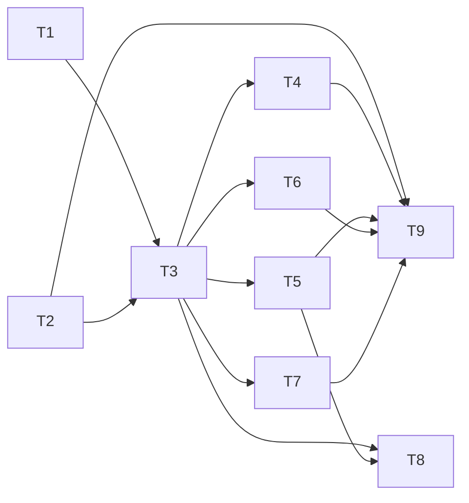

---
tasks:
  - id: T1
    title: "Settings keys"
    status: done
    capability: CAP-NEW-worktree-setup
    depends_on: []
    touches_core: false
    work_type: shell-scripts
    module: "feature-workflow"
    seam: "rules-setting.sh <key> command line, driven by the settings cases of tests/scripts/worktree-setup.sh"
    file: tasks/T01-settings-keys.md
    branch: task/00015-worktree-provisioning/T01-settings-keys
    predicted_files: [".agents/skills/feature-workflow/scripts/rules-setting.sh"]
    size: {files: 1, est_lines: 30, points: S}
    mode: afk
    parallel_with: []
    pr: null
    issue: null
  - id: T2
    title: "Install and allow the worktree setup script"
    status: done
    capability: CAP-NEW-worktree-setup
    depends_on: []
    touches_core: true
    work_type: shell-scripts
    module: "installer"
    seam: "install.sh run against a fixture target, and the settings template read as data"
    file: tasks/T02-install-and-allow.md
    branch: task/00015-worktree-provisioning/T02-install-and-allow
    predicted_files: ["install.sh", ".gitignore", ".agents/hooks/claude-settings.template.json", ".claude/settings.json", "PROVENANCE.md", "assetlist.md", "tests/scripts/install-payload.sh", "tests/scripts/install-claude-settings.sh"]
    size: {files: 8, est_lines: 90, points: M}
    mode: afk
    parallel_with: []
    pr: null
    issue: null
  - id: T3
    title: "Worktree setup script"
    status: done
    capability: CAP-NEW-worktree-setup
    depends_on: [T1, T2]
    touches_core: false
    work_type: shell-scripts
    module: "feature-workflow"
    seam: "worktree-setup.sh and spec-worktree.sh command lines in a throwaway repository"
    file: tasks/T03-worktree-setup-script.md
    branch: task/00015-worktree-provisioning/T03-worktree-setup-script
    predicted_files: [".agents/skills/feature-workflow/scripts/worktree-setup.sh", ".agents/skills/feature-workflow/scripts/spec-worktree.sh"]
    size: {files: 2, est_lines: 460, points: L}
    mode: afk
    parallel_with: []
    tests: ["tests/scripts/worktree-setup.sh", "tests/scripts/spec-worktree.sh"]
    pr: null
    issue: null
  - id: T4
    title: "Toolchain run starts services"
    status: done
    capability: CAP-NEW-worktree-setup
    depends_on: [T3]
    touches_core: false
    work_type: shell-scripts
    module: "feature-workflow"
    seam: "run-toolchain.sh command line and its evidence files"
    file: tasks/T04-toolchain-services.md
    branch: task/00015-worktree-provisioning/T04-toolchain-services
    predicted_files: [".agents/skills/feature-workflow/scripts/run-toolchain.sh"]
    size: {files: 1, est_lines: 160, points: M}
    mode: afk
    parallel_with: []
    tests: ["tests/scripts/run-toolchain.sh"]
    pr: null
    issue: null
  - id: T5
    title: "Step files name the script"
    status: done
    capability: CAP-NEW-worktree-setup
    depends_on: [T3]
    touches_core: false
    work_type: agent-docs
    module: "feature-workflow"
    seam: "the step files and the launching reference as loaded text, checked by the docs lint suites"
    file: tasks/T05-step-files.md
    branch: task/00015-worktree-provisioning/T05-step-files
    predicted_files: [".agents/skills/feature-workflow/modules/verification-setup.md", ".agents/skills/feature-workflow/modules/implementation-waves.md", ".agents/skills/feature-workflow/modules/implementation-shared-core.md", ".agents/skills/feature-workflow/modules/implementation-finish.md", ".agents/skills/feature-workflow/modules/sign-off.md", ".agents/skills/feature-workflow/modules/discovery-impact.md", ".agents/skills/feature-workflow/references/launching.md", ".agents/skills/feature-workflow/references/steps.tsv", "tests/lint/agent-worktree-docs.sh"]
    size: {files: 9, est_lines: 130, points: M}
    mode: afk
    parallel_with: []
    pr: null
    issue: null
  - id: T6
    title: "Project setup asks for it"
    status: done
    capability: CAP-NEW-worktree-setup
    depends_on: [T3]
    touches_core: false
    work_type: agent-docs
    module: "project-setup"
    seam: "the shipped rules template read by rules-setting.sh, and the project-setup documents as loaded text"
    file: tasks/T06-project-setup.md
    branch: task/00015-worktree-provisioning/T06-project-setup
    predicted_files: [".agents/skills/project-setup/assets/docs/rules.md", ".agents/skills/project-setup/assets/profiles/TEMPLATE.md", ".agents/skills/project-setup/modules/files.md", ".agents/skills/project-setup/modules/profiles.md", "tests/scripts/task-breakdown.sh"]
    size: {files: 5, est_lines: 80, points: S}
    mode: afk
    parallel_with: []
    pr: null
    issue: null
  - id: T7
    title: "Standards coverage"
    status: done
    capability: CAP-NEW-worktree-setup
    depends_on: [T3]
    touches_core: false
    work_type: agent-docs
    module: "project-standards"
    seam: "assets/coverage.md as loaded text, checked by a lint case over its rows"
    file: tasks/T07-standards-coverage.md
    branch: task/00015-worktree-provisioning/T07-standards-coverage
    predicted_files: [".agents/skills/project-standards/assets/coverage.md", "tests/lint/size-budget-docs.sh"]
    size: {files: 2, est_lines: 30, points: S}
    mode: afk
    parallel_with: []
    pr: null
    issue: null
  - id: T8
    title: "Agent definitions"
    status: pending
    capability: CAP-NEW-worktree-setup
    depends_on: [T3, T5]
    touches_core: false
    work_type: agent-docs
    module: "agents"
    seam: "the agent definitions as loaded text, checked by tests/lint/worktree-setup-docs.sh"
    file: tasks/T08-agent-definitions.md
    branch: task/00015-worktree-provisioning/T08-agent-definitions
    predicted_files: [".agents/agents/profile-mini-review.md", ".agents/agents/review-combined.md", ".agents/agents/review-end-state.md", ".agents/agents/review-standards.md", ".agents/agents/review-targets.md", ".agents/agents/implementation.md", ".agents/agents/integration.md", "tests/lint/review-escalation-docs.sh"]
    size: {files: 8, est_lines: 90, points: M}
    mode: afk
    parallel_with: []
    tests: ["tests/lint/worktree-setup-docs.sh"]
    pr: null
    issue: null
  - id: T9
    title: "Root docs and changelog"
    status: pending
    capability: CAP-NEW-worktree-setup
    depends_on: [T2, T4, T5, T6, T7]
    touches_core: false
    work_type: agent-docs
    module: "root-docs"
    seam: "the root documents as text, checked by lint/md-links"
    file: tasks/T09-root-docs.md
    branch: task/00015-worktree-provisioning/T09-root-docs
    predicted_files: ["README.md", ".agents/README.md", "AGENTS.md", ".codex/README.md", "CHANGELOG.md"]
    size: {files: 5, est_lines: 70, points: S}
    mode: afk
    parallel_with: []
    pr: null
    issue: null
---

# Tasks: Worktree provisioning

Spec: [spec.md](spec.md) · Data model: [data-model.md](data-model.md) · Task files: [tasks/](tasks/)

## Waves

| Wave | Task | Title | Size | Mode | Overlaps |
| --- | --- | --- | --- | --- | --- |
| 1 | [T1](tasks/T01-settings-keys.md) | Settings keys | S (1 file, ~30 lines) | afk | none |
| 1 | [T2](tasks/T02-install-and-allow.md) | Install and allow the worktree setup script | M (8 files, ~90 lines) | afk | none |
| 2 | [T3](tasks/T03-worktree-setup-script.md) | Worktree setup script | L (2 files, ~460 lines) | afk | none |
| 3 | [T4](tasks/T04-toolchain-services.md) | Toolchain run starts services | M (1 file, ~160 lines) | afk | none |
| 3 | [T5](tasks/T05-step-files.md) | Step files name the script | M (9 files, ~130 lines) | afk | none |
| 3 | [T6](tasks/T06-project-setup.md) | Project setup asks for it | S (5 files, ~80 lines) | afk | none |
| 3 | [T7](tasks/T07-standards-coverage.md) | Standards coverage | S (2 files, ~30 lines) | afk | none |
| 4 | [T8](tasks/T08-agent-definitions.md) | Agent definitions | M (8 files, ~90 lines) | afk | none |
| 4 | [T9](tasks/T09-root-docs.md) | Root docs and changelog | S (5 files, ~70 lines) | afk | none |

## Dependency graph

