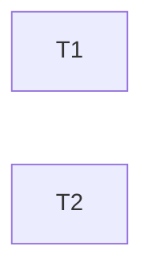

---
tasks:
  - id: T1
    title: "Handoff skill writes per-run session handoffs in the session's checkout"
    status: pending
    capability: CAP-NEW-per-run-handoffs
    depends_on: []
    touches_core: false
    work_type: null
    module: "standalone-skills"
    seam: "The Locate command block and the Resume wording of .agents/skills/handoff/SKILL.md"
    file: tasks/T01-handoff-skill-per-run.md
    branch: task/00016-per-run-handoffs/T01-handoff-skill-per-run
    predicted_files: [".agents/skills/handoff/SKILL.md", ".agents/skills/handoff/assets/handoff.md"]
    size: {files: 2, est_lines: 60, points: S}
    mode: afk
    parallel_with: []
    tests: ["tests/scripts/handoff-skill.sh"]
    pr: null
    issue: null
  - id: T2
    title: "Session-start offer lists session handoffs per checkout"
    status: pending
    capability: CAP-NEW-per-run-handoffs
    depends_on: []
    touches_core: false
    work_type: null
    module: "hooks"
    seam: "SessionStart hook I/O of .agents/hooks/session-start-resume.sh"
    file: tasks/T02-session-start-handoff-list.md
    branch: task/00016-per-run-handoffs/T02-session-start-handoff-list
    predicted_files: [".agents/hooks/session-start-resume.sh", ".agents/hooks/claude-settings.template.md"]
    size: {files: 2, est_lines: 50, points: S}
    mode: afk
    parallel_with: []
    tests: ["tests/hooks/audit-sync-resume.sh"]
    pr: null
    issue: null
---

# Tasks: Per-run session handoffs

Spec: [spec.md](spec.md) · Data model: [data-model.md](data-model.md) · Task files: [tasks/](tasks/)

## Waves

| Wave | Task | Title | Size | Mode | Overlaps |
| --- | --- | --- | --- | --- | --- |
| 1 | [T1](tasks/T01-handoff-skill-per-run.md) | Handoff skill writes per-run session handoffs in the session's checkout | S (2 files, ~60 lines) | afk | none |
| 1 | [T2](tasks/T02-session-start-handoff-list.md) | Session-start offer lists session handoffs per checkout | S (2 files, ~50 lines) | afk | none |

## Dependency graph

