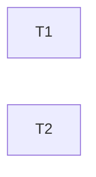

---
tasks:
  - id: T1
    title: "Deep dive held at once"
    status: done
    capability: CAP-NEW-deep-dive-discussion
    depends_on: []
    touches_core: false
    work_type: agent-docs
    module: "feature-workflow"
    seam: "step-file text read by tests/lint/stakeholder-asks-docs.sh (00019 JRN-001 to JRN-005), lint/step-list and scripts/step-progress"
    file: tasks/T01-deep-dive-held-at-once.md
    branch: task/00019-deep-dive-discussion/T01-deep-dive-held-at-once
    predicted_files: [".agents/skills/feature-workflow/modules/questioning-loop.md", ".agents/skills/feature-workflow/modules/large-path.md", ".agents/skills/feature-workflow/assets/design-log.md", ".agents/skills/feature-workflow/assets/questions.md", ".agents/skills/feature-workflow/references/steps.tsv", "PLAN/decision-flow.mermaid", "PLAN/decision-flow-reference.md"]
    size: {files: 7, est_lines: 200, points: M}
    mode: afk
    parallel_with: []
    tests: ["tests/lint/stakeholder-asks-docs.sh"]
    pr: null
    issue: null
  - id: T2
    title: "Waits count includes deep dive exchanges"
    status: done
    capability: CAP-NEW-deep-dive-discussion
    depends_on: []
    touches_core: false
    work_type: agent-docs
    module: "retrospective"
    seam: "the evidence.md waits command run on fixture design logs by tests/scripts/retrospective-evidence.sh (00019 JRN-006)"
    file: tasks/T02-waits-count-exchanges.md
    branch: task/00019-deep-dive-discussion/T02-waits-count-exchanges
    predicted_files: [".agents/skills/retrospective/modules/evidence.md"]
    size: {files: 1, est_lines: 5, points: S}
    mode: afk
    parallel_with: []
    tests: ["tests/scripts/retrospective-evidence.sh"]
    pr: null
    issue: null
---

# Tasks: Hold the deep dive at once, as a discussion that reaches agreement

Spec: [spec.md](spec.md) · Data model: [data-model.md](data-model.md) · Task files: [tasks/](tasks/)

## Waves

| Wave | Task | Title | Size | Mode | Overlaps |
| --- | --- | --- | --- | --- | --- |
| 1 | [T1](tasks/T01-deep-dive-held-at-once.md) | Deep dive held at once | M (7 files, ~200 lines) | afk | none |
| 1 | [T2](tasks/T02-waits-count-exchanges.md) | Waits count includes deep dive exchanges | S (1 file, ~5 lines) | afk | none |

## Dependency graph

