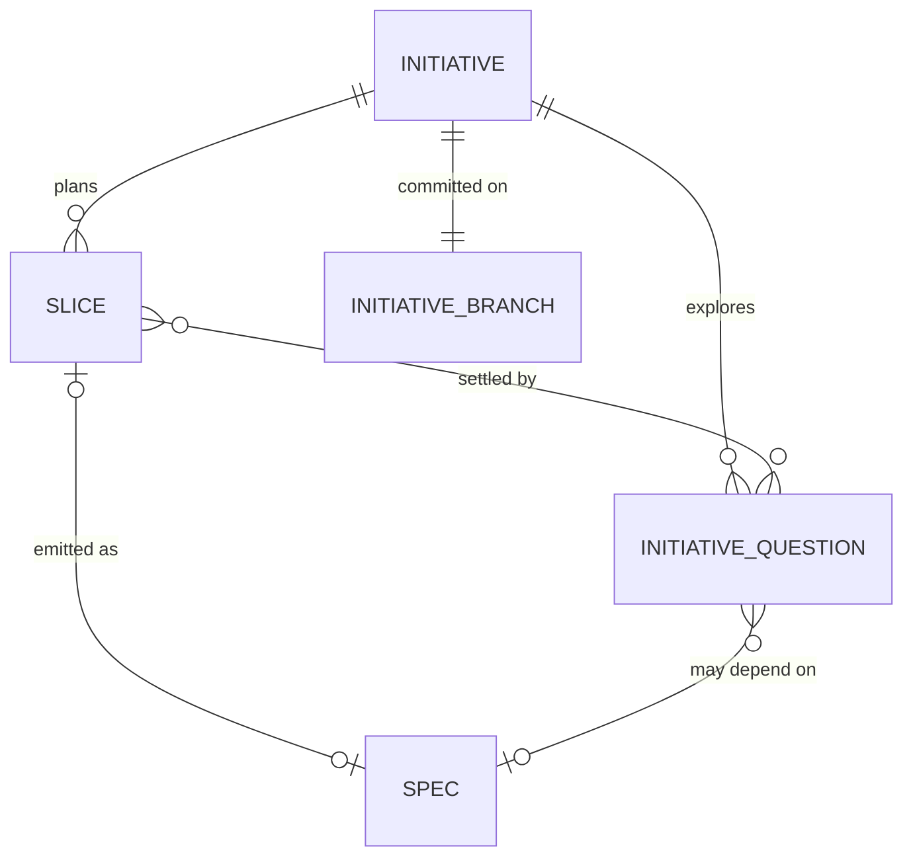

# Data model: Large path: planning a large subject into several specs

Spec: [spec.md](spec.md) · Placement: feature-workflow

## Summary

| Part | Kind | Classification | Owning module |
| --- | --- | --- | --- |
| Initiative | entity (`initiative.md` frontmatter) | create | feature-workflow |
| Slice | entity (record in `initiative.md`) | create | feature-workflow |
| Initiative question | entity (record in `questions.md`) | create | feature-workflow |
| Initiative step marker | entity (`.step`) | create | feature-workflow |
| Initiative branch `initiative/NNN-slug` | interface (git) | create | feature-workflow |
| Initiative PR/MR at `planned` and `done` | interface (`open-task-pr.sh` generic mode, `task_review`) | extend | feature-workflow |
| Spec `initiative` key | field (`spec.md` frontmatter) | extend | feature-workflow |
| Spec numbering at 0.1.1 | interface (discovery) | extend | feature-workflow |
| Large-path node ids (`6.x`, track `large`, phase 6) | interface (`references/steps.tsv`) | extend | feature-workflow |
| `initiative-transition.sh` | interface (status, step, set-slice, set-question, set-pr) | create | feature-workflow |
| `step-progress.sh` large form | interface | extend | feature-workflow |
| Guard class for `initiative.md`; Tier A gate aware of initiative `.step` | interface (`check-write.sh`, write guards) | extend | feature-workflow, hooks |
| Resume offer initiative lines (from initiative branch tips and main) | interface (`session-start-resume.sh`) | extend | hooks |
| Launch header from an initiative (`research`, `fact-lookup`, `retrieval`, `library-evaluation`) | interface (`resolve-launch.sh`, `pre-launch.sh`, `codex-pre-spawn.sh`) | extend | feature-workflow, hooks |
| `WF_INITIATIVES` | interface (`workflow-paths.sh`) | extend | lib (shared core) |
| Ignore and deny entries for `.workflow/initiatives/*/.step` | interface (`install.sh` `GI_ENTRIES`, `.gitignore`, settings templates) | extend | installer, hooks |
| Spec status, `status-transition.sh`, size budget, sign-off, `rules-setting.sh` | entity / interface | unchanged | feature-workflow |

## Entities

### Initiative (create)

The planning unit a large path creates: its goal, exploration record and the ordered specs it emits. Index file `initiative.md`; frontmatter read with yq, body holds the goal (Why) and the reference table of emitted specs. Lives on `initiative/NNN-slug` until merged into main at `planned`.

| Field | Type | Required | Validation rule | Change |
| --- | --- | --- | --- | --- |
| `status` | enum `exploring` \| `planned` \| `done` | yes | Changed only by `initiative-transition.sh` (CAP-NEW-initiative-close) | create |
| `origin` | string, `NNN-slug` of the converted spec | yes | Names a spec folder that no longer exists after conversion; kept for history (CAP-NEW-initiative-conversion) | create |
| `created` | ISO-8601 date | yes | Set once at conversion | create |
| `branch` | string `initiative/NNN-slug` | yes | Set at conversion; the branch every initiative commit lands on until `planned` merges (D22) | create |
| `merge_pr` | URL or `null` | yes | The `planned` PR/MR, written by `open-task-pr.sh --record` before `done`; `null` under `task_review: local` (D32) | create |
| `slices` | list of Slice records | yes (may be empty) | Ids unique, `depends_on` names existing slice ids (CAP-NEW-slice-emission) | create |

**Relationships:** Initiative has many Slices (0..n, embedded) and many Initiative questions (0..n, in `questions.md`); references many specs through `slices[].spec` (0..n; a spec folder is never deleted by the initiative).

**State transitions:**

| From | Event | To | Guard |
| --- | --- | --- | --- |
| (none) | conversion from a spec's questioning loop | `exploring` | the converted spec is `draft`; `initiative/NNN-slug` created off main; step `6.1` |
| `exploring` | last slice emitted | `planned` | every slice is `emitted` or `done`; no question `open` or `researching`; the branch is then merged into main per `task_review` (D24) |
| `planned` | stakeholder reopens exploration | `exploring` | at the large-path reopen node; the branch is re-created off main (D27, D28) |
| `planned` | resume of a planned initiative finds every emitted spec `done` on the main branch | `done` | read with `git show <main>:<spec.md>` (D26); the flip is committed on a re-created `initiative/NNN-slug` and merged like `planned` (D23) |

`done` is terminal: afterwards every subcommand of the initiative script exits 2.

**Invalid states ruled out:** `done` with a slice that is not `done` is refused by the script guard; `planned` with an open question is refused. Still representable: hand edits that bypass the script, which the single-writer rule forbids; the validator in the template reports them.

### Slice (create)

A planned part of an initiative that becomes exactly one spec. A record inside `initiative.md`.

| Field | Type | Required | Validation rule | Change |
| --- | --- | --- | --- | --- |
| `id` | `S<n>` | yes | Unique within the initiative, never reused | create |
| `title` | string | yes | Two to eight words | create |
| `status` | enum `planned` \| `emitted` \| `done` | yes | Changed only through `initiative-transition.sh set-slice` | create |
| `questions` | list of `IQ<n>` | yes | Every id exists in `questions.md`; all `settled` before emission (CAP-NEW-slice-emission) | create |
| `depends_on` | list of `S<n>` | yes (may be empty) | Informational order only (D18) | create |
| `spec` | string `NNN-slug` or `null` | yes | `null` while `planned`; the emitted spec folder name after | create |

**State transitions:**

| From | Event | To | Guard |
| --- | --- | --- | --- |
| `planned` | emission (discovery 0.1 seeded; the spec folder stays uncommitted in the working tree) | `emitted` | every question in `questions` is `settled`; stakeholder confirmed; the initiative commit lands before any switch to the spec's branch |
| `emitted` | the initiative is resumed and the spec is `done` on the main branch | `done` | read with `git show` from main (D26) |

**Invalid states ruled out:** `emitted` with `spec: null`, and `planned` with a non-null `spec`, are refused by the script. Still representable: none beyond hand edits.

### Initiative question (create)

One recorded uncertainty inside an initiative. A record in `questions.md` frontmatter.

| Field | Type | Required | Validation rule | Change |
| --- | --- | --- | --- | --- |
| `id` | `IQ<n>` | yes | Unique, never reused | create |
| `kind` | enum `research` \| `decision` | yes | `research` is answered by agents, `decision` by the stakeholder (CAP-NEW-initiative-exploration) | create |
| `state` | enum `open` \| `researching` \| `settled` | yes | Only `research` may be `researching` | create |
| `question` | string | yes | One question | create |
| `depends_on` | list of `IQ<n>` or `NNN-slug` (an emitted spec) | yes (may be empty) | On the frontier only when every dependency is `settled` (question) or `done` (spec, read from main) (D16, D26) | create |
| `launched` | map `{task_type, at}` or `null` | yes | Set when a research launch leaves the question `researching` across a session end (D9) | create |
| `settled` | string or `null` | yes | Source `path:line` or URL for research, the stakeholder's verbatim answer for a decision; non-null exactly when `state` is `settled` | create |

**State transitions:**

| From | Event | To | Guard |
| --- | --- | --- | --- |
| `open` | research launched | `researching` | `kind: research` |
| `researching` | answer written back by the main session | `settled` | the agent return is in hand |
| `researching` | resume finds no result | `open` | `launched` cleared |
| `open` | answered in a round | `settled` | `kind: decision`, or a fact looked up |

**Invalid states ruled out:** a `decision` in `researching`, and `settled` with a null `settled` line, are refused by the script. Still representable: none beyond hand edits.

### Initiative step marker (create)

Same shape as the spec marker (`step`, `updated_at`), under `.workflow/initiatives/NNN-slug/.step`, gitignored, written only by `initiative-transition.sh`. `step` is a `6.x` id. `check-write.sh` reads it beside the spec markers when judging a Tier A write (D30).

### Initiative branch (create)

`initiative/NNN-slug`, created in the main checkout at conversion off `origin/<main_branch>` when that ref exists after a fetch, else off local `main_branch` (D27); the session switches to it, as it switches to a spec branch at 1.1, and every later resume of the initiative switches to it first after checking the working tree is clean (D29). The large-path module commits `.workflow/initiatives/NNN-slug/**` and nothing else on it at conversion, after each round, at each emission and at each status change. Under `task_review` `pr` or `pr-blocking` each commit point pushes and `planned` opens a PR/MR into `main_branch` through the generic mode of `open-task-pr.sh` (`pr-blocking` waits for approval before merging); under `local` nothing is pushed and the branch is merged into main locally with `--no-ff` (D24, D25). After the merge the local branch is deleted (D28); reopen and the `done` flip re-create it the same way. An emitted spec folder is never added to an initiative commit.

### Spec `initiative` key (extend)

| Field | Type | Required | Validation rule | Change |
| --- | --- | --- | --- | --- |
| `initiative` | string `NNN-slug` | no | Present only on an emitted spec; names an initiative folder on main or on an initiative branch; written at 0.1.4 (CAP-NEW-slice-emission) | extend |

The spec validator treats it as an optional string, as it does `origin`. `status-transition.sh` leaves it untouched (fact: in-place yq edits).

### Spec numbering at 0.1.1 (extend)

The next spec number is one above the highest of: `.workflow/specs/[0-9][0-9][0-9]-*/` folders, `refs/heads/spec/*` and `refs/remotes/origin/spec/*` branch names, and the `slices[].spec` records of every initiative reachable in the working tree or on an initiative branch (D31). Applies to every spec, not only emitted ones.

### Large-path node ids (extend)

`references/steps.tsv` gains a `phase` row `6` named for the large path, rows `6.1`.. with track `large`, and one conversion node in phase 0 (track `both`) that the questioning loop enters at 0.3.19. `tests/lint/step-list.sh` widens its id regex to `(00|[0-6])`, pins seven phase rows, and counts `large` separately from `full` and `light`. `step-progress.sh` prints `Large path · step n of m — <title> (6.x)` for a `large` row.

### `initiative-transition.sh` (create)

```text
initiative-transition.sh status       <initiative-dir> <exploring|planned|done> [--step <6.x>]
initiative-transition.sh step         <initiative-dir> <6.x>
initiative-transition.sh set-slice    <initiative-dir> S<n> [--status <s>] [--spec <NNN-slug>]
initiative-transition.sh set-question <initiative-dir> IQ<n> [--state <s>] [--settled <text>] [--launched <task_type>|clear]
initiative-transition.sh set-pr       <initiative-dir> <url>|null
```

Exit 0 done; 1 environment error; 2 illegal transition with the reason on stderr. Same contract as the spec single writer; the two scripts never call each other.

### `open-task-pr.sh` generic mode (extend)

```text
open-task-pr.sh --head <branch> --base <branch> --title <text> [--body <text>] [--cwd <d>] [--record <initiative-dir>] [--dry-run]
```

Same host switch, auth precheck, open-PR reuse, `skipped: <reason>` line and exit contract as the task mode; `--record` writes the URL through `initiative-transition.sh set-pr`. The task mode is unchanged.

## Relationships



## Migrations

| # | Migration | Classification | Reversible | Depends on | Data handling |
| --- | --- | --- | --- | --- | --- |
| M1 | `WF_INITIATIVES` in `workflow-paths.sh`; ignore and deny entries in `install.sh`, `.gitignore`, the settings templates | extend | yes | - | none |
| M2 | `6.x` rows, phase 6 and the conversion node in `steps.tsv`; lint regex, phase rows, pins; PLAN flow docs; `step-progress.sh` large form | extend | yes | - | none |
| M3 | `assets/spec.md` admits `initiative:`; validator optional string; `assets/design-log.md` new entry shapes (Conversion, Origin from initiative, Initiative round, Emission) | extend | yes | - | none: no existing spec carries the key |
| M4 | `assets/initiative.md`, `assets/questions.md`, `initiative-transition.sh`; `open-task-pr.sh` generic mode | create / extend | yes | M1, M2 | none |
| M5 | Guard class for `initiative.md` and Tier A gate reading initiative `.step`; resume offer lists initiatives from branch tips and main; launch header from an initiative; `i<NNN>_` Codex task names | extend | yes | M1, M4 | none |
| M6 | `research` agent definition, model-map entry, launch requirements, manifest and PROVENANCE | create | yes | - | none |
| M7 | `modules/large-path.md` (branch, rounds, emission, PR at planned, lazy done); router, questioning-loop, discovery (conversion, seeded-from-a-slice, 0.1.1 numbering) and deferred-handoff edits; conversion re-points `superseded_by`, `origin_spec`, `promoted_to` and the moved log's `Spec:` line | create / extend | yes | M2, M4, M5, M6 | none |
| M8 | Test suites and README line | create / extend | yes | M1-M7 | none |
