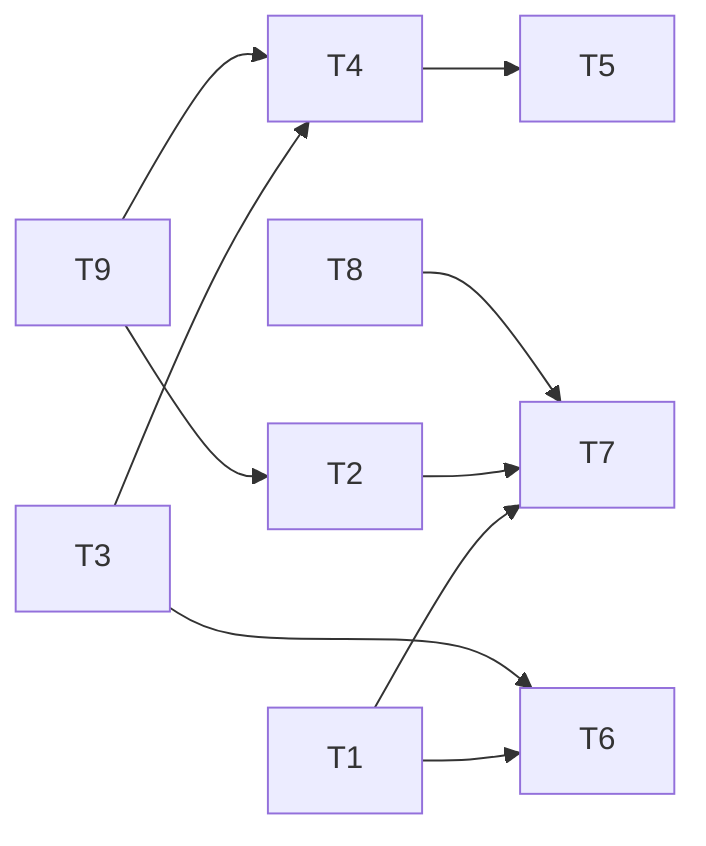

---
tasks:
  - id: T1
    title: "Initiative paths, ignore block and installer entries"
    status: pending
    capability: CAP-NEW-initiative-conversion
    depends_on: []
    touches_core: true
    work_type: null
    module: "installer"
    seam: "the install fixture's .gitignore block and dry-run output (tests/scripts/install.sh); wf_path on WF_INITIATIVES"
    file: tasks/T01-initiative-paths.md
    branch: task/001-large-path/T01-initiative-paths
    predicted_files:
      - .agents/lib/workflow-paths.sh
      - install.sh
      - .gitignore
      - tests/scripts/install.sh
    size: {files: 4, est_lines: 40, points: S}
    mode: afk
    parallel_with: []
    pr: null
  - id: T2
    title: "Large track in the step list and progress line"
    status: pending
    capability: CAP-NEW-initiative-exploration
    depends_on: [T9]
    touches_core: false
    work_type: null
    module: "feature-workflow"
    seam: "step-progress.sh <id> stdout, and tests/lint/step-list.sh over references/steps.tsv and the PLAN flow docs"
    file: tasks/T02-large-track-steps.md
    branch: task/001-large-path/T02-large-track-steps
    predicted_files:
      - .agents/skills/feature-workflow/references/steps.tsv
      - .agents/skills/feature-workflow/scripts/step-progress.sh
      - PLAN/decision-flow-reference.md
      - PLAN/decision-flow.mermaid
      - tests/lint/step-list.sh
      - tests/scripts/step-progress.sh
      - tests/fixtures/initiative.sh
    size: {files: 7, est_lines: 250, points: M}
    mode: afk
    parallel_with: []
    tests:
      - tests/lint/step-list.sh
      - tests/scripts/step-progress.sh
    pr: null
  - id: T3
    title: "Templates admit initiatives"
    status: pending
    capability: CAP-NEW-slice-emission
    depends_on: []
    touches_core: false
    work_type: null
    module: "feature-workflow"
    seam: "the yq validators embedded in the templates (frontmatter oracle)"
    file: tasks/T03-initiative-templates.md
    branch: task/001-large-path/T03-initiative-templates
    predicted_files:
      - .agents/skills/feature-workflow/assets/spec.md
      - .agents/skills/feature-workflow/assets/design-log.md
      - .agents/skills/feature-workflow/assets/initiative.md
      - .agents/skills/feature-workflow/assets/questions.md
    size: {files: 4, est_lines: 150, points: S}
    mode: afk
    parallel_with: []
    pr: null
  - id: T4
    title: "The initiative single writer"
    status: pending
    capability: CAP-NEW-initiative-exploration
    depends_on: [T3, T9]
    touches_core: false
    work_type: null
    module: "feature-workflow"
    seam: "initiative-transition.sh CLI: exit 0/1/2, the reason on stderr, the frontmatter and .step it writes (read with yq)"
    file: tasks/T04-initiative-single-writer.md
    branch: task/001-large-path/T04-initiative-single-writer
    predicted_files:
      - .agents/skills/feature-workflow/scripts/initiative-transition.sh
    size: {files: 1, est_lines: 380, points: M}
    mode: afk
    parallel_with: []
    tests:
      - tests/scripts/initiative-emission.sh
    pr: null
  - id: T5
    title: "Generic PR mode"
    status: pending
    capability: CAP-NEW-initiative-close
    depends_on: [T4]
    touches_core: false
    work_type: null
    module: "feature-workflow"
    seam: "open-task-pr.sh --head/--base/--title --dry-run stdout with gh and glab stubs on PATH; --record writes merge_pr through set-pr"
    file: tasks/T05-generic-pr-mode.md
    branch: task/001-large-path/T05-generic-pr-mode
    predicted_files:
      - .agents/skills/feature-workflow/scripts/open-task-pr.sh
      - .agents/skills/feature-workflow/scripts/rules-setting.sh
    size: {files: 2, est_lines: 120, points: S}
    mode: afk
    parallel_with: []
    tests:
      - tests/scripts/initiative-merge.sh
    pr: null
  - id: T6
    title: "Hooks know initiatives"
    status: pending
    capability: CAP-NEW-initiative-close
    depends_on: [T1, T3]
    touches_core: false
    work_type: null
    module: "hooks"
    seam: "hook stdin and stdout JSON: session-start-resume.sh additionalContext text; codex-pre-spawn.sh deny JSON and exit code; the settings templates' deny entries"
    file: tasks/T06-hooks-initiatives.md
    branch: task/001-large-path/T06-hooks-initiatives
    predicted_files:
      - .agents/hooks/session-start-resume.sh
      - .agents/hooks/codex-pre-spawn.sh
      - .agents/hooks/pre-launch.sh
      - .agents/hooks/claude-settings.template.json
      - .agents/hooks/claude-settings.template.md
      - .agents/hooks/codex-config.template.toml
      - tests/scripts/install.sh
    size: {files: 7, est_lines: 220, points: M}
    mode: afk
    parallel_with: []
    tests:
      - tests/scripts/initiative-conversion.sh
      - tests/scripts/initiative-transition.sh
      - tests/hooks/session-start-initiatives.sh
      - tests/hooks/codex-pre-spawn-initiative.sh
    pr: null
  - id: T7
    title: "Guards and launches from an initiative"
    status: pending
    capability: CAP-NEW-initiative-exploration
    depends_on: [T1, T2, T8]
    touches_core: false
    work_type: null
    module: "feature-workflow"
    seam: "check-write.sh --cwd --path [--only] exit code and reason, driven through the three guard hooks' stdin JSON; resolve-launch.sh --requirements JSON and a resolved research header"
    file: tasks/T07-guards-and-launches.md
    branch: task/001-large-path/T07-guards-and-launches
    predicted_files:
      - .agents/skills/feature-workflow/scripts/check-write.sh
      - .agents/skills/feature-workflow/scripts/resolve-launch.sh
      - tests/scripts/status-transition-check-write.sh
      - tests/scripts/resolve-launch.sh
    size: {files: 4, est_lines: 220, points: M}
    mode: afk
    parallel_with: []
    tests:
      - tests/hooks/initiative-write-guards.sh
      - tests/scripts/resolve-launch-initiative.sh
    pr: null
  - id: T8
    title: "The research task type"
    status: pending
    capability: CAP-NEW-initiative-exploration
    depends_on: []
    touches_core: false
    work_type: null
    module: "agents"
    seam: "tests/lint/frontmatter.sh over .agents/agents/research.md and the Codex toml generate-codex-agents.sh produces from it"
    file: tasks/T08-research-task-type.md
    branch: task/001-large-path/T08-research-task-type
    predicted_files:
      - .agents/agents/research.md
      - .agents/install-manifest.txt
      - PROVENANCE.md
      - tests/lint/frontmatter.sh
      - tests/scripts/generate-codex-agents.sh
    size: {files: 5, est_lines: 100, points: S}
    mode: afk
    parallel_with: []
    pr: null
  - id: T9
    title: "The large-path module and its entry points"
    status: pending
    capability: CAP-NEW-initiative-conversion
    depends_on: []
    touches_core: false
    work_type: null
    module: "feature-workflow"
    seam: "prose: tests/lint/step-list.sh (every step id the skill names exists) and the Phase 4 review lenses against the JRN-001, JRN-003 and JRN-005 replays"
    file: tasks/T09-large-path-module.md
    branch: task/001-large-path/T09-large-path-module
    predicted_files:
      - .agents/skills/feature-workflow/modules/large-path.md
      - .agents/skills/feature-workflow/SKILL.md
      - .agents/skills/feature-workflow/modules/questioning-loop.md
      - .agents/skills/feature-workflow/modules/discovery.md
      - .agents/skills/feature-workflow/modules/deferred-handoff.md
      - .agents/skills/feature-workflow/modules/sign-off.md
    size: {files: 6, est_lines: 400, points: M}
    mode: afk
    parallel_with: []
    pr: null
---

# Tasks: Large path: planning a large subject into several specs

Spec: [spec.md](spec.md) · Data model: [data-model.md](data-model.md) · Task files: [tasks/](tasks/)

## Waves

Derived from `depends_on` at 2.5 and approved in the 2.1 quiz (2026-10-22). T9 leads because the step list, the node ids and the scripts' call sites derive from the module it writes. Every task is `afk`; no `parallel_with` was needed.

| Wave | Task | Title | Size | Mode | Overlaps |
| --- | --- | --- | --- | --- | --- |
| 1 | [T1](tasks/T01-initiative-paths.md) | Initiative paths, ignore block and installer entries | S (4 files, ~40 lines) | afk | T6: `tests/scripts/install.sh`, ordered by the T1 → T6 edge |
| 1 | [T3](tasks/T03-initiative-templates.md) | Templates admit initiatives | S (4 files, ~150 lines) | afk | none |
| 1 | [T8](tasks/T08-research-task-type.md) | The research task type | S (5 files, ~100 lines) | afk | none |
| 1 | [T9](tasks/T09-large-path-module.md) | The large-path module and its entry points | M (6 files, ~400 lines) | afk | none |
| 2 | [T2](tasks/T02-large-track-steps.md) | Large track in the step list and progress line | M (7 files, ~250 lines) | afk | none |
| 2 | [T4](tasks/T04-initiative-single-writer.md) | The initiative single writer | M (1 file, ~380 lines) | afk | none |
| 2 | [T6](tasks/T06-hooks-initiatives.md) | Hooks know initiatives | M (7 files, ~220 lines) | afk | T1: `tests/scripts/install.sh`, ordered by the T1 → T6 edge |
| 3 | [T5](tasks/T05-generic-pr-mode.md) | Generic PR mode | S (2 files, ~120 lines) | afk | none |
| 3 | [T7](tasks/T07-guards-and-launches.md) | Guards and launches from an initiative | M (4 files, ~220 lines) | afk | none |

## Dependency graph

