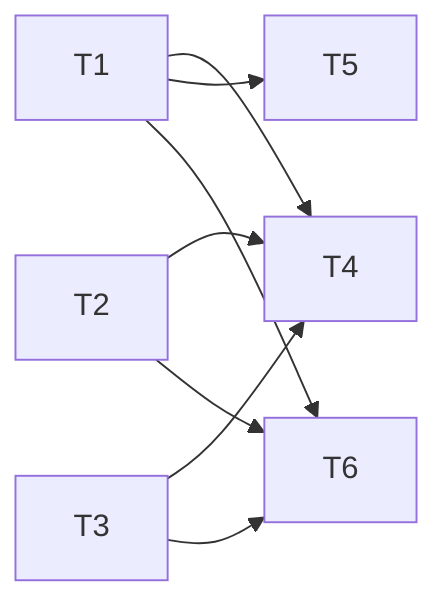

---
tasks:
  - id: T1
    title: "Lessons file template and the 5.7 guard class"
    status: in-progress
    capability: CAP-NEW-review-lessons-record
    depends_on: []
    touches_core: true
    work_type: shell-scripts
    module: "feature-workflow"
    seam: "check-write.sh exit codes and messages; the tier-a-write-guard allow or deny JSON; the template's own validate: and next-id: commands"
    file: tasks/T01-lessons-template-and-guard.md
    branch: task/002-review-lessons/T01-lessons-template-and-guard
    predicted_files:
      - .agents/lib/workflow-paths.sh
      - .agents/skills/feature-workflow/assets/review-lessons.md
      - .agents/skills/feature-workflow/scripts/check-write.sh
      - .agents/skills/feature-workflow/SKILL.md
      - .agents/hooks/tier-a-write-guard.sh
      - tests/scripts/check-write-tier-a.sh
      - tests/hooks/write-guards.sh
    size: {files: 7, est_lines: 160, points: M}
    mode: afk
    parallel_with: []
    tests:
      - tests/scripts/check-write-tier-a.sh
      - tests/hooks/write-guards.sh
    pr: null
  - id: T2
    title: "Launch row, lens table and step 4.9"
    status: in-progress
    capability: CAP-NEW-review-lessons-lens
    depends_on: []
    touches_core: false
    work_type: shell-scripts
    module: "feature-workflow"
    seam: "resolve-launch.sh --requirements JSON; pre-launch.sh allow or deny JSON; check-review-findings.sh exit, errors and table; step-progress.sh output; steps.tsv rows against the PLAN docs"
    file: tasks/T02-launch-row-lens-table-step.md
    branch: task/002-review-lessons/T02-launch-row-lens-table-step
    predicted_files:
      - .agents/skills/feature-workflow/scripts/resolve-launch.sh
      - .agents/skills/feature-workflow/scripts/check-review-findings.sh
      - .agents/skills/feature-workflow/references/steps.tsv
      - PLAN/decision-flow-reference.md
      - PLAN/decision-flow.mermaid
      - tests/scripts/resolve-launch.sh
      - tests/scripts/check-review-findings.sh
      - tests/scripts/step-progress.sh
      - tests/lint/step-list.sh
      - tests/hooks/pre-launch.sh
    size: {files: 10, est_lines: 120, points: M}
    mode: afk
    parallel_with: []
    tests:
      - tests/scripts/resolve-launch.sh
      - tests/scripts/check-review-findings.sh
      - tests/scripts/step-progress.sh
      - tests/lint/step-list.sh
      - tests/hooks/pre-launch.sh
    pr: null
  - id: T3
    title: "The review-lessons lens definition"
    status: done
    capability: CAP-NEW-review-lessons-lens
    depends_on: []
    touches_core: false
    work_type: agent-docs
    module: "agents"
    seam: "the frontmatter lint and the generated Codex toml; the lens's judgement by the JRN-001 and JRN-002 live runs at 3.10"
    file: tasks/T03-review-lessons-lens.md
    branch: task/002-review-lessons/T03-review-lessons-lens
    predicted_files:
      - .agents/agents/review-lessons.md
      - .agents/install-manifest.txt
      - PROVENANCE.md
      - assetlist.md
      - README.md
    size: {files: 5, est_lines: 180, points: M}
    mode: afk
    parallel_with: []
    pr: null
  - id: T4
    title: "Triage launches four lenses; sign-off names the lessons write"
    status: done
    capability: CAP-NEW-review-lessons-lens
    depends_on: [T1, T2, T3]
    touches_core: false
    work_type: agent-docs
    module: "feature-workflow"
    seam: "none in the harness: prose checked at 3.7 and 4.2; the step-list lint guards the 4.9 step calls it adds"
    file: tasks/T04-triage-four-lenses.md
    branch: task/002-review-lessons/T04-triage-four-lenses
    predicted_files:
      - .agents/skills/feature-workflow/modules/review-triage.md
      - .agents/skills/feature-workflow/modules/sign-off.md
      - .agents/skills/feature-workflow/assets/design-log.md
      - .agents/skills/feature-workflow/SKILL.md
    size: {files: 4, est_lines: 60, points: S}
    mode: afk
    parallel_with: []
    pr: null
  - id: T5
    title: "Retrospective writes and retires review lessons"
    status: done
    capability: CAP-NEW-review-lessons-record
    depends_on: [T1]
    touches_core: false
    work_type: agent-docs
    module: "retrospective"
    seam: "the template's validate: and next-id: commands (JRN-006 oracle in tests/lint/review-lessons.sh); the procedure runs live at this spec's 5.7"
    file: tasks/T05-retrospective-writes-lessons.md
    branch: task/002-review-lessons/T05-retrospective-writes-lessons
    predicted_files:
      - .agents/skills/retrospective/SKILL.md
      - .agents/skills/retrospective/modules/routing.md
      - .agents/skills/retrospective/modules/evidence.md
      - .agents/skills/retrospective/assets/retrospective.md
    size: {files: 4, est_lines: 160, points: M}
    mode: afk
    parallel_with: []
    pr: null
  - id: T6
    title: "New projects get the lessons file; the asset-set lint goes green"
    status: done
    capability: CAP-NEW-review-lessons-record
    depends_on: [T1, T2, T3]
    touches_core: false
    work_type: agent-docs
    module: "project-setup"
    seam: "the modules/files.md table row and the asset-set assertions of tests/lint/review-lessons.sh"
    file: tasks/T06-project-setup-lessons-file.md
    branch: task/002-review-lessons/T06-project-setup-lessons-file
    predicted_files:
      - .agents/skills/project-setup/modules/files.md
      - .agents/skills/project-setup/modules/model-map.md
      - .agents/skills/project-setup/SKILL.md
      - tests/lint/review-lessons.sh
    size: {files: 4, est_lines: 20, points: S}
    mode: afk
    parallel_with: []
    tests:
      - tests/lint/review-lessons.sh
    pr: null
---

# Tasks: Review lessons: a Phase 4 lens for retrospective lessons

Spec: [spec.md](spec.md) · Data model: [data-model.md](data-model.md) · Task files: [tasks/](tasks/)

## Waves

Derived from `depends_on` at 2.5 and approved in the 2.1 quiz (2026-10-22). Wave 1 lays the plumbing in three modules at once; wave 2 wires the lens into triage and the retrospective and brings the asset-set suite green. Every task is `afk`; no `parallel_with` was needed.

| Wave | Task | Title | Size | Mode | Overlaps |
| --- | --- | --- | --- | --- | --- |
| 1 | [T1](tasks/T01-lessons-template-and-guard.md) | Lessons file template and the 5.7 guard class | M (7 files, ~160 lines) | afk | T4: `.agents/skills/feature-workflow/SKILL.md`, ordered by the T1 → T4 edge |
| 1 | [T2](tasks/T02-launch-row-lens-table-step.md) | Launch row, lens table and step 4.9 | M (10 files, ~120 lines) | afk | none |
| 1 | [T3](tasks/T03-review-lessons-lens.md) | The review-lessons lens definition | M (5 files, ~180 lines) | afk | none |
| 2 | [T4](tasks/T04-triage-four-lenses.md) | Triage launches four lenses; sign-off names the lessons write | S (4 files, ~60 lines) | afk | T1: `.agents/skills/feature-workflow/SKILL.md`, ordered by the T1 → T4 edge |
| 2 | [T5](tasks/T05-retrospective-writes-lessons.md) | Retrospective writes and retires review lessons | M (4 files, ~160 lines) | afk | none |
| 2 | [T6](tasks/T06-project-setup-lessons-file.md) | New projects get the lessons file; the asset-set lint goes green | S (4 files, ~20 lines) | afk | none |

## Dependency graph

