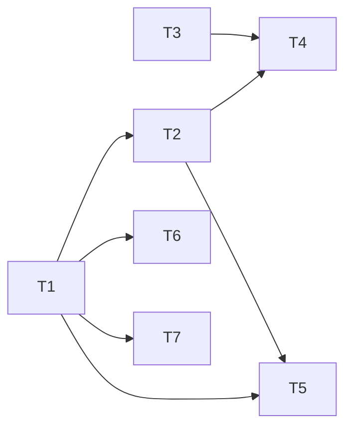

---
tasks:
  - id: T1
    title: "Graph extractor per work profile"
    status: pending
    capability: CAP-NEW-selectable-graph-extractor
    depends_on: []
    touches_core: false
    work_type: null
    module: "regenerate-caches"
    seam: "build-architecture.sh CLI (profile resolution, --extractor, --print-generator, --from-json) and the extractors/dependency-cruiser.sh contract"
    file: tasks/T01-graph-extractor-per-profile.md
    branch: task/003-bash-cache-extractor/T01-graph-extractor-per-profile
    predicted_files:
      - .agents/skills/regenerate-caches/scripts/build-architecture.sh
      - .agents/skills/regenerate-caches/scripts/extractors/dependency-cruiser.sh
    size: {files: 2, est_lines: 220, points: M}
    mode: afk
    parallel_with: []
    tests:
      - tests/scripts/cache-missing-extractor-key.sh
    pr: null
  - id: T2
    title: "Unresolved edges in architecture"
    status: pending
    capability: CAP-NEW-bash-graph-extractor
    depends_on: [T1]
    touches_core: false
    work_type: null
    module: "regenerate-caches"
    seam: "build-architecture.sh --cache architecture output, and check-staged-cache.sh on an architecture body"
    file: tasks/T02-unresolved-edges-section.md
    branch: task/003-bash-cache-extractor/T02-unresolved-edges-section
    predicted_files:
      - .agents/skills/regenerate-caches/scripts/build-architecture.sh
      - .agents/skills/regenerate-caches/scripts/check-staged-cache.sh
      - tests/scripts/build-architecture.sh
    size: {files: 3, est_lines: 120, points: S}
    mode: afk
    parallel_with: []
    tests:
      - tests/scripts/build-architecture.sh
      - tests/scripts/cache-js-unchanged.sh
    pr: null
  - id: T3
    title: "Bash graph extractor"
    status: pending
    capability: CAP-NEW-bash-graph-extractor
    depends_on: []
    touches_core: false
    work_type: null
    module: "regenerate-caches"
    seam: "extractors/bash.sh --root DIR --scope PATH... and its Graph JSON on stdout"
    file: tasks/T03-bash-graph-extractor.md
    branch: task/003-bash-cache-extractor/T03-bash-graph-extractor
    predicted_files:
      - .agents/skills/regenerate-caches/scripts/extractors/bash.sh
    size: {files: 1, est_lines: 200, points: M}
    mode: afk
    parallel_with: []
    tests:
      - tests/scripts/extractor-bash.sh
    pr: null
  - id: T4
    title: "Bash functions and test exclusion in modules and entries"
    status: pending
    capability: CAP-NEW-bash-graph-extractor
    depends_on: [T2, T3]
    touches_core: false
    work_type: null
    module: "regenerate-caches"
    seam: "build-architecture.sh --cache modules and --cache entries output"
    file: tasks/T04-bash-interface-and-entries.md
    branch: task/003-bash-cache-extractor/T04-bash-interface-and-entries
    predicted_files:
      - .agents/skills/regenerate-caches/scripts/build-architecture.sh
    size: {files: 1, est_lines: 80, points: S}
    mode: afk
    parallel_with: []
    tests:
      - tests/scripts/cache-bash-project.sh
      - tests/scripts/cache-mixed-extractors.sh
    pr: null
  - id: T5
    title: "regenerate-caches docs for graph extractors"
    status: pending
    capability: CAP-NEW-selectable-graph-extractor
    depends_on: [T1, T2]
    touches_core: false
    work_type: null
    module: "regenerate-caches"
    seam: "None: docs, checked by the agent-docs lint suites"
    file: tasks/T05-regenerate-caches-docs.md
    branch: task/003-bash-cache-extractor/T05-regenerate-caches-docs
    predicted_files:
      - .agents/skills/regenerate-caches/SKILL.md
      - .agents/skills/regenerate-caches/assets/cache-frontmatter.md
    size: {files: 2, est_lines: 60, points: S}
    mode: afk
    parallel_with: []
    pr: null
  - id: T6
    title: "Discovery 0.2.8 publishes the extractor names"
    status: pending
    capability: CAP-NEW-selectable-graph-extractor
    depends_on: [T1]
    touches_core: false
    work_type: null
    module: "feature-workflow"
    seam: "None: docs, checked by the agent-docs lint suites"
    file: tasks/T06-discovery-publish-generator.md
    branch: task/003-bash-cache-extractor/T06-discovery-publish-generator
    predicted_files:
      - .agents/skills/feature-workflow/modules/discovery.md
    size: {files: 1, est_lines: 10, points: S}
    mode: afk
    parallel_with: []
    pr: null
  - id: T7
    title: "cache-regeneration agent names the extractors"
    status: pending
    capability: CAP-NEW-selectable-graph-extractor
    depends_on: [T1]
    touches_core: false
    work_type: null
    module: "agents"
    seam: "None: docs, checked by the agent-docs lint suites"
    file: tasks/T07-cache-regeneration-generator.md
    branch: task/003-bash-cache-extractor/T07-cache-regeneration-generator
    predicted_files:
      - .agents/agents/cache-regeneration.md
    size: {files: 1, est_lines: 10, points: S}
    mode: afk
    parallel_with: []
    pr: null
  - id: T8
    title: "Profile template asks for graph_extractor"
    status: pending
    capability: CAP-NEW-selectable-graph-extractor
    depends_on: []
    touches_core: false
    work_type: null
    module: "project-setup"
    seam: "None: docs, checked by the agent-docs lint suites"
    file: tasks/T08-profile-graph-extractor-key.md
    branch: task/003-bash-cache-extractor/T08-profile-graph-extractor-key
    predicted_files:
      - .agents/skills/project-setup/assets/profiles/TEMPLATE.md
      - .agents/skills/project-setup/assets/profiles/examples/test-harness.md
      - .agents/skills/project-setup/assets/profiles/examples/e2e-browser.md
      - .agents/skills/project-setup/modules/profiles.md
    size: {files: 4, est_lines: 40, points: S}
    mode: afk
    parallel_with: []
    pr: null
---

# Tasks: Tier B caches for bash projects

Spec: [spec.md](spec.md) · Data model: [data-model.md](data-model.md) · Task files: [tasks/](tasks/)

## Waves

| Wave | Task | Title | Size | Mode | Overlaps |
| --- | --- | --- | --- | --- | --- |
| 1 | [T1](tasks/T01-graph-extractor-per-profile.md) | Graph extractor per work profile | M (2 files, ~220 lines) | afk | T2, T4: `build-architecture.sh`, edges |
| 1 | [T3](tasks/T03-bash-graph-extractor.md) | Bash graph extractor | M (1 files, ~200 lines) | afk | none |
| 1 | [T8](tasks/T08-profile-graph-extractor-key.md) | Profile template asks for graph_extractor | S (4 files, ~40 lines) | afk | none |
| 2 | [T2](tasks/T02-unresolved-edges-section.md) | Unresolved edges in architecture | S (3 files, ~120 lines) | afk | T1, T4: `build-architecture.sh`, edges |
| 2 | [T6](tasks/T06-discovery-publish-generator.md) | Discovery 0.2.8 publishes the extractor names | S (1 files, ~10 lines) | afk | none |
| 2 | [T7](tasks/T07-cache-regeneration-generator.md) | cache-regeneration agent names the extractors | S (1 files, ~10 lines) | afk | none |
| 3 | [T4](tasks/T04-bash-interface-and-entries.md) | Bash functions and test exclusion in modules and entries | S (1 files, ~80 lines) | afk | T1, T2: `build-architecture.sh`, edges |
| 3 | [T5](tasks/T05-regenerate-caches-docs.md) | regenerate-caches docs for graph extractors | S (2 files, ~60 lines) | afk | none |

## Dependency graph

