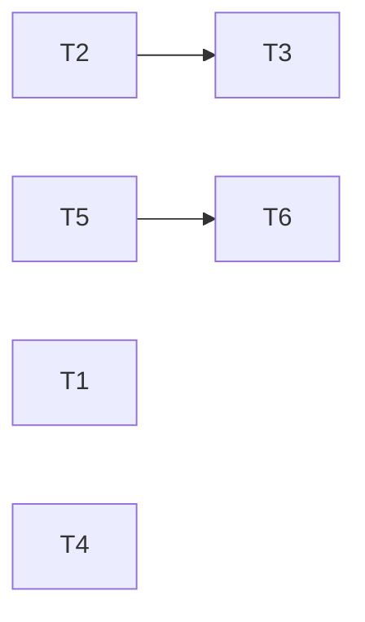

---
tasks:
  - id: T1
    title: "Feature-workflow scripts use the shared folder-path and test-path helpers"
    status: done
    capability: CAP-004
    depends_on: []
    touches_core: true
    work_type: shell-scripts
    module: "feature-workflow"
    seam: "each script's CLI (exit code, stdout, stderr) in its suite; wf_norm_folder and wf_main_root sourced in tests/scripts/lib-workflow-paths.sh"
    file: tasks/T01-feature-workflow-shared-helpers.md
    branch: task/005-cache-build-followups/T01-feature-workflow-shared-helpers
    predicted_files:
      - .agents/skills/feature-workflow/scripts/status-transition.sh
      - .agents/skills/feature-workflow/scripts/budget-check.sh
      - .agents/skills/feature-workflow/scripts/task-waves.sh
      - .agents/skills/feature-workflow/scripts/commit-workflow-data.sh
      - .agents/skills/feature-workflow/scripts/initiative-transition.sh
      - .agents/skills/feature-workflow/scripts/open-task-pr.sh
    size: {files: 6, est_lines: 250, points: M}
    mode: afk
    parallel_with: []
    tests:
      - tests/scripts/lib-workflow-paths.sh
      - tests/scripts/task-breakdown.sh
    pr: null
  - id: T2
    title: "Flow entry candidates read test files through the shared helper"
    status: done
    capability: CAP-004
    depends_on: []
    touches_core: true
    work_type: shell-scripts
    module: "regenerate-caches"
    seam: "build-architecture.sh --cache entries on the test-pattern profiles fixture; wf_*test* functions sourced in tests/scripts/lib-test-paths.sh"
    file: tasks/T02-entry-candidates-shared-test-paths.md
    branch: task/005-cache-build-followups/T02-entry-candidates-shared-test-paths
    predicted_files:
      - .agents/skills/regenerate-caches/scripts/build-architecture.sh
    size: {files: 1, est_lines: 80, points: S}
    mode: afk
    parallel_with: []
    tests:
      - tests/scripts/lib-test-paths.sh
    pr: null
  - id: T3
    title: "Boundary violations says Not checked when depcruise did not run"
    status: pending
    capability: CAP-004
    depends_on: [T2]
    touches_core: false
    work_type: shell-scripts
    module: "regenerate-caches"
    seam: "build-architecture.sh --cache architecture on the JS fixture with DEPCRUISE stand-ins (tests/scripts/cache-boundary-check.sh)"
    file: tasks/T03-boundary-not-checked.md
    branch: task/005-cache-build-followups/T03-boundary-not-checked
    predicted_files:
      - .agents/skills/regenerate-caches/scripts/build-architecture.sh
    size: {files: 1, est_lines: 60, points: S}
    mode: afk
    parallel_with: []
    tests:
      - tests/scripts/cache-boundary-check.sh
    pr: null
  - id: T4
    title: "Bash graph extractor skips case arm patterns"
    status: done
    capability: CAP-005
    depends_on: []
    touches_core: false
    work_type: shell-scripts
    module: "regenerate-caches"
    seam: "extractors/bash.sh JSON on the case forms fixture; build-architecture.sh --cache architecture over a copy of this repo"
    file: tasks/T04-bash-extractor-case-arms.md
    branch: task/005-cache-build-followups/T04-bash-extractor-case-arms
    predicted_files:
      - .agents/skills/regenerate-caches/scripts/extractors/bash.sh
    size: {files: 1, est_lines: 80, points: S}
    mode: afk
    parallel_with: []
    tests:
      - tests/scripts/extractor-bash.sh
      - tests/scripts/cache-repo-architecture.sh
    pr: null
  - id: T5
    title: "Staged-cache check runs the Mermaid validator"
    status: done
    capability: CAP-004
    depends_on: []
    touches_core: false
    work_type: shell-scripts
    module: "regenerate-caches"
    seam: "check-staged-cache.sh flows <staged body> CLI (stdout, stderr, exit) with a node stand-in and with node or packages absent"
    file: tasks/T05-staged-cache-mermaid-check.md
    branch: task/005-cache-build-followups/T05-staged-cache-mermaid-check
    predicted_files:
      - .agents/skills/regenerate-caches/scripts/check-staged-cache.sh
    size: {files: 1, est_lines: 50, points: S}
    mode: afk
    parallel_with: []
    pr: null
  - id: T6
    title: "Cache-regeneration agent calls only regenerate-caches"
    status: pending
    capability: CAP-004
    depends_on: [T5]
    touches_core: false
    work_type: agent-docs
    module: "agents"
    seam: "the agent doc's content, checked by the JRN-007 grep in tests/scripts/cache-scripts.sh"
    file: tasks/T06-cache-regeneration-agent-ownership.md
    branch: task/005-cache-build-followups/T06-cache-regeneration-agent-ownership
    predicted_files:
      - .agents/agents/cache-regeneration.md
    size: {files: 1, est_lines: 20, points: S}
    mode: afk
    parallel_with: []
    tests:
      - tests/scripts/cache-scripts.sh
    pr: null
---

# Tasks: Cache build follow-ups from spec 003

Spec: [spec.md](spec.md) · Data model: [data-model.md](data-model.md) · Task files: [tasks/](tasks/)

## Waves

Before wave 1, one shell-scripts integration batch applies the shared-core requests of T1 and T2 (`.agents/lib/workflow-paths.sh`, `.agents/lib/test-paths.sh`).

| Wave | Task | Title | Size | Mode | Overlaps |
| --- | --- | --- | --- | --- | --- |
| 1 | [T1](tasks/T01-feature-workflow-shared-helpers.md) | Feature-workflow scripts use the shared folder-path and test-path helpers | M (6 files, ~250 lines) | afk | none |
| 1 | [T2](tasks/T02-entry-candidates-shared-test-paths.md) | Flow entry candidates read test files through the shared helper | S (1 file, ~80 lines) | afk | T3: `build-architecture.sh`, edge T2 → T3 |
| 1 | [T4](tasks/T04-bash-extractor-case-arms.md) | Bash graph extractor skips case arm patterns | S (1 file, ~80 lines) | afk | none |
| 1 | [T5](tasks/T05-staged-cache-mermaid-check.md) | Staged-cache check runs the Mermaid validator | S (1 file, ~50 lines) | afk | none |
| 2 | [T3](tasks/T03-boundary-not-checked.md) | Boundary violations says Not checked when depcruise did not run | S (1 file, ~60 lines) | afk | T2: `build-architecture.sh`, edge T2 → T3 |
| 2 | [T6](tasks/T06-cache-regeneration-agent-ownership.md) | Cache-regeneration agent calls only regenerate-caches | S (1 file, ~20 lines) | afk | none (T5 → T6 is a gating edge: T6 owns `cache-scripts.sh`) |

## Dependency graph

