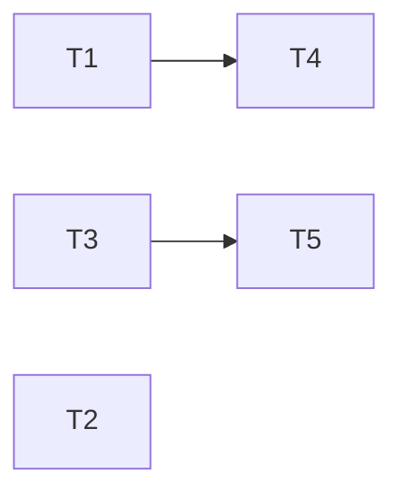

---
tasks:
  - id: T1
    title: "Hooks build agent worktree names from the shared lib"
    status: pending
    capability: CAP-NEW-result-file-write
    depends_on: []
    touches_core: true
    work_type: null
    module: "hooks"
    seam: "hook JSON contract: PreToolUse payload -> deny JSON or nothing (worktree-guard JRN-002/003), SubagentStop payload with a toolchain stand-in (audit-agent-worktrees), lib functions sourced (lib-workflow-paths), settings matcher after install and upgrade"
    file: tasks/T01-hooks-agent-worktree-names.md
    branch: task/006-result-file-guard/T01-hooks-agent-worktree-names
    predicted_files:
      - .agents/hooks/worktree-write-guard.sh
      - .agents/hooks/post-implementation-audit.sh
      - .agents/hooks/codex-pre-spawn.sh
      - .agents/hooks/claude-settings.template.json
      - .agents/hooks/claude-settings.template.md
      - .claude/settings.json
    size: {files: 6, est_lines: 200, points: M}
    mode: afk
    parallel_with: []
    tests:
      - tests/scripts/lib-workflow-paths.sh
      - tests/hooks/audit-agent-worktrees.sh
      - tests/scripts/install-claude-settings.sh
      - tests/scripts/install-upgrade.sh
    pr: null
  - id: T2
    title: "Artifacts merge gate"
    status: pending
    capability: CAP-NEW-result-file-write
    depends_on: []
    touches_core: false
    work_type: null
    module: "feature-workflow"
    seam: "check-merge-artifacts.sh CLI (exit code, stdout lines) on a fixture repo with a spec branch, task branches and detached commits (check-merge-artifacts JRN-007)"
    file: tasks/T02-artifacts-merge-gate.md
    branch: task/006-result-file-guard/T02-artifacts-merge-gate
    predicted_files:
      - .agents/skills/feature-workflow/scripts/check-merge-artifacts.sh
    size: {files: 1, est_lines: 90, points: S}
    mode: afk
    parallel_with: []
    tests:
      - tests/scripts/check-merge-artifacts.sh
    pr: null
  - id: T3
    title: "Agent briefs write the result file to the main checkout"
    status: pending
    capability: CAP-NEW-result-file-write
    depends_on: []
    touches_core: false
    work_type: null
    module: "agents"
    seam: "the brief's result-file command, extracted from the doc and run under the guard (worktree-guard JRN-002 to JRN-004), plus the brief-path cases in agent-worktree-docs JRN-008"
    file: tasks/T03-agent-briefs-main-checkout-result.md
    branch: task/006-result-file-guard/T03-agent-briefs-main-checkout-result
    predicted_files:
      - .agents/agents/implementation.md
      - .agents/agents/integration.md
    size: {files: 2, est_lines: 20, points: S}
    mode: afk
    parallel_with: []
    pr: null
  - id: T4
    title: "Read-only commands pass the worktree scope check"
    status: pending
    capability: CAP-NEW-worktree-read-commands
    depends_on: [T1]
    touches_core: false
    work_type: null
    module: "feature-workflow"
    seam: "check-worktree-scope.sh --command through a confined PreToolUse Bash payload, cwd in the main checkout (worktree-guard JRN-009)"
    file: tasks/T04-read-only-commands-pass-scope-check.md
    branch: task/006-result-file-guard/T04-read-only-commands-pass-scope-check
    predicted_files:
      - .agents/skills/feature-workflow/scripts/check-worktree-scope.sh
    size: {files: 1, est_lines: 120, points: S}
    mode: afk
    parallel_with: []
    tests:
      - tests/hooks/worktree-guard.sh
    pr: null
  - id: T5
    title: "Orchestrator steps launch Phase 1 and integration in agent worktrees"
    status: pending
    capability: CAP-NEW-result-file-write
    depends_on: [T3]
    touches_core: false
    work_type: null
    module: "feature-workflow"
    seam: "doc text of verification-setup.md and implementation-orchestrator.md, checked clause by clause (agent-worktree-docs JRN-008)"
    file: tasks/T05-orchestrator-agent-worktrees.md
    branch: task/006-result-file-guard/T05-orchestrator-agent-worktrees
    predicted_files:
      - .agents/skills/feature-workflow/modules/verification-setup.md
      - .agents/skills/feature-workflow/modules/implementation-orchestrator.md
    size: {files: 2, est_lines: 120, points: S}
    mode: afk
    parallel_with: []
    tests:
      - tests/lint/agent-worktree-docs.sh
    pr: null
---

# Tasks: Sub-agents can write their own result file

Spec: [spec.md](spec.md) · Data model: [data-model.md](data-model.md) · Task files: [tasks/](tasks/)

## Waves

Before wave 1, one shell-scripts integration batch applies T1's shared-core request (`wf_enc`, `wf_agent_worktree_name` in `.agents/lib/workflow-paths.sh`).

| Wave | Task | Title | Size | Mode | Overlaps |
| --- | --- | --- | --- | --- | --- |
| 1 | [T1](tasks/T01-hooks-agent-worktree-names.md) | Hooks build agent worktree names from the shared lib | M (6 files, ~200 lines) | afk | none |
| 1 | [T2](tasks/T02-artifacts-merge-gate.md) | Artifacts merge gate | S (1 file, ~90 lines) | afk | none |
| 1 | [T3](tasks/T03-agent-briefs-main-checkout-result.md) | Agent briefs write the result file to the main checkout | S (2 files, ~20 lines) | afk | none |
| 2 | [T4](tasks/T04-read-only-commands-pass-scope-check.md) | Read-only commands pass the worktree scope check | S (1 file, ~120 lines) | afk | none (T1 → T4 is a gating edge: T4 owns `worktree-guard.sh`, which also holds T1's cases) |
| 2 | [T5](tasks/T05-orchestrator-agent-worktrees.md) | Orchestrator steps launch Phase 1 and integration in agent worktrees | S (2 files, ~120 lines) | afk | none (T3 → T5 is a gating edge: T5 owns `agent-worktree-docs.sh`, which also holds T3's cases) |

## Dependency graph

