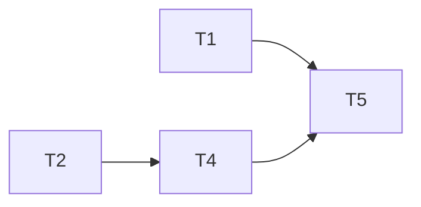

---
tasks:
  - id: T1
    title: "Done folder path and write deny"
    status: done
    capability: CAP-NEW-done-folder
    depends_on: []
    touches_core: true
    work_type: shell-scripts
    module: feature-workflow
    seam: "check-write.sh --cwd --path CLI from tests/scripts/check-write-paths.sh; WF_SPECS_DONE and wf_norm_folder spec from tests/scripts/lib-workflow-paths.sh"
    file: tasks/T01-done-folder-path-and-write-deny.md
    branch: task/007-done-folder/T01-done-folder-path-and-write-deny
    predicted_files: [.agents/skills/feature-workflow/scripts/check-write.sh]
    size: {files: 1, est_lines: 40, points: S}
    mode: afk
    parallel_with: []
    tests: [tests/scripts/check-write-paths.sh, tests/scripts/lib-workflow-paths.sh]
    pr: null
  - id: T2
    title: "Review lessons accept the Done folder"
    status: done
    capability: CAP-NEW-done-folder
    depends_on: []
    touches_core: false
    work_type: shell-scripts
    module: feature-workflow
    seam: "review-lessons.sh validate <file> CLI from tests/scripts/review-lessons.sh"
    file: tasks/T02-review-lessons-accept-done-folder.md
    branch: task/007-done-folder/T02-review-lessons-accept-done-folder
    predicted_files: [.agents/skills/feature-workflow/scripts/review-lessons.sh, .agents/skills/feature-workflow/scripts/check-pr-body.sh]
    size: {files: 2, est_lines: 20, points: S}
    mode: afk
    parallel_with: []
    tests: [tests/scripts/review-lessons.sh]
    pr: null
  - id: T3
    title: "Session start sees done-on-main in the Done folder"
    status: done
    capability: CAP-NEW-done-folder
    depends_on: []
    touches_core: false
    work_type: shell-scripts
    module: hooks
    seam: "session-start-resume.sh hook output for planned initiatives, from tests/hooks/session-start-initiatives.sh"
    file: tasks/T03-session-start-done-on-main.md
    branch: task/007-done-folder/T03-session-start-done-on-main
    predicted_files: [.agents/hooks/session-start-resume.sh]
    size: {files: 1, est_lines: 15, points: S}
    mode: afk
    parallel_with: []
    tests: [tests/hooks/session-start-initiatives.sh]
    pr: null
  - id: T4
    title: "Sign-off, discovery and large-path docs for the Done folder"
    status: in-progress
    capability: CAP-NEW-done-folder
    depends_on: [T2]
    touches_core: false
    work_type: agent-docs
    module: feature-workflow
    seam: "doc text checks in tests/lint/done-folder-docs.sh; the 5.8 publish block run by tests/scripts/sign-off-pr.sh"
    file: tasks/T04-sign-off-discovery-large-path-docs.md
    branch: task/007-done-folder/T04-sign-off-discovery-large-path-docs
    predicted_files: [.agents/skills/feature-workflow/modules/sign-off.md, .agents/skills/feature-workflow/modules/discovery.md, .agents/skills/feature-workflow/modules/large-path.md, .agents/skills/feature-workflow/SKILL.md, .agents/skills/feature-workflow/assets/pr-template.md, .agents/skills/feature-workflow/assets/review-lessons.md]
    size: {files: 6, est_lines: 120, points: M}
    mode: afk
    parallel_with: []
    tests: [tests/lint/done-folder-docs.sh, tests/scripts/sign-off-pr.sh]
    pr: null
  - id: T5
    title: "move-to-done.sh check, move and sweep"
    status: in-progress
    capability: CAP-NEW-done-folder
    depends_on: [T1, T4]
    touches_core: false
    work_type: shell-scripts
    module: feature-workflow
    seam: "move-to-done.sh --check <spec-dir> | <spec-dir> | --sweep CLI against the fixture project, from tests/scripts/move-to-done.sh"
    file: tasks/T05-move-to-done-script.md
    branch: task/007-done-folder/T05-move-to-done-script
    predicted_files: [.agents/skills/feature-workflow/scripts/move-to-done.sh, PROVENANCE.md]
    size: {files: 2, est_lines: 300, points: M}
    mode: afk
    parallel_with: []
    tests: [tests/scripts/move-to-done.sh]
    pr: null
---

# Tasks: Done folder for finished specs

Spec: [spec.md](spec.md) · Data model: [data-model.md](data-model.md) · Task files: [tasks/](tasks/)

## Waves

| Wave | Task | Title | Size | Mode | Overlaps |
| --- | --- | --- | --- | --- | --- |
| 1 | [T1](tasks/T01-done-folder-path-and-write-deny.md) | Done folder path and write deny | S (1 file, ~40 lines; plus the shared-core request) | afk | none |
| 1 | [T2](tasks/T02-review-lessons-accept-done-folder.md) | Review lessons accept the Done folder | S (2 files, ~20 lines) | afk | none |
| 1 | [T3](tasks/T03-session-start-done-on-main.md) | Session start sees done-on-main in the Done folder | S (1 file, ~15 lines) | afk | none |
| 2 | [T4](tasks/T04-sign-off-discovery-large-path-docs.md) | Sign-off, discovery and large-path docs for the Done folder | M (6 files, ~120 lines) | afk | none |
| 3 | [T5](tasks/T05-move-to-done-script.md) | move-to-done.sh check, move and sweep | M (2 files, ~300 lines) | afk | none |

## Dependency graph

