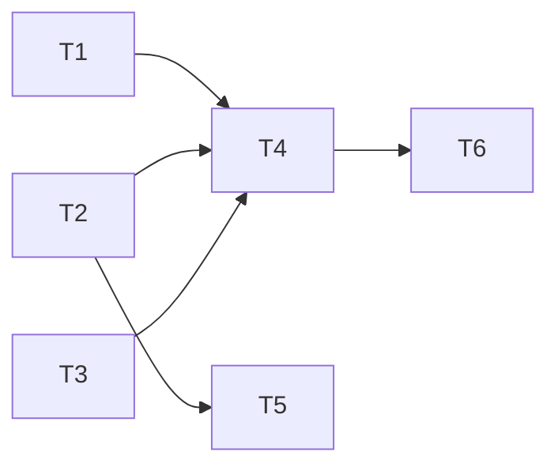

---
tasks:
  - id: T1
    title: "pr_template setting reads workflow or a host template path"
    status: done
    capability: CAP-NEW-pr-template
    depends_on: []
    touches_core: false
    work_type: shell-scripts
    module: feature-workflow
    seam: "rules-setting.sh pr_template [--cwd] [--rules] CLI, from the rules-setting block of tests/scripts/task-breakdown.sh"
    file: tasks/T01-pr-template-setting.md
    branch: task/008-pr-description-template/T01-pr-template-setting
    predicted_files: [.agents/skills/feature-workflow/scripts/rules-setting.sh]
    size: {files: 1, est_lines: 40, points: S}
    mode: afk
    parallel_with: []
    tests: [tests/scripts/task-breakdown.sh]
    pr: null
  - id: T2
    title: "PR template and its check script"
    status: done
    capability: CAP-NEW-pr-template
    depends_on: []
    touches_core: false
    work_type: shell-scripts
    module: feature-workflow
    seam: "check-pr-body.sh <file> [--project-template <file>] CLI plus the template headings, from tests/scripts/check-pr-body.sh"
    file: tasks/T02-pr-template-and-check.md
    branch: task/008-pr-description-template/T02-pr-template-and-check
    predicted_files: [.agents/skills/feature-workflow/assets/pr-template.md, .agents/skills/feature-workflow/scripts/check-pr-body.sh, PROVENANCE.md]
    size: {files: 3, est_lines: 180, points: S}
    mode: afk
    parallel_with: []
    tests: [tests/scripts/check-pr-body.sh]
    pr: null
  - id: T3
    title: "project-setup asks pr_template"
    status: done
    capability: CAP-NEW-pr-template
    depends_on: []
    touches_core: false
    work_type: agent-docs
    module: project-setup
    seam: "text checks of project-setup and its rules.md template in tests/scripts/sign-off-pr.sh (owned by T4)"
    file: tasks/T03-project-setup-asks-pr-template.md
    branch: task/008-pr-description-template/T03-project-setup-asks-pr-template
    predicted_files: [.agents/skills/project-setup/SKILL.md, .agents/skills/project-setup/modules/files.md, .agents/skills/project-setup/assets/docs/rules.md]
    size: {files: 3, est_lines: 30, points: S}
    mode: afk
    parallel_with: []
    pr: null
  - id: T4
    title: "Sign-off fills, approves and publishes the PR body"
    status: done
    capability: CAP-NEW-pr-template
    depends_on: [T1, T2, T3]
    touches_core: false
    work_type: agent-docs
    module: feature-workflow
    seam: "the 5.8 publish block run against stand-in gh/glab plus sign-off, SKILL.md and project-setup text checks, in tests/scripts/sign-off-pr.sh"
    file: tasks/T04-sign-off-publishes-body.md
    branch: task/008-pr-description-template/T04-sign-off-publishes-body
    predicted_files: [.agents/skills/feature-workflow/modules/sign-off.md, .agents/skills/feature-workflow/SKILL.md, .agents/skills/feature-workflow/assets/design-log.md]
    size: {files: 3, est_lines: 90, points: S}
    mode: afk
    parallel_with: []
    tests: [tests/scripts/sign-off-pr.sh]
    pr: null
  - id: T5
    title: "Project mode reads every heading level"
    status: done
    capability: CAP-NEW-pr-template
    depends_on: [T2]
    touches_core: false
    work_type: shell-scripts
    module: feature-workflow
    seam: "check-pr-body.sh <file> --project-template <file> CLI, from the JRN-003 cases of tests/scripts/check-pr-body.sh"
    file: tasks/T05-project-mode-every-heading-level.md
    branch: task/008-pr-description-template/T05-project-mode-every-heading-level
    predicted_files: [.agents/skills/feature-workflow/scripts/check-pr-body.sh, .agents/skills/feature-workflow/assets/pr-template.md]
    size: {files: 2, est_lines: 60, points: S}
    mode: afk
    parallel_with: []
    tests: [tests/scripts/check-pr-body.sh]
    pr: null
  - id: T6
    title: "Sign-off routes an unusable host template and points at one path list"
    status: done
    capability: CAP-NEW-pr-template
    depends_on: [T4]
    touches_core: false
    work_type: agent-docs
    module: feature-workflow
    seam: "sign-off and project-setup text checks, JRN-006 cases of tests/scripts/sign-off-pr.sh"
    file: tasks/T06-sign-off-host-template-route.md
    branch: task/008-pr-description-template/T06-sign-off-host-template-route
    predicted_files: [.agents/skills/feature-workflow/modules/sign-off.md]
    size: {files: 1, est_lines: 15, points: S}
    mode: afk
    parallel_with: []
    tests: [tests/scripts/sign-off-pr.sh]
    pr: null
---

# Tasks: PR template for the Sign-off PR

Spec: [spec.md](spec.md) · Data model: [data-model.md](data-model.md) · Task files: [tasks/](tasks/)

## Waves

| Wave | Task | Title | Size | Mode | Overlaps |
| --- | --- | --- | --- | --- | --- |
| 1 | [T1](tasks/T01-pr-template-setting.md) | `pr_template` setting reads `workflow` or a host template path | S (1 file, ~40 lines) | afk | none |
| 1 | [T2](tasks/T02-pr-template-and-check.md) | PR template and its check script | S (3 files, ~180 lines) | afk | none |
| 1 | [T3](tasks/T03-project-setup-asks-pr-template.md) | project-setup asks `pr_template` | S (3 files, ~30 lines) | afk | none |
| 2 | [T4](tasks/T04-sign-off-publishes-body.md) | Sign-off fills, approves and publishes the PR body | S (3 files, ~90 lines) | afk | none |
| 2 | [T5](tasks/T05-project-mode-every-heading-level.md) | Project mode reads every heading level | S (2 files, ~60 lines) | afk | T2: `scripts/check-pr-body.sh`, edge T2 → T5 (T2 done) |
| 3 | [T6](tasks/T06-sign-off-host-template-route.md) | Sign-off routes an unusable host template and points at one path list | S (1 file, ~15 lines) | afk | T4: `modules/sign-off.md`, edge T4 → T6 (T4 done) |

## Dependency graph

