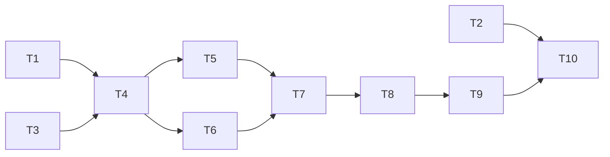

---
tasks:
  - id: T1
    title: "Term-list script"
    status: done
    capability: CAP-NEW-lean-workflow-load
    depends_on: []
    touches_core: false
    work_type: shell-scripts
    module: "domain-modeling"
    seam: "term-list.sh [--define <term>] command line, driven by tests/scripts/term-list.sh"
    file: tasks/T01-term-list-script.md
    branch: task/009-slim-workflow-context/T01-term-list-script
    predicted_files: [".agents/skills/domain-modeling/scripts/term-list.sh", "PROVENANCE.md"]
    size: {files: 2, est_lines: 120, points: S}
    mode: afk
    parallel_with: [T3]
    tests: ["tests/scripts/term-list.sh"]
    pr: null
  - id: T2
    title: "Output style reads the term list"
    status: done
    capability: CAP-NEW-lean-workflow-load
    depends_on: []
    touches_core: false
    work_type: agent-docs
    module: "output-styles"
    seam: "the inline term-list command in concise-technical.md, run on this repo's glossary"
    file: tasks/T02-output-style-term-list.md
    branch: task/009-slim-workflow-context/T02-output-style-term-list
    predicted_files: [".agents/output-styles/concise-technical.md"]
    size: {files: 1, est_lines: 5, points: S}
    mode: afk
    parallel_with: []
    pr: null
  - id: T3
    title: "Workflow conventions file"
    status: done
    capability: CAP-NEW-lean-workflow-load
    depends_on: []
    touches_core: false
    work_type: agent-docs
    module: "feature-workflow"
    seam: "references/conventions.md as loaded text, checked by lint/shared-rule-homes and lint/md-links"
    file: tasks/T03-workflow-conventions.md
    branch: task/009-slim-workflow-context/T03-workflow-conventions
    predicted_files: [".agents/skills/feature-workflow/SKILL.md", ".agents/skills/feature-workflow/references/conventions.md", ".agents/skills/feature-workflow/modules/large-path.md", ".agents/skills/feature-workflow/modules/questioning-loop.md", ".agents/skills/feature-workflow/modules/discovery.md", ".agents/skills/feature-workflow/modules/review-triage.md", ".agents/skills/feature-workflow/modules/discovered-work.md", "PROVENANCE.md", "tests/lint/done-folder-docs.sh", "tests/lint/review-escalation-docs.sh"]
    size: {files: 10, est_lines: 350, points: M}
    mode: afk
    parallel_with: [T1]
    pr: null
  - id: T4
    title: "Launching reference"
    status: done
    capability: CAP-NEW-lean-workflow-load
    depends_on: [T1, T3]
    touches_core: false
    work_type: agent-docs
    module: "feature-workflow"
    seam: "references/launching.md as loaded text, checked by lint/shared-rule-homes and lint/md-links"
    file: tasks/T04-launching-reference.md
    branch: task/009-slim-workflow-context/T04-launching-reference
    predicted_files: [".agents/skills/feature-workflow/SKILL.md", ".agents/skills/feature-workflow/references/launching.md", ".agents/skills/feature-workflow/modules/discovery.md", ".agents/skills/feature-workflow/modules/questioning-loop.md", ".agents/skills/feature-workflow/modules/review-triage.md", ".agents/skills/feature-workflow/modules/implementation-orchestrator.md", ".agents/skills/feature-workflow/modules/verification-setup.md", ".agents/skills/feature-workflow/modules/large-path.md", ".agents/skills/feature-workflow/modules/sign-off.md", ".agents/skills/feature-workflow/modules/deferred-handoff.md", "PROVENANCE.md", "tests/lint/small-path-docs.sh"]
    size: {files: 12, est_lines: 300, points: M}
    mode: afk
    parallel_with: []
    pr: null
  - id: T5
    title: "Discovery split and the 0.2.1 read"
    status: done
    capability: CAP-NEW-lean-workflow-load
    depends_on: [T4]
    touches_core: false
    work_type: agent-docs
    module: "feature-workflow"
    seam: "the 0.2.1 fenced command in discovery.md, run by tests/lint/affected-area.sh; Route table draft rows"
    file: tasks/T05-discovery-split.md
    branch: task/009-slim-workflow-context/T05-discovery-split
    predicted_files: [".agents/skills/feature-workflow/modules/discovery.md", ".agents/skills/feature-workflow/modules/discovery-impact.md", ".agents/skills/feature-workflow/modules/questioning-loop.md", ".agents/skills/feature-workflow/SKILL.md", ".agents/skills/feature-workflow/assets/codebase-map.md", ".agents/skills/feature-workflow/assets/design-log.md", ".agents/skills/feature-workflow/assets/data-model.md", ".agents/skills/feature-workflow/assets/verification-plan.md", "PROVENANCE.md", "upstream-lineage.json"]
    size: {files: 10, est_lines: 300, points: M}
    mode: afk
    parallel_with: [T6]
    tests: ["tests/lint/affected-area.sh"]
    pr: null
  - id: T6
    title: "Shared-core and per-task gates step files"
    status: done
    capability: CAP-NEW-lean-workflow-load
    depends_on: [T4]
    touches_core: false
    work_type: agent-docs
    module: "feature-workflow"
    seam: "implementation-shared-core.md and implementation-gates.md as loaded text: lint/md-links and the re-pointed orchestrator pins"
    file: tasks/T06-shared-core-and-gates.md
    branch: task/009-slim-workflow-context/T06-shared-core-and-gates
    predicted_files: [".agents/skills/feature-workflow/modules/implementation-orchestrator.md", ".agents/skills/feature-workflow/modules/implementation-shared-core.md", ".agents/skills/feature-workflow/modules/implementation-gates.md", "PROVENANCE.md", "upstream-lineage.json", "tests/lint/agent-worktree-docs.sh", "tests/lint/review-escalation-docs.sh", "tests/scripts/run-toolchain.sh"]
    size: {files: 8, est_lines: 250, points: M}
    mode: afk
    parallel_with: [T5]
    pr: null
  - id: T7
    title: "Fold the small path into its step files"
    status: done
    capability: CAP-NEW-lean-workflow-load
    depends_on: [T5, T6]
    touches_core: false
    work_type: agent-docs
    module: "feature-workflow"
    seam: "tests/lint/small-path-docs.sh and tests/lint/shared-rule-homes.sh"
    file: tasks/T07-fold-small-path.md
    branch: task/009-slim-workflow-context/T07-fold-small-path
    predicted_files: [".agents/skills/feature-workflow/modules/small-path.md", ".agents/skills/feature-workflow/modules/discovery.md", ".agents/skills/feature-workflow/modules/discovery-impact.md", ".agents/skills/feature-workflow/modules/questioning-loop.md", ".agents/skills/feature-workflow/modules/sign-off.md", ".agents/skills/feature-workflow/SKILL.md", ".agents/skills/feature-workflow/assets/report.md", "PROVENANCE.md"]
    size: {files: 8, est_lines: 200, points: M}
    mode: afk
    parallel_with: []
    tests: ["tests/lint/small-path-docs.sh", "tests/lint/shared-rule-homes.sh"]
    pr: null
  - id: T8
    title: "Setup, waves and finish step files; orchestrator removed"
    status: pending
    capability: CAP-NEW-lean-workflow-load
    depends_on: [T7]
    touches_core: false
    work_type: agent-docs
    module: "feature-workflow"
    seam: "tests/lint/step-routing.sh, lint/md-links and the re-pointed orchestrator pins"
    file: tasks/T08-implementation-step-files.md
    branch: task/009-slim-workflow-context/T08-implementation-step-files
    predicted_files: [".agents/skills/feature-workflow/modules/implementation-orchestrator.md", ".agents/skills/feature-workflow/modules/implementation-setup.md", ".agents/skills/feature-workflow/modules/implementation-waves.md", ".agents/skills/feature-workflow/modules/implementation-finish.md", ".agents/skills/feature-workflow/modules/implementation-shared-core.md", ".agents/skills/feature-workflow/modules/implementation-gates.md", ".agents/skills/feature-workflow/SKILL.md", ".agents/skills/feature-workflow/modules/review-triage.md", ".agents/skills/feature-workflow/modules/task-breakdown.md", ".agents/skills/feature-workflow/modules/discovery-impact.md", ".agents/skills/feature-workflow/modules/verification-setup.md", ".agents/skills/feature-workflow/modules/large-path.md", "PROVENANCE.md", "upstream-lineage.json", "tests/hooks/worktree-guard.sh", "tests/lint/agent-worktree-docs.sh"]
    size: {files: 16, est_lines: 500, points: L}
    mode: afk
    parallel_with: []
    tests: ["tests/lint/step-routing.sh"]
    pr: null
  - id: T9
    title: "Script and asset headers re-pointed"
    status: pending
    capability: CAP-NEW-lean-workflow-load
    depends_on: [T8]
    touches_core: false
    work_type: shell-scripts
    module: "feature-workflow"
    seam: "grep for the removed file names under .agents prints nothing; existing suites pass"
    file: tasks/T09-header-repoints.md
    branch: task/009-slim-workflow-context/T09-header-repoints
    predicted_files: [".agents/skills/feature-workflow/scripts/budget-check.sh", ".agents/skills/feature-workflow/scripts/check-merge-artifacts.sh", ".agents/skills/feature-workflow/scripts/check-task-result.sh", ".agents/skills/feature-workflow/scripts/commit-workflow-data.sh", ".agents/skills/feature-workflow/scripts/open-task-pr.sh", ".agents/skills/feature-workflow/scripts/rules-setting.sh", ".agents/skills/feature-workflow/scripts/status-transition.sh", ".agents/skills/feature-workflow/scripts/task-waves.sh", ".agents/skills/feature-workflow/scripts/spec-worktree.sh", ".agents/skills/feature-workflow/assets/task.md", ".agents/skills/feature-workflow/assets/tasks.md"]
    size: {files: 11, est_lines: 25, points: M}
    mode: afk
    parallel_with: []
    pr: null
  - id: T10
    title: "Hit the load targets"
    status: pending
    capability: CAP-NEW-lean-workflow-load
    depends_on: [T2, T9]
    touches_core: false
    work_type: agent-docs
    module: "feature-workflow"
    seam: "tests/lint/workflow-load-size.sh"
    file: tasks/T10-load-targets.md
    branch: task/009-slim-workflow-context/T10-load-targets
    predicted_files: [".agents/skills/feature-workflow/SKILL.md", ".agents/skills/feature-workflow/references/conventions.md", ".agents/skills/feature-workflow/modules/discovery.md", ".agents/skills/feature-workflow/modules/implementation-waves.md", ".agents/skills/feature-workflow/references/launching.md"]
    size: {files: 5, est_lines: 150, points: M}
    mode: afk
    parallel_with: []
    tests: ["tests/lint/workflow-load-size.sh"]
    pr: null
---

# Tasks: Slim the workflow context

Spec: [spec.md](spec.md) · Data model: [data-model.md](data-model.md) · Task files: [tasks/](tasks/)

## Waves

Derived from `depends_on` by `task-waves.sh` (no implied edges). Every other predicted-file overlap is already ordered by an edge.

| Wave | Task | Title | Size | Mode | Overlaps |
| --- | --- | --- | --- | --- | --- |
| 1 | [T1](tasks/T01-term-list-script.md) | Term-list script | S (2 files, ~120 lines) | afk | T3: `PROVENANCE.md`, approved `parallel_with` (merged in id order) |
| 1 | [T2](tasks/T02-output-style-term-list.md) | Output style reads the term list | S (1 file, ~5 lines) | afk | none |
| 1 | [T3](tasks/T03-workflow-conventions.md) | Workflow conventions file | M (10 files, ~350 lines) | afk | T1: `PROVENANCE.md`, approved `parallel_with` (merged in id order) |
| 2 | [T4](tasks/T04-launching-reference.md) | Launching reference | M (12 files, ~300 lines) | afk | T1, T3: edges |
| 3 | [T5](tasks/T05-discovery-split.md) | Discovery split and the 0.2.1 read | M (10 files, ~300 lines) | afk | T6: `PROVENANCE.md`, `upstream-lineage.json`, approved `parallel_with` (merged in id order) |
| 3 | [T6](tasks/T06-shared-core-and-gates.md) | Shared-core and per-task gates step files | M (8 files, ~250 lines) | afk | T5: `PROVENANCE.md`, `upstream-lineage.json`, approved `parallel_with` (merged in id order) |
| 4 | [T7](tasks/T07-fold-small-path.md) | Fold the small path into its step files | M (8 files, ~200 lines) | afk | T5, T6: edges |
| 5 | [T8](tasks/T08-implementation-step-files.md) | Setup, waves and finish step files; orchestrator removed | L (16 files, ~500 lines), kept by the stakeholder | afk | T7: edge |
| 6 | [T9](tasks/T09-header-repoints.md) | Script and asset headers re-pointed | M (11 files, ~25 lines) | afk | none |
| 7 | [T10](tasks/T10-load-targets.md) | Hit the load targets | M (5 files, ~150 lines) | afk | T9: edge (shared files ordered through T8) |

## Dependency graph

